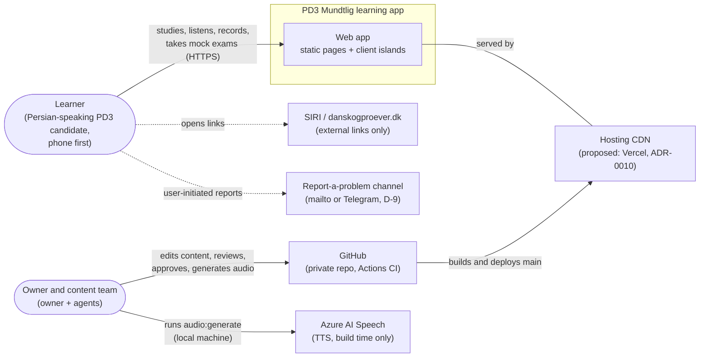
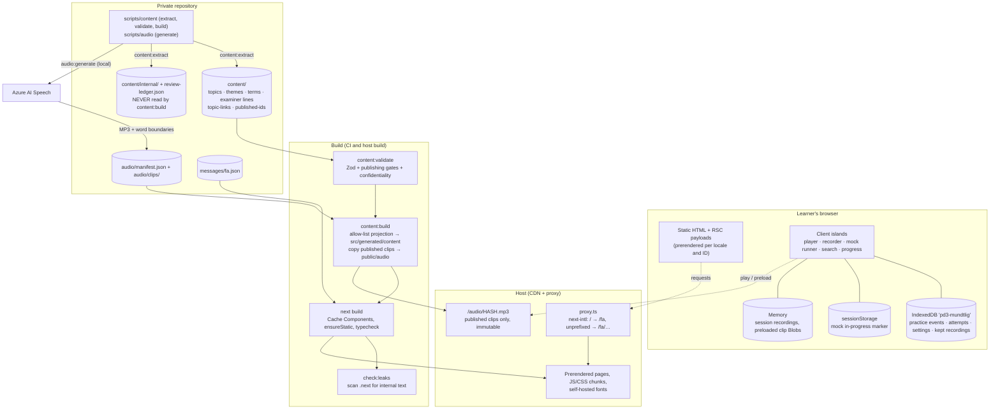
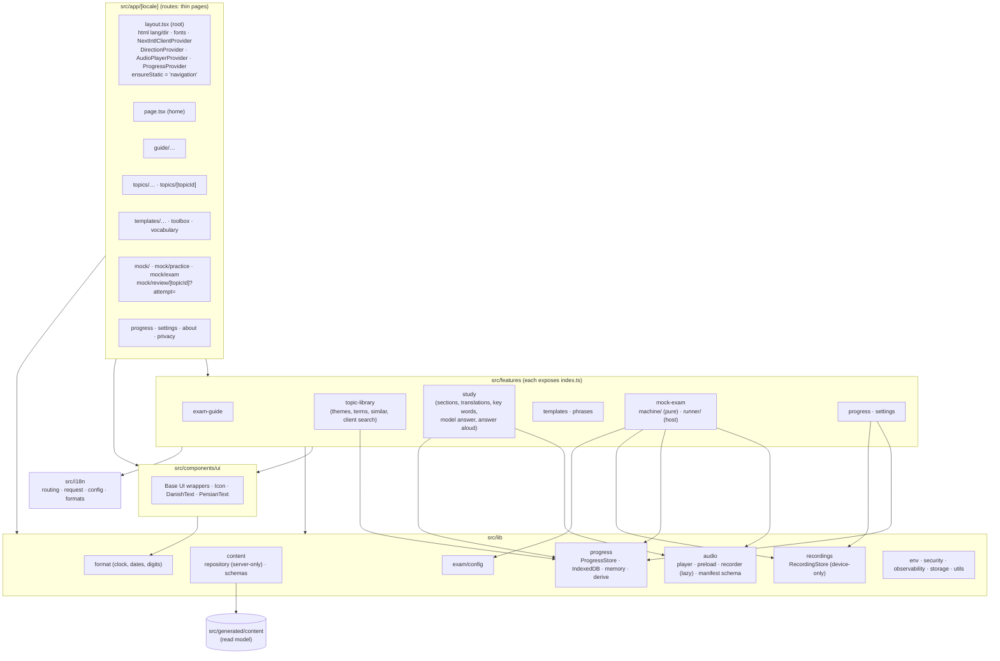
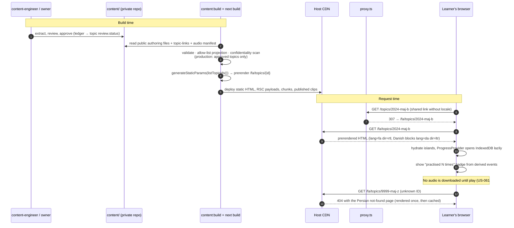
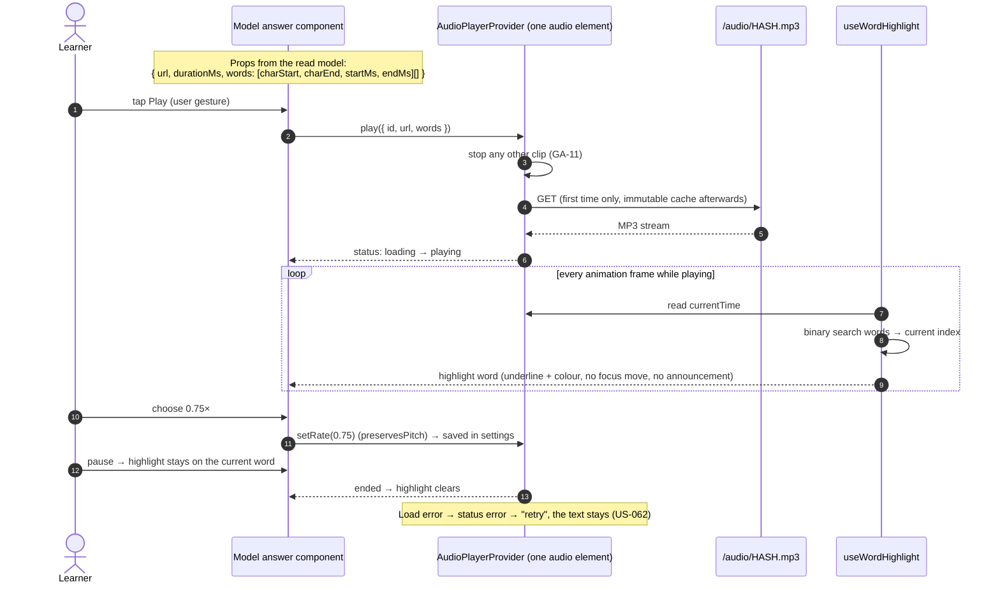
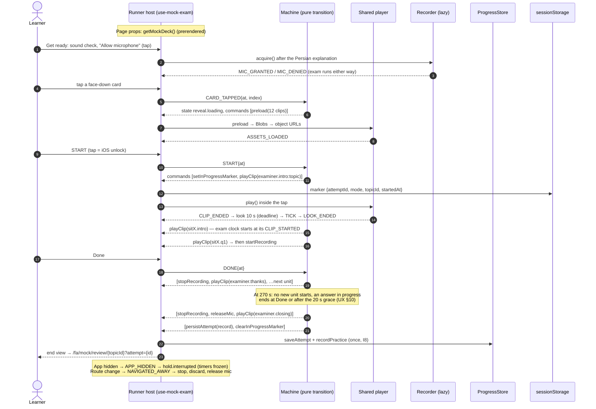
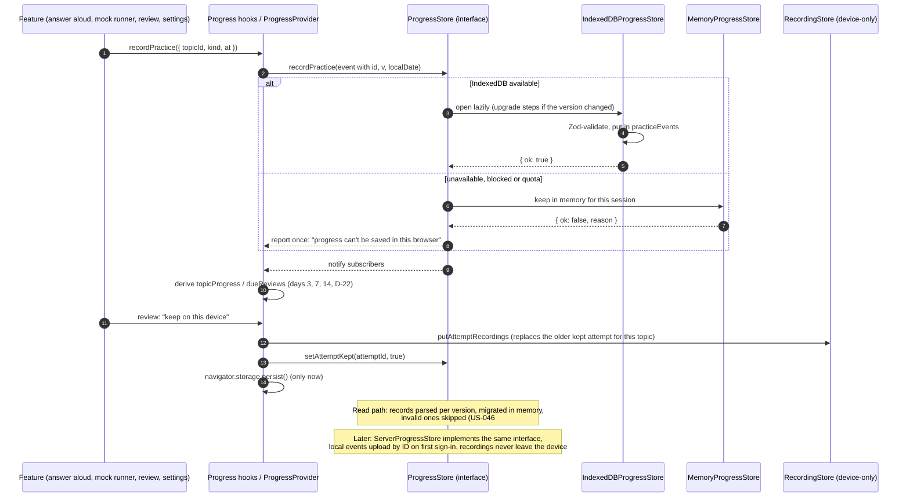

# Architecture overview (v1)

| | |
|---|---|
| **Status** | v1 architecture, 2026-11-19. Decisions are in [docs/adr/](adr/README.md); this page shows how they fit together. |
| **Author** | `software-architect` |
| **Inputs** | [CLAUDE.md](../CLAUDE.md), [PRD rev. 3.1](product/prd.md), [user stories](product/user-stories.md), [decision log](product/decision-log.md), [schema proposal](content/schema-proposal.md), [pipeline](content/pipeline.md), [pilot report](content/pilot-report.md), [information architecture](ux/information-architecture.md), [mock exam state machine](ux/flows/mock-exam-state-machine.md) |
| **Scaffolding** | [scaffold-plan.md](scaffold-plan.md) |

## 1. In one paragraph

A **statically generated Next.js 16 app** (Cache Components, every route prerendered and enforced with `ensureStatic`) served from a CDN. Content is authored as versioned JSON in a private repository, validated, and **projected at build time into a published read model** that contains only approved, public fields; the app reads it through an async repository. Danish audio is **pre-generated** with Azure AI Speech on a developer machine, stored with content-hashed names, and served from the same origin. Everything personal (progress, settings, kept recordings) stays **on the device** in IndexedDB behind async interfaces. Interactive parts (the audio player, recorder, mock exam runner, search, progress views) are small client islands. There is no server-side state, no account, no analytics and no secret in any deployment.

## 2. Context (C4 level 1)

**Nothing flows from the app to Azure, GitHub or any third party at runtime.** The learner's browser talks only to the host.

## 3. Containers (C4 level 2)

## 4. Components inside the app (C4 level 3)

## 5. Module map

| Module | Responsibility | Depends on | Must not | Owner | ADR |
|---|---|---|---|---|---|
| `src/app/[locale]/**` | Routes, `generateStaticParams`, metadata, error and not-found pages; compose features | features (via `index.ts`), ui, lib, i18n | contain business logic; read cookies, headers or server `searchParams` | frontend-developer | 0001, 0005 |
| `src/proxy.ts` | Locale redirects (next-intl) | i18n/routing | do anything else | frontend-developer | 0004 |
| `src/features/exam-guide` | Guide pages, examiner phrases, study method | content repo, audio player, ui | – | frontend-developer | – |
| `src/features/topic-library` | Themes, terms, similar questions, client-side search, practice badges | content repo, progress hooks | fetch content on the client | frontend-developer | 0005 |
| `src/features/study` | Topic study page sections, translations on request, key words, model answer with highlighting, answer aloud | content repo, audio, progress, recorder (lazy) | store recordings beyond the page (D-6) | frontend-developer | 0007 |
| `src/features/templates`, `phrases` | Templates, toolbox, vocabulary; "test myself" | content repo, audio | – | frontend-developer | – |
| `src/features/mock-exam/machine` | Pure reducer, script builder, deadlines, seeded draw | exam config, content types | touch DOM, media, storage or real time | frontend-developer | 0007 |
| `src/features/mock-exam/runner` | Executes commands through ports; platform signals → events | machine, audio, recorder, progress, recordings, storage | contain exam rules | frontend-developer, speech-engineer | 0007 |
| `src/features/progress`, `settings` | History, ready-to-review list, settings, delete everything | progress, recordings | know about IndexedDB | frontend-developer | 0008 |
| `src/components/ui` | Accessible, RTL-aware primitives; only importer of Base UI and lucide | Base UI, lucide, format, utils | contain business logic or hard-coded strings | frontend-developer, ui-designer | 0009 |
| `src/lib/content` | Read-model schemas; async repository; file source (server-only) | `src/generated/content` | be imported by client components (except types) | content-engineer (schema), frontend-developer (repository) | 0002 |
| `src/lib/audio` | Shared player, word highlighting, mock preload, recorder adapter, manifest schema | – | upload anything | speech-engineer | 0006, 0007 |
| `src/lib/progress` | `ProgressStore` interface, IndexedDB and memory implementations, migrations, derivations, review schedule | idb (browser folder only) | store recordings or personal data | frontend-developer | 0008 |
| `src/lib/recordings` | Device-only `RecordingStore` | idb | sync to any server | frontend-developer | 0008 |
| `src/lib/exam` | Exam config (C1–C16), examiner line IDs | – | hold Danish text (lines live in content) | frontend-developer, pd3-exam-expert reviews | 0007 |
| `src/lib/format` | Clock, durations, dates with the digit and calendar config | i18n/config | format by hand outside this module | frontend-developer | 0004 |
| `src/lib/env`, `security`, `observability`, `storage`, `utils` | Env schemas, header builder, `reportError`, guarded sessionStorage, `cn()` | zod | read secrets in client code | software-architect | 0010, 0011, 0013 |
| `src/i18n` | Locale list, request config, direction, formats | next-intl | hard-code `rtl` anywhere else | frontend-developer | 0004 |
| `messages/` | Interface strings (`fa.json` reference) | – | contain content translations | persian-localization-reviewer | 0004 |
| `content/` | Authoring data; `internal/` and the ledger are internal | – | be imported by `src/` | content-engineer | 0002, 0003 |
| `audio/` | Manifest + clips (committed) | – | be imported by `src/`; be copied wholesale to `public/` | speech-engineer | 0006 |
| `scripts/content` | Extract, validate, build read model, fidelity checks | `src/lib` pure modules | be imported by `src/` | content-engineer | 0003 |
| `scripts/audio` | TTS generation, dry run, prune | Azure Speech SDK | run in CI | speech-engineer | 0006 |
| `scripts/ci` | Leak scan, budget checks | – | – | software-architect, qa-engineer | 0002, 0014 |

## 6. Data flows

### 6.1 Browsing a topic

### 6.2 Playing audio with word highlighting

### 6.3 Running a mock exam (exam conditions)

### 6.4 Saving progress

## 7. Cross-cutting rules (where they're enforced)

| Rule | Enforced by |
|---|---|
| Content only through `src/lib/content` | lint (`no-restricted-imports`), ADR-0001/0002 |
| Internal content never in a build | `content:build` reads no internal files; allow-list projection; confidentiality scan; `check:leaks` in CI |
| Only approved content in production | `CONTENT_RELEASE=production` gates in `content:build`; build guard on `VERCEL_ENV` |
| Every page static | `ensureStatic = "navigation"` (build fails otherwise) |
| No hard-coded strings; Danish isolated | `react/jsx-no-literals`, attribute rule, messages tests, E2E Latin-name check |
| Logical CSS only, tokens only | `better-tailwindcss` rules |
| One clip at a time; no autoplay | single shared `<audio>`; E2E |
| Recordings never uploaded | no upload code path; E2E network assertion |
| Secrets never in the browser | no secrets deployed at all; env schemas; lint ban on the Speech SDK in `src/` |

## 8. Readiness for tomorrow

| Future change | Where it lands | Cost |
|---|---|---|
| **Database for content** | `db-source.ts` behind the same repository + `content:publish` + `"use cache"`/`cacheTag` | adapter + script; pages unchanged (ADR-0002 §6) |
| **Accounts** | `ServerProgressStore` + auth route handlers; local events upload by ID | new store; features unchanged (ADR-0008 §6) |
| **More interface languages** | `routing.locales` + `messages/en.json` | data only; direction, digits and routes follow (ADR-0004) |
| **Delprøve 1** | `buildDelproeve1Script` + mode policy; `/fa/guide/delproeve-1`, `/fa/delproeve-1/…`; attempts already carry `part` | new script and pages; reuses timer, recorder, review (ADR-0007, IA §8) |
| **Speech-to-text** | `/api/speech/token` route handler issuing short-lived tokens; client SDK in a lazy island | first dynamic route; keys server-only (ADR-0010) |
| **Moving hosts** | static output + same-origin audio; headers in one module | deployment change (ADR-0010) |
