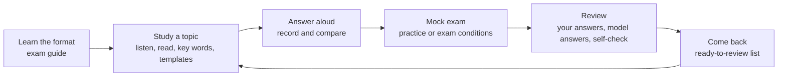

# PRD: PD3 Mundtlig learning app, v1

| | |
|---|---|
| **Status** | Draft, revision 3.3. All decisions D-1 to D-28 are made: D-1 to D-17 by the owner, and the rest confirmed by owner delegation. No decisions are open. |
| **Date** | 2026-11-18 (revisions 3 to 3.3: 2026-11-19 and 2026-11-20) |
| **Author** | `product-manager` agent |
| **Decision owner** | Project owner |
| **Inputs** | [concept.md](concept.md), [ABOUT_PD3_MUNDTLIG.md](../resources/ABOUT_PD3_MUNDTLIG.md) (checked 17 Nov 2026), [PD3_Mundtlig_Delproeve2.md](../resources/PD3_Mundtlig_Delproeve2.md) (the content source), [exam-accuracy review of revision 2](../reviews/2026-11-18-pd3-exam-review-prd.md), [CLAUDE.md](../../CLAUDE.md) |
| **Companion docs** | [user-stories.md](user-stories.md), [personas.md](personas.md), [decision-log.md](decision-log.md) |

**Revision 3.4 (2026-11-20):** applies [the mock-rules exam review](../reviews/2026-11-20-exam-review-mock-rules.md). By delegation, 2026-11-20:
- **Timing:** C17 = 150 s; a new C21 handover at 200 s; a 330 s grace ceiling.
- **Validated:** DL-049 (270 s + 20 s grace) and DL-050 (the transition line).
- **§6.5:** three new rows: SIRI's *suggested* wording, the visible clock and one-minute announcement, and the spoken *"Hvorfor eller hvorfor ikke?"*.
- **Stories changed:** US-034 and US-035, plus the config table.

**Revision 3.3 (2026-11-19/20):** the owner delegated confirmation ("I want you to confirm on behalf of me", 2026-11-19).
- **Confirmed by owner delegation:** D-18 to D-25.
- **Confirmed as recommended:** D-5 and D-9 to D-14.
- **New, confirmed:**
  - D-26: hosting on Vercel Hobby, with deployment protection
  - D-27: a custom domain
  - D-28: the owner's UX questions
- **Closed:** OQ-14, OQ-17 and UX-OQ-13, 19, 20, 21, 25 and 31.
- **§11.2** is now empty, and **§11.3** lists only owner actions. The Azure resource exists; its key still needs to move to `.env.local`.
- **Stories changed:** US-015, US-018, US-022, US-038, US-065 and US-068.

**Revision 3.2 (2026-11-19):** applies the UX architecture's story updates and its decisions RD-1 to RD-12 ([docs/ux/README.md](../ux/README.md)), plus the ADR decisions in `docs/adr/`.
- **New decisions, by delegation, owner to confirm:**
  - D-24: the UX decisions, including the wake lock, the back guard, a microphone mute counting as an interruption, the part-1 cut-off at about 2:45, "End and see my answers", history without ticks, and the calendar
  - D-25: PM answers to UX-OQ-17, 18, 24 and 26, and to R-38
- **Recorded per ADR:**
  - the review route
  - the message-parity test (US-056 #2)
  - the browser floor: iOS 16.4+, Chrome/Edge/Firefox 111+ (OQ-10 closed)
  - no analytics or third-party error reporting in v1 (D-5 stays open)
- **Stories:** new US-071 (Could); 27 changed.
- **Sections changed:** §4.4, §6.1, §6.3, §6.4, §10, §11 and §12.2.

**Revision 3.1 (2026-11-19):** adds the content decisions that followed the M0 content pilot ([pilot report](../content/pilot-report.md) §6). The owner asked us to go ahead with our recommendations while away, so these are **decided by delegation, owner to confirm**.
- **D-18:** situation cards show the booklet's own situation title.
- **D-19:** no Persian translation of model answers or follow-up answers in v1. The booklet has none.
- **D-20:** the 7 nurse-specific personal examples are shown to everyone, labelled.
- **D-21:** no margin note is shown publicly in v1. 🔁 and 🔗 notes become structured topic links, in our own wording.
- **D-22:** spaced review runs per topic, and day 1 is the first study day. OQ-2 is closed.
- **D-23:** the repository stays private.

The pilot's findings also update the facts:
- all 18 May–June 2024 questions and follow-ups match SIRI
- there are 45 margin notes
- 1,501 Danish strings are checked
- the Nov–Dec 2019 SIRI booklet is a third-party copy whose authenticity needs confirming (OQ-22, R18)

Changes are in §2.3, §4.1, §4.4, §5.2, §6.6, §10, §11.1, §11.3 and §12, and in US-007, US-011, US-017, US-018, US-029, US-047, US-064 and US-068.

**Revision 3 (2026-11-19):** applies the `pd3-exam-expert` review of revision 2 and three owner decisions from 2026-11-18.
- **Owner decisions recorded (§11.1):**
  - D-15: leave out the booklet's prediction sentence and its "memorise one answer" note.
  - D-16 (new): an examiner intro for every situation.
  - D-17 (new): verify older terms against SIRI, with per-question provenance.
- **Blockers fixed:**
  - B1: booklet margin notes are excluded unless reviewed, and any reference to a later exam is flagged (§6.6).
  - B2: the mock exam now includes the examiner's situation intro (§6.3).
- **Should-fix findings applied (S1–S6):**
  - "official" is claimed only where wording is verified
  - follow-ups are now "suggested follow-ups"
  - SIRI's scripted lines are classified separately from our own
  - honest wording about similar questions
  - the full assessment criteria
  - the appendix is correctly labelled as 2013–2015
- **Review suggestions adopted:**
  - unmarked draw cards
  - a grace period at the time limit
  - guide additions
  - the about-page statement
  - the pre-2023 label explanation
  - two optional Could stories
- **Open questions:** OQ-3, OQ-4, OQ-5, OQ-6 and OQ-20 are closed. OQ-21 and OQ-22 are new.
- **Earlier revisions:**
  - Revision 2 recorded D-1 to D-4 and D-6 to D-8, and switched to the Markdown content source.
  - Revision 1 was the first draft.

**How to review this document (about 15 minutes)**
1. Read [§1 Why learners will care](#1-why-learners-will-care) and [§6.1 v1 at a glance](#61-v1-at-a-glance).
2. Scan [§5 Not now](#5-non-goals-and-not-now). Is there anything you want back in?
3. Check the decisions in [§11.1](#111-decisions-made); none are open in [§11.2](#112-decisions-still-needed). Then see your actions in [§11.3](#113-owner-actions).

The rest is detail for the UX architect, UI designer and software architect.

**References.**
- `§3.4` means a section of [ABOUT_PD3_MUNDTLIG.md](../resources/ABOUT_PD3_MUNDTLIG.md).
- "Review Q1" or "review B1" means an item in the [exam-accuracy review](../reviews/2026-11-18-pd3-exam-review-prd.md).
- "booklet:N" means line N of the content source.
- `US-0xx` is a story in [user-stories.md](user-stories.md).
- `D-x` is a decision in §11.
- `OQ-x` is an open question in §10.
- `DL-0xx` is an entry in [decision-log.md](decision-log.md).

---

## 1. Why learners will care

You can't script delprøve 2. You draw one of three topics and get about ten seconds to look at it. Then you answer an examiner's questions in Danish for about four and a half minutes, and your listening is judged along with your speaking (§1, §3.4, §4.1). The oral grade counts double towards passing PD3 (§4.3). Some learners need more than a pass: nurses educated outside the EU/EEA need at least 10 in the oral for Danish authorisation ([personas.md](personas.md)).

Persian-speaking learners already have a strong booklet of past topics, with translations, key words and simple model answers. But a booklet is silent. It can't:
- ask you the question in an examiner's voice
- make you answer before the time runs out
- let you hear yourself next to a good answer

This app turns that booklet into spoken practice that follows the real exam step by step. It explains everything in Persian, runs on the phone you already study on, and keeps sessions short enough for a break at work. **The aim is that nothing about delprøve 2 is new on exam day.**

---

## 2. Problem

### 2.1 The learner's problem

In delprøve 2, Persian-speaking adults at about B1+ to B2 have to show that they can:
- **understand** an unseen spoken question straight away. Listening is part of the oral grade (§1, §4.1).
- **answer with substance:** explain, give reasons and examples, take a position, and weigh advantages against disadvantages (§3.4, §4.1).
- **speak coherently,** in fairly nuanced language that fits the situation, with fairly high complexity and correctness (§4.1; BEK bilag 1, pkt. 3.40).
- **keep going** when the examiner asks harder follow-ups. The examiner does this on purpose to place you on the scale (§3.4).
- **do it in about 4½ minutes,** with only about 10 seconds to look at the topic first (§1, §3.4).

Most of them study in short sessions on a phone, around work, and are anxious about speaking under time pressure. *(Owner insight from the brainstorm; still to be validated. See [personas.md](personas.md).)*

### 2.2 What learners use today, and where it falls short

| Resource | Strength | Gap |
|---|---|---|
| **The booklet** by Shery Rahimi (116 pages: 51 topics from 2016–2024 in 10 themes, plus an appendix of 18 topics from 2013–2015 and a title-only list for 2004–2012) | Danish questions taken from SIRI's examiner booklets. The booklet says it checked May–June 2024 word for word; older terms differ slightly in places (review Q4). Also Persian translations, 3 key words per question, simple model answers, three answer templates and a study method. | Silent and static: no audio, no timing, no way to record yourself, no tracking. Learners only have it as a PDF. |
| **SIRI's public material** (May–June 2024 examiner booklet, pictures, video of a passed exam; §3.4, §9) | Authoritative | One exam term only, all in Danish, not interactive |
| **Teachers and classes** | Real feedback | Limited speaking time per learner *(assumption)* |

**No new public material is coming.** Since the winter 2024 term, exam tasks have been confidential and reused from a closed task bank (§5, §6). The published sets up to May–June 2024 are what learners will have from now on. SIRI says material from summer 2024 and earlier "may still be used in teaching, as it is not confidential" (SIRI practical guide, October 2026, §2.7, as cited in review Q7).

**The gap:** nothing lets a learner rehearse the real delprøve 2 sequence out loud, alone, on a phone, with explanations in Persian.

### 2.3 What we know and what we assume

| Statement | Basis |
|---|---|
| Delprøve 2 format, timings, examiner behaviour and grading rules | **Evidence:** §1, §3.4, §4; review §3 |
| The oral counts double; PD3 is passed at an average of at least 2.0 | **Evidence:** §4.3 |
| Exam material has been confidential since winter 2024. Material from summer 2024 and earlier may be used in teaching. | **Evidence:** §5, §6; SIRI practical guide §2.7 (review Q7) |
| SIRI gives no split of the 4½ minutes, and no scripted sentence for the transition to the general question | **Evidence:** 2019 and 2024 examiner booklets (review Q1, Q2) |
| The booklet reaches Persian-speaking nurses through a Telegram channel | **Evidence:** the booklet's distribution channel |
| The booklet has 51 main topics (17 terms, each a complete A/B/C set), 306 questions with answers, and 18 appendix topics. Its Danish matches the PDF word for word. | **Evidence:** the owner's Markdown extraction (DL-041); the content pilot checked all 1,501 Danish strings against the PDF (pilot report §1.11) |
| The booklet has **no Persian translation of any model answer or follow-up answer.** Questions, situation titles and key words do have Persian. | **Evidence:** pilot report, summary and §6 |
| The booklet has 7 personal examples, all nurse-specific, and 45 margin notes | **Evidence:** pilot report |
| Only the May–June 2024 questions are verified against SIRI's wording. All 9 required questions and all 9 follow-ups match. In Nov–Dec 2019 the booklet's wording differs slightly, according to a third-party copy of SIRI's booklet. | **Evidence:** booklet:38; review Q4; pilot report §4.1 and §4.3 |
| Only 9 of the 51 main topics are in the current format (May–June 2023 onwards). The other 42 come from the picture-description era, but no question depends on the pictures. | **Evidence:** the booklet's term labels; §6; review Q4 |
| Nurses educated outside the EU/EEA need at least 10 in the PD3 oral for authorisation (since 1 July 2025) | **Evidence:** Danish Patient Safety Authority (see [personas.md](personas.md)) |
| Learners are Iranian and Afghan (Dari), mostly B1+ to B2, often working, studying on phones | **Owner insight:** not yet validated |
| Learners are anxious about speaking under time pressure | **Owner insight:** not yet validated |
| Learners will speak aloud and record themselves if the app makes it easy | **Assumption:** the key thing to test |
| A text-only situation card is an acceptable substitute for the exam pictures | **Assumption** |

**How to check cheaply:** five 20-minute interviews with learners from the community, plus five usability sessions on a prototype. The plan is in [personas.md](personas.md#validation-plan).

---

## 3. Users

Full personas, with evidence and assumptions marked, are in [personas.md](personas.md).

- **Primary:** Persian-speaking adults (Iranian and Afghan/Dari backgrounds) preparing for the PD3 oral, mostly B1+ to B2.
  - **Maryam:** a nurse from Iran who needs a high oral grade. She studies on her phone in short breaks.
  - **Ahmad:** a shift worker from Afghanistan (Dari). He is a B1 learner who prefers listening, uses an older Android phone and has limited mobile data.
- **Secondary:**
  - **Sara:** a strong, sceptical learner on a laptop who wants efficient drills and proof that the material matches the real exam.
- **Not for v1:**
  - teachers and classes
  - PD2 or Studieprøven candidates
  - delprøve 1 preparation (later)
  - learners who don't read Persian (later, through more interface languages)

---

## 4. Goals and success measures

### 4.1 Learner goals (outcomes)

| ID | Goal | Why it matters |
|---|---|---|
| **G1** | **Know the format.** The learner can describe the delprøve 2 sequence and what the examiner will and won't do. | Uncertainty feeds anxiety. The format is fixed and learnable (§3.4). |
| **G2** | **Understand spoken questions.** The learner understands an examiner's question in Danish the first time, or knows how to ask for a repeat. | Listening is part of the grade (§4.1). The examiner must repeat a required question if asked (§3.4). |
| **G3** | **Answer with structure and keep talking.** The learner gives a reason and an example, links ideas, covers both sides when asked, ends with a position, and keeps going with a rescue phrase instead of stopping. | These are the assessed skills: explain, justify, take a position, argue, and express yourself coherently (§4.1; pkt. 3.40). |
| **G4** | **Rehearse under realistic conditions.** The learner completes full mock exams out loud. | Speaking is a skill you build by doing it. Reading model answers isn't speaking practice. |
| **G5** | **Keep going without pressure.** The learner returns to topics on a spaced schedule. | Spaced review is the booklet's own method (day 1 → 3 → 7 → 14). The booklet applies it per chapter; the app applies it per topic, and says so (D-22). |

### 4.2 Project goals

- **Trust:** content is accurate, attributed and honest about what it is, including which wording is verified against SIRI.
- **Privacy:** no user audio leaves the device, and there's no tracking by default.
- **Room to grow:** delprøve 1, accounts, a database and more languages can be added without a rewrite (CLAUDE.md).
- **Low running cost and low legal risk.**

### 4.3 Hypotheses and how we'll know

Every feature is a bet. The targets below are proposals for the owner to confirm. We can't attribute anyone's real exam result to the app, and we won't claim to.

| ID | We believe… | We'll know it's working when… | How to measure without analytics | Extra signal if analytics is approved (D-5) |
|---|---|---|---|---|
| **H1** | A short Persian guide makes the format clear | In usability sessions, **at least 4 of 5** learners can put the delprøve 2 steps in order and say what to do if they don't understand a question | Moderated sessions (US-001) | Guide page views |
| **H2** | Answering aloud is what learners will actually do with the app, not just reading | **Most interviewed beta learners** say they spoke or recorded at least one answer in a typical session | Interviews; the learner's own on-device counts | Count of completed "answer aloud" exercises |
| **H3** | A realistic mock exam is usable on a phone under pressure | **At least 4 of 5** beta learners complete a mock exam under exam conditions on their own phone without help, **at least 2 of them on an iPhone** | Beta sessions | Mock exams started vs completed |
| **H4** | The mock exam feels like the real thing | After their exam, **most surveyed learners** say the mock "felt similar" or "very similar" | Voluntary survey after each exam term | None |
| **H5** | A self-check without grades leads to honest self-review | After a mock, learners can name one specific thing to improve | Sessions and interviews | Share of reviews where the self-check was opened |
| **H6** | Spaced review brings learners back | Learners say the "ready to review" list told them what to do next | Interviews | Not measurable without identifiers. We won't add identifiers for this. |
| **H7** | Accurate, attributed content earns trust | No confirmed errors in Danish exam question wording at launch; no "official wording" claim without a verification record; every reported content problem gets a recorded resolution | Content review status (US-064, US-068); the report channel (US-065) | None |
| **H8** | The app helps people in the real exam | Learners report that it helped | Voluntary survey after each term, with an optional self-reported result | None |

**What we deliberately don't optimise for:** time in the app, streaks, daily active use. These reward engagement, not learning.

### 4.4 Quality guardrails (no analytics needed)

- **Accessibility:** WCAG 2.2 AA, with no blocking findings from `accessibility-auditor` on core pages.
- **Browser floor (ADR-0014):** iOS/iPadOS Safari 16.4+, Chrome/Edge/Firefox 111+. Telegram's in-app browser is in the test matrix.
- **Browsers and devices:** the core journeys pass end-to-end tests on mobile WebKit, mobile Chromium and desktop Chromium in `fa`. The mock exam is also checked by hand on a **real iPhone** and a **low-end Android phone**.
- **Light pages:** opening any page loads no audio until the learner presses play. The one exception is the mock exam preload (US-027).
- **No audio upload:** no network request ever contains user audio. QA checks this with network inspection.
- **Content accuracy:**
  - every published topic has review status `approved`
  - every published question has a verification record (US-068)
  - no booklet margin note text is published in v1 (US-064, D-21)

### 4.5 Measuring while respecting privacy

**The default is no analytics.** Learning will be measured qualitatively: interviews, usability sessions and a voluntary survey after each exam term.

If the owner wants numbers, the least invasive option is **aggregate, cookieless counts of about six events**, with no user identifiers, no answer content and no third-party advertising tracking:
- mock started
- mock completed
- mock interrupted
- answer-aloud completed
- audio error
- microphone denied

**This needs an owner decision (D-5).** Any third-party analytics or form service would be a second external service, which changes a decision in CLAUDE.md.

---

## 5. Non-goals and "not now"

### 5.1 Non-goals (not this product)

- **Grades, scores, pass predictions or predicted grades.** The real grade is a holistic judgement by an examiner and a censor, and the detailed criteria aren't public (§4.1). A number from us would be false precision.
- **Predicting which topics will come up.** Nobody outside the exam system can know (§5, §6). This applies to booklet text too (D-15).
- **Sharing confidential exam material,** or anything about the content of exams from the winter 2024 term onwards (§5, §6). This includes booklet notes that mention later exams (review B1).
- **Pressure tactics:** streaks, streak-loss warnings, fake urgency, leaderboards (US-067).

### 5.2 Not now (reassess after v1)

| Item | Why not now | Revisit when |
|---|---|---|
| **Delprøve 1 practice** (2-minute presentation timer, follow-up practice) | Decided as later. v1 focuses on the part learners can't script. The IA and data model leave room for it. | After public v1 |
| **Accounts and syncing across devices** | Decided: no accounts in v1. Privacy and scope. | Learners report losing progress or ask for multi-device use |
| **Speech-to-text, pronunciation feedback** | Danish support in Azure not yet checked. It would need audio to leave the device, which contradicts the privacy rule. Adds cost. | After `speech-engineer` checks `da-DK` support and the owner decides on audio upload |
| **An AI examiner, AI feedback, generated questions** | Decided: no AI. | Owner reopens the AI decision |
| **Extra follow-up questions written by us** (generic or adaptive) | Without speech recognition they can't respond to what the learner said, so they'd feel unnatural. They also need writing and expert review. | With speech-to-text, or if `pd3-exam-expert` drafts a vetted set |
| **Rephrasing a question when the learner asks for a repeat** | The source has no rephrasings. Writing them is an authoring and review burden. The examiner repeats first anyway (Huskeliste, review Q5). | Same as above |
| **Detecting when the learner stops speaking** (silence detection) | It would cut off thinking pauses, which the real examiner accepts (§4.1). Microphones vary too much between devices. | If learners find the "Done" button disruptive |
| **Situation illustrations or photos** | Decided (D-4): text cards with a theme icon in v1. The SIRI pictures can't be used, 102 situations (51 topics × 2) would need commissioned art, and AI image generation is excluded. | If learners say text cards feel wrong |
| **The appendix: 18 topics from 2013–2015** (plus a title-only list for 2004–2012) | Decided (D-3). Review Q6 confirms it lacks situation descriptions, model answers, follow-up answers, personal examples and Persian for the follow-ups. The 2004–2012 list is from the paired-exam era and is never usable for mocks. | A later "questions only" practice set, if learners ask for more topics |
| **Persian translations of model answers and follow-up answers** (about 300 texts) | Decided (D-19, by delegation, owner to confirm). The booklet has none, and writing and reviewing them ourselves is out of scope for v1. | Later, possibly with the author |
| **Public booklet margin notes** | Decided (D-21, by delegation, owner to confirm). None are public in v1; 🔁 and 🔗 notes are used only as structured links. | A note can be made public later, after individual approval |
| **Persian audio of translations** | Extra Azure cost and review work. B1–B2 learners can read the Persian. | If listening-first learners (Ahmad) ask for it |
| **Push or email reminders, notification badges** | Pressure and permission prompts; needs infrastructure. | After v1, only if learners ask, and only as opt-in |
| **Exam-date countdown, study plans** | Adds pressure. Planning features need research. | After v1 interviews |
| **Vocabulary flashcards** | Concept lists them as later. Key words and phrases cover v1. | After public v1 |
| **Exporting and importing progress** | Small benefit until learners actually lose progress. | Learners report losing progress (risk R9) |
| **Offline mode, installable app (PWA), native apps** | Decided: offline not required. The web reaches every phone. | Field reports about connectivity |
| **Teacher or class features, sharing recordings, comments** | Privacy, moderation, scope. | After v1, if teachers ask |
| **Content beyond the booklet** (new topics, stronger answers aimed at grade 10) | Fidelity and authoring burden; permission scope. | Demand from the nurse segment (Maryam), with author involvement |
| **More interface languages (English first)** | Decided as later. The i18n architecture makes it a messages file. | After public v1 |
| **Picture-description practice** | Removed from the exam in 2023 (§6). | Never, unless the exam changes |

---

## 6. Solution overview

### 6.1 v1 at a glance

| Area | What learners get | Priority | Stories |
|---|---|---|---|
| **Exam guide** | A short Persian explanation of delprøve 2: the steps, a timeline of about 4½ minutes, what the examiner does and doesn't do, what's assessed (including coherent, fairly nuanced language), the examiner's key phrases, and the grade facts. Every claim is sourced and dated. | Must | US-001 to US-004 |
| **Topic library** | The 51 topics from 2016–2024, browsed by theme (Must). Also by exam term, "similar questions in several exams" and search in Danish or Persian (Should). Topics from 2016–2022 are labelled (D-3). | Must / Should | US-005 to US-010 |
| **Topic study page** | Laid out like the exam (situation A, situation B, the general question). For each situation: the examiner's intro (D-16). For each question: examiner audio, the Persian translation on request, key words, the model answer with audio and speed control, and the **suggested follow-up** with a short answer. "Official wording" appears only where verified (US-068). **Answer aloud** and compare with the model. | Must | US-011 to US-020, US-068 |
| **Templates and phrases** | The three answer templates as cards with audio and a "test myself" mode (Must). The toolbox and key phrases (Should). | Must / Should | US-021 to US-023 |
| **Shadowing** | Hear a sentence, say it, compare | Should (D-7) | US-024, US-025 |
| **Mock exam** | The real delprøve 2 sequence with an examiner voice, including the situation intro, a timer and on-device recording, in **practice** and **exam conditions** modes. Two optional extras: a short instruction before the draw, and a pacing aid in practice mode. | Must (extras Could) | US-026 to US-040, US-069, US-070 |
| **After the mock exam** | Your recordings next to the model answers, plus a self-check list. No grade. | Must | US-041 to US-045 |
| **Progress** | Saved on the device: what you've practised, a delete option, and safe handling when storage is unavailable (Must). A "ready to review" list on the booklet's schedule and a mock exam history (Should). | Must / Should | US-046 to US-050 |
| **Settings and i18n** | Persian RTL interface, correct Danish inside it, one digit style, light/dark, ready for more languages | Must / Should | US-051 to US-056 |
| **Cross-cutting** | Home page, attribution and disclaimer, privacy, accessibility, slow networks, audio and microphone edge cases, the publishing gate (including margin notes and later-exam references), reporting problems, sharing links, no pressure tactics | Must / Should | US-057 to US-067 |

There are **71 stories: 45 Must, 20 Should and 6 Could.** The Musts are 30 learner-facing stories plus 15 quality, trust, privacy and edge-case stories. Shoulds are planned for v1 but can move to v1.1 without breaking the product (see the [cut order](#122-cut-order)).

### 6.2 The core loop

The app follows the booklet's own method:
1. Learn the three answer templates first.
2. For each question, remember the 3 key words, then rebuild the answer with the template.
3. Say it aloud and record yourself, about 45–60 seconds per required answer.
4. Review on day 1, 3, 7 and 14. The booklet does this per chapter; the app proposes per topic (DL-042).

This keeps the content and the tool telling the same story.

**What the app doesn't take from the method (D-15, decided):**
- The booklet's fifth step (booklet:54), "read the recurring questions first; they are more likely to come up again", is left out.
- So is the note at booklet:4885, "memorise one answer for all of them".
- The app uses its own honest copy about similar questions instead (§6.7, US-007).

The booklet's estimated five-band split of the 4½ minutes (booklet:225–235) may appear verbatim and attributed in the study method. It is not used as live mock exam UI (OQ-3, closed).

### 6.3 The mock exam: the real exam and the app, step by step

Sources for the "real exam" column: §3.4, the SIRI May–June 2024 examiner booklet and the SIRI practical guide (October 2026), as cited in the review.

| # | Real exam | App: **exam conditions** | App: **practice** |
|---|---|---|---|
| 0 | n/a | Choose a mode. Sound check. Microphone permission (optional). Mode rules explained up front. Optionally, a short delprøve 2 instruction in the examiner voice, in our own wording (US-069, Could). | Same, plus you can choose a topic or theme |
| 1 | Draw topic A, B or C. The slips are identical and carry no marks on the side the candidate sees (practical guide §4.3.5). | **Three identical, unmarked face-down cards.** Tap one. Its letter and topic are revealed. | Draw the same way, or pick a topic |
| 2 | A sheet with two pictures (two situations). The examiner says SIRI's scripted line: *"Her er der to billeder, som viser nogle situationer, der handler om emnet [emne]. Du har nu 10 sekunder til at overveje emnet, og derefter vil jeg stille dig spørgsmål til én af situationerne."* About 10 seconds to look. | The topic and its two situations on **text cards with a theme icon** (D-4). Each card shows the booklet's short description of the situation. A one-line Persian note says that the real exam shows two pictures instead. The examiner voice says SIRI's scripted line **verbatim, for every topic**. A 10-second countdown runs. | The countdown can be paused, extended or skipped |
| 3 | The examiner picks **one** situation and introduces it in one or two sentences (2024 booklet p. 5, with a *"Forslag til indledning"* for each situation, e.g. *"Situation A viser en sygeplejerske, der har ansvar for mange patienter og har travlt."*). Then comes the **first required question** (concrete, often *"Hvorfor tror du, …?"*). | The app picks situation A or B at random. The examiner voice plays the **situation intro** (D-16), then the first required question as given in the booklet. **The overall clock starts at the situation intro.** The text is hidden by default; "Show text" is always available. | You can pick the situation. Hints are available: translation, key words, template. |
| 4 | Follow-ups, as far as the examiner judges necessary | The booklet's **suggested follow-up** (*forslag til opfølgende spørgsmål*) for that situation | Same |
| 5 | SIRI instructs the examiner to announce that *"et spørgsmål af en mere overordnet karakter"* is coming. There is no scripted line, and the 2019 booklet has no announcement at all (review Q2). Then the **second required question** (usually *"Hvilke fordele og ulemper mener du, der kan være ved …?"*). | The app's own sentence, labelled as ours: *"Nu vil jeg stille dig et spørgsmål af en mere overordnet karakter."* Then the second required question as given in the booklet. **It is always asked:** after the part-1 cut-off (150 s, C17), no new part-1 follow-up starts, and at the handover (200 s, C21) a running part-1 answer gets the grace period, then the transition (D-24; DL-073). | Same, without the cut-off |
| 6 | More follow-ups. After about 4½ minutes, SIRI's scripted line: *"Tak, så er prøven forbi."* | The suggested follow-up for the general question. The closing line plays after the last answer, or at about 4½ minutes. At the limit, no new question starts. An answer in progress ends at the learner's next "done" or after a short **grace period** (config, proposed 20 s), whichever comes first. | The closing line plays after the last answer. No time limit. |
| 7 | Grading and the grade (§3.2) | **No grade.** Review and self-check. | Same |

**Examiner behaviour throughout** (§3.4, §4.1; Huskeliste, review Q5 and suggestion 1):
- The examiner repeats a question when asked, with roughly the same words. This applies to follow-ups too.
- Between answers the examiner voice says *"Tak."* This is **an app convention**, not a rule. The Huskeliste asks examiners to say *"tak"* rather than *"fint"*, so as not to signal how it's going. The examiner voice never says *"fint"*, *"godt"* or anything evaluative.
- No corrections, no feedback during the exam.
- The app never hurries the learner within an answer, because the examiner accepts pauses and avoids interrupting.

### 6.4 Two modes, one sequence

**Both modes are in v1, and practice is shown first (D-1, decided 2026-11-18).** Both run **the same prompts in the same order**, so practice builds the habit the real exam needs. Both use one state machine (CLAUDE.md rule 9). The mode only changes the rules.

| | **Practice** (suggested label «تمرین») | **Exam conditions** (suggested label «شرایط آزمون») |
|---|---|---|
| Topic | Draw, or choose a topic or theme | Draw only |
| Situation | Random, or choose | Random |
| 10-second look | Can pause, extend or skip | Fixed 10 s |
| Overall clock | Shows elapsed time only, no limit. An optional pacing aid, collapsed by default (US-070, Could). | Continuous from the situation intro; ends at about 4½ min, with a short grace period. **No phase bands and no "move on" prompts** (OQ-3). |
| Pause | Yes, at any point | No (announced up front, WCAG 2.2.1) |
| Question text | Hidden by default, "Show text" available | Hidden by default, "Show text" available; its use is noted neutrally in the review |
| Hints (translation, key words, template) | On request | None during the attempt |
| Re-record an answer | Yes | No |
| Ask for a repeat | Yes | Yes; the clock keeps running, as in the real exam |
| Interruption (call, screen lock, microphone muted while answering) | Pauses; continue when ready | Pauses; the attempt is marked "interrupted", not failed |
| Screen | Kept awake (wake lock) | Kept awake (wake lock) |
| Part-1 cut-off | n/a | At 150 s, no new part-1 follow-up starts (C17). At 200 s, a part-1 answer still running gets a "finish your sentence" notice and the grace period, then the second required question (C21). The second required question is always asked. The end of the exam is capped at 330 s. |
| Stopping early | The pause overlay and the leave dialog offer "End and see my answers" or "Leave without saving" | The leave dialog offers the same two choices |
| Browser back | Opens the leave dialog. Fallback: saves as "ended early" (C19, pending the OQ-9 spike) | Same |
| History label | "Practice", plus "ended early" where it applies | "Exam conditions", plus "interrupted" or "ended early" where they apply |

The Persian labels are suggestions only. `ux-architect` and `persian-localization-reviewer` set the final copy.

### 6.5 Deliberate differences from the real exam

| Difference | Why | Effect on the learner |
|---|---|---|
| **Text situation cards instead of pictures** | SIRI's pictures can't be used, and AI images are excluded | The cards give a **written Danish cue** that real pictures don't, so the look is slightly easier than the real one. A Persian note says the real exam shows two pictures (review Q3). |
| **SIRI's intro line is spoken over text cards** | Learners should recognise the real line (*"Her er der to billeder …"*), which is SIRI's script | The line mentions pictures while the screen shows cards; the Persian note explains this. The 2024 script is used for every topic, and never the 2019 picture-description script. |
| **Situation intros for 2016–2022 are written by us** | SIRI's intros are available for May–June 2024 (and possibly 2023), but not for older terms (D-16) | They're labelled as the app's wording and reviewed by `danish-language-reviewer`. They may differ from what a real examiner would say. |
| **The 2024 sequence is used for every term,** including the transition announcement that 2019-era exams didn't have | Learners prepare for today's exam | Older topics run in today's format |
| **Only the booklet's suggested follow-ups** (one per required question) | No AI, and the app can't react to what you said | A mock can finish before 4½ minutes. The review shows the total time so learners can see it. |
| **The learner taps "Done" to end an answer** | Without speech recognition, the app can't hear when you stop | One tap per answer. It never cuts you off mid-answer. At the limit in exam conditions, a short grace period applies. |
| **A repeat replays the same audio** and is never rephrased | The source has no rephrasings | Matches the examiner's first step: repeat with roughly the same words (Huskeliste) |
| **Situation intros and follow-ups are SIRI's *suggested* wording** (*"eksaminator kan også vælge en anden formulering"*, 2024 booklet p. 5) | The app needs one fixed wording to play | A real examiner may word them differently. Practise **understanding**, not memorising. The source label reads "SIRI's suggested wording", and the guide says this in one line. *(By delegation, 2026-11-20.)* |
| **A visible clock and a "one minute left" announcement** in exam conditions | They help learners learn what 4½ minutes feels like, and give screen-reader users the same information (US-060) | The real exam table has neither. The clock can be hidden (UXD-05). *(By delegation, 2026-11-20.)* |
| **The audio says *"Hvorfor eller hvorfor ikke?"*** where SIRI prints *"Hvorfor?/Hvorfor ikke?"* | A TTS voice reading the slash form sounds wrong, and saying only *"Hvorfor?"* assumes the learner agreed | The display stays SIRI's verbatim text. The audio plays the question part, a short pause, then the spoken form. *(By delegation, 2026-11-20.)* |
| **The app records you** | For self-review only. (Recording is not allowed in the real exam, §3.1.) | Recordings stay on the device (CLAUDE.md rule 10) |
| **"Show text" is available** | Accessibility (WCAG 1.2.1) and anxiety relief | Its use is noted neutrally in the review, never penalised |

### 6.6 Content in v1

#### Source and verification

[PD3_Mundtlig_Delproeve2.md](../resources/PD3_Mundtlig_Delproeve2.md) is the owner's Markdown extraction of the booklet (DL-041).
- **Extraction:**
  - All 517 Danish passages match the PDF word for word.
  - The Persian is clean Unicode, and the owner reviews it before approval.
  - The PDF is used only for cross-checking.
- **Anchors:** each main topic has a stable anchor, such as `t-N16C` for Nov–Dec 2016, Emne C. `content-engineer` maps these anchors to the app's topic IDs (for example `2016-nov-c`).
- **Verification against SIRI (D-17, decided):**
  - The booklet says only May–June 2024 was compared word for word with SIRI's examiner booklet (booklet:38).
  - The content pilot confirmed that all 9 required questions and all 9 follow-ups of May–June 2024 match SIRI, along with its 6 situation intros (pilot report §4.1).
  - The review and the pilot found small differences in Nov–Dec 2019 (booklet:2417, 2429, 2437). That SIRI booklet comes from a **third-party mirror** (sokolova.dk), so its authenticity must be confirmed before it's used for corrections (OQ-22).
- **What D-17 requires of the content work:**
  - Check older terms against **public SIRI examiner booklets where they can be found** (OQ-22).
  - Give **every question a verification record**: matches SIRI, differs from SIRI, or not checked; with the SIRI source and the date checked (US-068).
  - Keep booklet text as is, and **record any difference as a correction next to it** (OQ-17).
  - Show "official wording" only where the record says it matches.
  - Always call follow-ups **"suggested follow-ups"** (*forslag til opfølgende spørgsmål*), never "official follow-ups".

#### Booklet content in v1

This needs the author's permission. It is shown exactly as in the source, with attribution.
- **51 main topics from 2016–2024:** 17 terms, from May–June 2016 to May–June 2024, each a complete A/B/C set.
  - **Themes:** 10, with 16, 6, 5, 5, 5, 4, 3, 3, 2 and 2 topics.
  - **Questions:** 306 questions with answers, 6 per topic.
  - **Each topic has:**
    - its Danish and Persian name, term and letter
    - a title for situation A and for situation B, in Danish and Persian. **The situation cards show this title for all 51 topics** (D-18). SIRI's picture captions exist only for 2024 and aren't used.
    - for each situation: the first required question, its Persian translation, 3 key words, a model answer, and the suggested follow-up (with a Persian translation) and its short answer
    - **no Persian translation of any model answer or follow-up answer.** The booklet has none, so v1 has none either (D-19).
    - in 7 topics, a personal example, always from a nurse's perspective. It is shown to everyone, labelled (D-20).
    - the second required question, with the same parts
- **The three answer templates** ("golden skeletons"):
  1. *"Hvorfor tror du, …?"*: reasons
  2. *"Hvilke fordele og ulemper …?"*: both sides and an opinion
  3. answering follow-up questions, including *"Mener du, at …?"*

  The booklet says every model answer is built on them. Its question markers map to the templates: 🔴 first required → template 1, 🟡 second required → template 2, ➕ follow-up → template 3.
- **The toolbox:** 10 all-purpose reasons, 6 personal sentences and 9 rescue sentences.
- **Golden words and phrases.**
- **The data in the table of similar questions** (booklet:4887–4926, 29 rows):
  - Each row links to the exact topics and parts where a similar question appeared. 6 rows also link to appendix topics, which aren't published; every row has at least one main topic.
  - The table's introduction (booklet:4885) is **not** shown (D-15). The app writes its own copy (US-007).
- **The study method,** steps 1–4 (§6.2). Step 5 (booklet:54) is not shown (D-15).
- **The booklet's estimated time split** (booklet:225–235), verbatim and attributed, inside the study method only (OQ-3).

#### Booklet content not in v1

- **All booklet margin notes (review B1; D-21).**
  - **What they are:** 45 free-text notes on topics, marked 🔁, 🔗, 📌, ⭐ or 🩺 (pilot report).
  - **The rule:** none is shown publicly in v1. 📌 tips and the ⭐ and 🩺 notes stay hidden. A public note needs individual approval later.
  - **What we use instead:** 🔁 (recurring) and 🔗 (related) notes may become **structured links between topics**, shown only in our own neutral wording, never the booklet's text (US-007).
  - **Why:** booklet:1689 reveals a topic from the confidential 2026 written exam, which must never be published (§5.1). Others act as predictions or "memorise the same answer" advice.
- **The appendix:** 18 topics from 2013–2015, plus a title-only list for 2004–2012 (D-3; review Q6).
- **The booklet's own rules chapter ("chapter 0").** The app's guide is written from ABOUT_PD3_MUNDTLIG.md, which is the source of truth (DL-016, DL-043).
- **Booklet:54 and booklet:4885** (D-15).

#### Content validation

These rules come in addition to `.claude/rules/content-data.md`, and are enforced in US-064 and US-068.
- **References to later exams.**
  - **The check:** every text field is scanned, in any language and including notes, labels and metadata. A field is flagged if it contains:
    - a year of 2025 or later
    - *"Skriftlig 20xx"* or *"Mundtlig 20xx"* referring to a term after May–June 2024
  - **What happens:** a flagged item can't be `approved` until a reviewer clears it with a recorded reason. Some flags are harmless: the booklet's source list cites a SIRI guide from January 2025 (booklet:5892).
- **No margin note text is in any v1 build** (D-21). Only the structured links derived from 🔁 and 🔗 notes are.
- **Every published question** has a verification record. **Every published situation** has an approved intro.

#### SIRI's scripted examiner lines (verified wording)

These come from SIRI's public May–June 2024 examiner booklet and may be labelled as SIRI's wording (review Q3, S3).
- **The intro line,** *"Her er der to billeder …"*, used verbatim for every topic.
- **The closing line,** *"Tak, så er prøven forbi."*
- **The situation intros for May–June 2024:** SIRI's *"Forslag til indledning"*, verbatim (D-16).
- **The situation intros for 2023:** SIRI's, if those examiner booklets can be found (OQ-22).

SIRI says material from summer 2024 and earlier may be used in teaching. OQ-18 checks that this covers a free public app.

#### Content we write

This was accepted by the owner under D-8 and extended by D-16. It is labelled as the app's own wording and checked by `pd3-exam-expert`, `danish-language-reviewer` and `persian-localization-reviewer`.
- **The Persian exam guide,** written from ABOUT_PD3_MUNDTLIG.md.
- **Examiner lines of our own:**
  - the transition: *"Nu vil jeg stille dig et spørgsmål af en mere overordnet karakter."* (OQ-4, closed)
  - *"Tak."* between answers (an app convention)
  - **situation intros for 2016–2022,** and for any 2023 term whose SIRI booklet isn't found
    - about 84–96 sentences, one per situation, written from the booklet's situation description
    - reviewed by `danish-language-reviewer` for naturalness and TTS stress
    - reviewed by `pd3-exam-expert`, so they describe the situation without hinting at an answer (D-16)
  - the optional delprøve 2 instruction before the draw (US-069, Could)
- **Persian notes:**
  - the note that the real exam shows pictures
  - the pre-2023 label and its explanation
  - the pacing-aid label (US-070, Could)
- **Honest copy** about similar questions (D-15).
- **The self-check list.**

#### Audio

Pre-generated with Azure TTS and word timings (CLAUDE.md).
- an **examiner voice** for questions and examiner lines
- a different **model-answer voice** for answers, templates and phrases
- **Estimated size:** about 765 clips for the 51 topics, plus personal examples, templates, phrases and the fixed examiner lines.
  - per topic: the intro line, 2 situation intros and 6 questions in the examiner voice, and 6 answers in the model-answer voice
  - `speech-engineer` produces the real character count and a cost estimate in a dry run before any paid run

### 6.7 What the app may and may not say

| The app **may** say | The app **must not** say |
|---|---|
| "Past exam topics, 2016–2024" | That any topic will or is likely to come up, in our copy or in booklet text (D-15) |
| "A similar question came up in more than one published exam (2016–2024). One set of ideas covers several topics, so studying them is efficient." | That a similar question is more likely to come up again, or "memorise one answer for all of them" |
| "Since winter 2024 SIRI reuses confidential tasks, and nobody outside knows that bank. Our questions come from published exams up to May–June 2024, which SIRI says may be used in teaching." | Anything about the content of exams from winter 2024 onwards, such as which topics appeared in 2025–2026 |
| "Official wording (checked against SIRI's examiner booklet, [term])", but only for questions whose verification record matches (US-068). Otherwise: "the question as given in the booklet (from SIRI's examiner booklets)". | That an unverified question is official, or that the app or its content is official or approved by SIRI or a school |
| "Suggested follow-up" (*forslag til opfølgende spørgsmål*) | "Official follow-up", or that the examiner will ask it |
| "SIRI's wording" for the intro and closing lines and the 2024 situation intros; "the app's wording" for the transition, *"Tak."* and our situation intros | That the app's own lines are SIRI's |
| "Self-check" | Any grade, score, percentage, pass/fail or predicted grade |
| "A simple, clear sample answer" (final wording: OQ-14) | That a model answer earns a particular grade, or is "perfect" |
| "About 4½ minutes", "about 10 seconds"; "the booklet suggests an approximate split" | Exact timings presented as rules, or an official split |
| "Before 2023 the exam also had a picture-description task" | That picture description is part of today's exam |

### 6.8 Platform constraints (already decided; see CLAUDE.md)

- **Product:**
  - public web app, phone first
  - Persian RTL interface, i18n-ready
  - no offline mode
  - no accounts; progress on the device behind an interface
- **Services:**
  - no AI
  - Azure AI Speech is the only external service, with pre-generated TTS
- **Privacy:** recordings never leave the device.
- **Content:** versioned data files read through a data-access layer.

### 6.9 Room for later

- **Delprøve 1:** the IA should treat "delprøve 2" as one section of "the oral exam", so delprøve 1 can sit next to it. The exam guide can mention delprøve 1 now and mark it "coming later". Any facts it states must follow review suggestion 9 (US-001). The mock exam state machine's timings and lines live in config, so a 2-minute presentation flow can reuse the timer, recorder and review.
- **Accounts and database:** progress and content are already behind interfaces (CLAUDE.md rules 1 and 6).

---

## 7. Key decisions and trade-offs

| # | Decision | What we gain | What we give up | Confidence |
|---|---|---|---|---|
| **K1** | **Two mock exam modes on one sequence** (D-1) | Realism for readiness, plus a calmer path for anxious learners. Meets WCAG 2.2.1: a strict time limit needs an adjustable alternative. | More states to design and test | **Decided** 2026-11-18 |
| **K2** | **The learner taps "Done"; the app never cuts off an answer.** At the limit in exam conditions, a short grace period applies. | Faithful to "the examiner accepts pauses and avoids interrupting" (§4.1). No speech recognition needed. | Learners can rush through, and a mock can end early | High |
| **K3** | **Only the booklet's suggested follow-ups** | Fidelity; no content to write or vet | Fewer follow-ups than a real examiner may ask, so mocks are often shorter than 4½ minutes | Medium |
| **K4** | **No grades; a labelled self-check instead** | Honesty: grading is holistic and the criteria aren't public (§4.1) | Some learners want a number | High |
| **K5** | **Persian translation hidden until requested** | Danish first, which supports listening and reading comprehension (§4.1) | One extra tap for B1 learners | Medium (test with Ahmad-type learners) |
| **K6** | **Microphone optional:** you can run every speaking exercise without recording | Nobody is blocked by permissions or hardware | Those learners can't hear themselves back | High |
| **K7** | **All audio for a mock exam is loaded before the clock starts** | No stalls mid-exam on a slow network | A short wait before the exam starts | High |
| **K8** | **Recordings are session-only by default**, with an opt-in to keep the latest attempt per topic (D-6) | Privacy and simplicity | Comparing progress over time needs the opt-in | **Decided** 2026-11-18 |
| **K9** | **Only approved content from public exam terms is published,** with margin notes excluded unless reviewed and later-exam references flagged | Trust, legal safety, exam confidentiality (§6; review B1) | A slower and possibly smaller launch; some useful booklet notes are lost until reviewed | High |
| **K10** | **A "ready to review" list in the app; no notifications or streaks** | No pressure, no permission prompts, no infrastructure | A weaker trigger to come back | Medium-high |
| **K11** | **Answer aloud on the study page is Must; shadowing is Should** (D-7) | The smallest real speaking loop sits right next to the content | Shadowing may slip to v1.1 | **Decided** 2026-11-18 |
| **K12** | **Show 2016–2022 topics with a clear label, and keep the 2013–2015 appendix out for now** (D-3) | Keeps all 51 main topics. Without the 42 pre-2023 topics, only 9 current-format topics would remain, too few for a varied mock exam. | Learners have to understand the label | **Decided** 2026-11-18 |
| **K13** | **Leave out the booklet's prediction sentence and its "memorise one answer" note** (D-15) | Consistent, honest claims (§6.7) | Not every sentence from the booklet appears; the author should be told | **Decided** 2026-11-18 |
| **K14** | **An examiner intro for every situation:** SIRI's verbatim for 2024 (and 2023 if found), our own for older terms (D-16) | The full official sequence, and practice understanding the situation by ear | About 84–96 sentences to write and review. Our intros may not match what a real examiner would say. | **Decided** 2026-11-18 |
| **K15** | **Per-question verification against SIRI; "official" only where verified** (D-17) | Honest claims; differences are visible and traceable | Verification work. Fewer "official wording" notes where SIRI booklets can't be found. | **Decided** 2026-11-18 |

---

## 8. Risks

L = likelihood, I = impact (High / Medium / Low).

| ID | Risk | L | I | Mitigation | Owner |
|---|---|---|---|---|---|
| **R1** | **Content permission is denied, delayed or limited.** Without it there is nothing to publish. | ? | High | Build the pipeline and app privately. Publish nothing until permission is in writing (US-064). Ask for an explicit scope (D-12). Keep a fallback in mind: SIRI's public questions (usable in teaching, §2.2) plus our own model answers, but only if the owner chooses it and the rights are checked (OQ-18). | Project owner |
| **R2** | **Errors in the Persian content.** The scrambled-PDF problem is gone (DL-041). What remains is the chance of typos or transcription slips, which only a human review catches. | Low | Medium | The owner reviews the Persian before a topic is `approved`. Validation checks Persian script rules (`.claude/rules/content-data.md`). Only approved topics are published (US-064). A second reviewer is optional (D-14). | Owner, `content-engineer` |
| **R3** | **iOS Safari audio and recording limits:** no autoplay; examiner audio may get quieter or route to the earpiece while the mic is open; `audio/mp4` recording; the mic stops when the app goes to the background | High | High | Run a technical spike on **real iPhones** in M0 (OQ-9). One user tap starts the exam and unlocks audio. "Tap to hear" fallback (US-062). Exercises can continue without recording. | `speech-engineer` |
| **R4** | **Outdated pre-2023 material.** 42 of the 51 main topics come from the picture-description era. Review Q4 found that no question depends on the pictures, but some premises are tied to their time (booklet:1397, 3347, 4133). | Low | Medium | Label these topics (US-009, D-3). Never present a picture-description task. Check the time-bound premises (OQ-21). | `pd3-exam-expert` |
| **R5** | **Confidential or later-exam material slips in.** *Raised in revision 3:* booklet:1689 mentions a topic from the 2026 written exam (review B1). | Medium | High | Exclude margin notes unless individually reviewed. Flag any field that mentions a year of 2025 or later, or a later "Skriftlig/Mundtlig" exam, until cleared (US-064). Keep the term guard. | `content-engineer`, `pd3-exam-expert` |
| **R6** | **Danish TTS quality:** mispronunciations, abbreviations, an unnatural examiner | Medium | Medium | Listening test before choosing voices; SSML lexicon (`.claude/rules/speech-audio.md`); `danish-language-reviewer` listens to samples, including our intros and transition; "report a problem" (US-065) | `speech-engineer` |
| **R7** | **Learners memorise model answers word for word** instead of learning to respond | Medium | Medium | Answer aloud **before** the model answer is shown (US-019). Emphasise templates and key words. Frame model answers as examples. Practise follow-ups. Don't show "memorise one answer" notes (D-15). | Product, UX |
| **R8** | **Learners treat the app as official or as a grade predictor** | Medium | High | Claims policy (§6.7); disclaimer (US-058); "official" only where verified (US-068); no scores anywhere (global criterion GA-10) | Product |
| **R9** | **Progress is lost:** browser data cleared; Safari may delete website data after a period without use (verify the current WebKit policy, OQ-11); switching phones | Medium | Low-Medium | Explain this plainly (US-050, US-059). Nothing critical is stored. Accounts later. | `software-architect` |
| **R10** | **Scope creep** | High | High | MoSCoW, the not-now list (§5.2), the cut order (§12.2), reassessing at each milestone. Revision 3 adds only one Must story (US-068) and two Coulds. | Product, owner |
| **R11** | **One-person bottleneck:** the owner is the only Persian reviewer and the only decision maker | Medium | Medium | The review load is smaller now that the Persian is clean (R2). Batch the decisions (§11.2). Review theme by theme. A second reviewer is optional (D-14). | Owner |
| **R12** | **Exam conditions make anxiety worse** | Low-Medium | Medium | Practice is shown first. Calm copy. Exam conditions are opt-in, explained up front, and can be left at any time. | UX |
| **R13** | **The Persian interface feels foreign to Dari speakers** | Medium | Medium | Standard Persian understood by both (`.claude/rules/i18n-rtl.md`), localisation review, interviews with Dari speakers (OQ-15) | `persian-localization-reviewer` |
| **R14** | **Pass-level model answers fall short for learners aiming at 10** (nurses) | Medium | Medium | Honest labelling (OQ-14). Templates, follow-up practice and the fuller self-check (coherence, keeping going) push depth. Stronger content is a later option with the author. | Owner |
| **R15** | **Exam rules change** (a new exam order) | Low-Medium | Medium | The guide shows a "last checked" date. Timings and lines sit in one config. `pd3-exam-expert` checks before each exam term. | `pd3-exam-expert` |
| **R16** | **Hosting and Azure costs grow** | Low | Low-Medium | A dry run before generating audio; static hosting where possible; the owner approves anything that costs money | `software-architect`, owner |
| **R17** | **The booklet's own claims conflict with ours:** the prediction sentence, "memorise one answer", margin notes, and a rules chapter that differs from ABOUT_PD3_MUNDTLIG.md | High (it's in the text) | Medium | D-15 decided (leave out booklet:54 and :4885). Margin-notes rule (§6.6). Don't show the rules chapter (DL-043). Tell the author (§11.3). | Owner, `pd3-exam-expert` |
| **R18** | **Wording drift in older terms:** the booklet's pre-2024 questions differ slightly from SIRI's (review Q4) | High | Low-Medium | Verification records and corrections alongside the original (D-17, US-068, OQ-17). "Official" only where verified. | `content-engineer` |
| **R19** | **Our situation intros or transition sound unnatural, or hint at an answer** | Medium | Medium | Write from the booklet's situation description only. `danish-language-reviewer` and `pd3-exam-expert` review them. Label them as the app's wording (D-16). | `content-engineer`, reviewers |

---

## 9. Dependencies

| Dependency | Blocks | Status |
|---|---|---|
| Written permission from the booklet's author, with an explicit scope (D-12) | Any public release, and any closed beta (D-10) | Requested by the owner |
| A clean content source with reliable Persian text (R2) | Content structuring and review | **Resolved 2026-11-18:** the owner's Markdown extraction (DL-041) |
| Public SIRI examiner booklets for terms before May–June 2024 (D-16, D-17) | Verification records; SIRI situation intros for 2023 | Known: Nov–Dec 2019 (hosted on sokolova.dk) and May–June 2024 (SIRI). Others to be searched (OQ-22). |
| Azure Speech resource and voice choice (listening test with the owner) | Audio for M1 | Not started |
| Hosting decision (`software-architect` proposes, owner decides) | Any deployment | Not started |
| Owner review time: Persian content review and the decisions in §11 | Every milestone | Ongoing |

---

## 10. Open questions

These need investigation, not a value judgement. Decisions for the owner are in §11. IDs are permanent: closed questions keep their ID.

### 10.1 Open

| ID | Question | Owner | Needed by |
|---|---|---|---|
| **OQ-9** | On real iPhones: does examiner audio stay at normal volume and on the loudspeaker while the mic is open? Can prompts play one after another after a single tap? Which iOS versions support `MediaRecorder`? | `speech-engineer` (spike) | M0 exit |
| **OQ-11** | What is the current WebKit policy on deleting website storage? Should we request persistent storage? How do we explain it? | `software-architect` | Before US-050 |
| **OQ-15** | Do Dari-speaking learners find the Persian interface and translations natural? | `persian-localization-reviewer`, owner (interviews) | Before public v1 |
| **OQ-16** | Are the persona assumptions right? (Five interviews; see [personas.md](personas.md#validation-plan).) | Owner | M0 |
| **OQ-18** | Legal wording for the disclaimer and privacy page. Does storing progress on the device, or any aggregate analytics, need a consent notice under Danish/EU rules? **Also:** does SIRI's statement that material from summer 2024 and earlier "may be used in teaching" cover quoting SIRI's examiner-booklet lines and intros in a free public app? | Owner (legal advice if needed) | Before public v1 |
| **OQ-19** | Should the overall clock be visible by default in exam conditions, or hidden as at a real exam table? **UX proposal (UXD-05):** visible as elapsed time "m:ss of about 4:30", hideable with one remembered toggle, never counting down or changing colour. Still to validate with learners (UX-OQ-03). | `ux-architect`, learner testing | Before M2 exit |
| **OQ-21** | **New.** Do any time-bound premises in the 2016–2022 questions (for example booklet:1397, 3347, 4133) now rest on facts that are no longer true? If so, keep the question and add a short Persian note, or exclude the topic. | `pd3-exam-expert` | Before those topics are approved |
| **OQ-22** | Which public SIRI examiner booklets can be found for the terms from 2016 to 2023? This decides which questions can be verified (D-17) and whether 2023 gets SIRI's intros (D-16). **Known so far:** May–June 2024, from SIRI's own site. *Done:* all 18 questions and follow-ups match (pilot report §4.1). Nov–Dec 2019, but **only from a third-party mirror (sokolova.dk).** Its authenticity must be confirmed against an official or archived copy before it's used for any correction or "matches SIRI" record (pilot report §4.2, R-C8; exam expert E4). | `content-engineer`, `pd3-exam-expert` (2019 authenticity) | 2019 authenticity: before any 2019 correction is approved. Others: before M4, best effort. |

### 10.2 Closed

| ID | Question | Answer | Answered by |
|---|---|---|---|
| **OQ-1** | Does the booklet give a title for each situation? | **Yes.** All 102 situations have a booklet title, in Danish and Persian. The cards show it for all 51 topics (D-18, US-029). | Content source, 2026-11-18; pilot report |
| **OQ-2** | What does the booklet's review schedule mean? | The booklet says "review each **chapter** on day 1 → 3 → 7 → 14" (booklet:52). The app uses the same intervals **per topic**, and says plainly that this adapts the booklet's per-chapter method. **Day 1 is the day the learner first studies the topic,** so reviews fall on days 3, 7 and 14 (D-22, US-047). | Pilot report; D-22 (by delegation, 2026-11-19) |
| **OQ-3** | How should the 4½ minutes be split? | **SIRI gives no split.** **Exam conditions:** one overall clock from the situation intro, with no phase bands and no "move on" prompts. **Practice mode:** an optional pacing aid, collapsed by default, with two coarse phases (first question with follow-up about 2 min; general question with follow-up about 2½ min) plus the 45–60 s guide per required answer. It is labelled as the booklet's approximate split and never enforced or coloured (US-070, Could). **The booklet's five-band table** may appear verbatim in the study method only (US-004). | Review Q1, 2026-11-18 |
| **OQ-4** | What does the examiner voice say before the general question? | **There is no official line.** SIRI instructs the examiner to announce *"et spørgsmål af en mere overordnet karakter"*. The app's own sentence, labelled as ours: *"Nu vil jeg stille dig et spørgsmål af en mere overordnet karakter."* `danish-language-reviewer` confirms naturalness and stress. The guide teaches learners to listen for *overordnet* or *generelt* (US-002, US-034). | Review Q2 |
| **OQ-5** | Keep *"Her er der to billeder …"* word for word? | **Yes.** It's SIRI's printed script (2024 booklet), and may be labelled as SIRI's wording. Use it for every topic, never the 2019 script. Show a Persian note that the real exam shows pictures (US-029, §6.5). | Review Q3 |
| **OQ-6** | Do the 2016–2022 topics fit today's format, and could the appendix be used? | **Main topics: yes, unchanged.** No question depends on the pictures. Caveats: wording fidelity (D-17), the two added steps (intro, D-16; transition, OQ-4), and time-bound premises (OQ-21). **Appendix:** 18 complete topics from 2013–2015, but without situation descriptions, model answers, follow-up answers or Persian for the follow-ups. Keep it out (D-3); a "questions only" set is a later option. | Review Q4, Q6 |
| **OQ-7** | Which exam terms have a complete A/B/C set? | **All 17 main terms** (May–June 2016 to May–June 2024) (US-028). | Content source |
| **OQ-8** | Does the booklet say which template each model answer uses? | **Yes, by the question's role:** 🔴 → template 1, 🟡 → template 2, ➕ → template 3 (US-020). | Content source |
| **OQ-10** | Which browsers and devices do we support as a minimum? | **iOS/iPadOS Safari 16.4+ and Chrome/Edge/Firefox 111+**, which is Next.js 16's floor. Real-device checks on an iPhone and a low-end Android phone; Telegram's in-app browser is in the test matrix (US-061 #5). | ADR-0014, 2026-11-19 |
| **OQ-14** | How should we describe the model answers? | «یک پاسخ نمونهٔ ساده و روشن» ("a simple, clear sample answer"), never "the best answer". Mention it to the author (US-015). | D-28, 2026-11-19 |
| **OQ-17** | How is a correction, such as a difference from SIRI, shown? | The booklet text is the main text, with a disclosure "SIRI's wording differs slightly" showing SIRI's version. The original is never overwritten (US-068 #4). | D-28, 2026-11-19 |
| **OQ-12** | Are any booklet topics from terms after May–June 2024? | **No.** The main set ends at May–June 2024, and the appendix covers 2013–2015 (plus 2004–2012 titles). **But** one margin note mentions a 2026 exam (review B1; R5). | Content source; review B1 |
| **OQ-13** | Is the recurring-questions table structured enough? | **Yes.** It has 29 rows with exact links. Use its data, but not its introduction (D-15, US-007). | Content source |
| **OQ-20** | Which wording does the repeat control use? | ***"Undskyld, vil du godt gentage spørgsmålet?"*** It matches the examiners' register. The toolbox shows the booklet's *"Undskyld, vil du gentage spørgsmålet?"* as an equally correct variant (US-022, US-032). | Review Q5 |

---

## 11. Decisions

These belong to the owner: scope, money, publishing, content rights and analytics.

### 11.1 Decisions made

- **D-1 to D-17:** decided by the owner on **2026-11-18**.
- **D-18 to D-25:** decided by delegation on 2026-11-19, then **confirmed by owner delegation on 2026-11-19.** The owner wrote: "I want you to confirm on behalf of me".
- **D-5, D-9 to D-14, D-26 and D-27:** confirmed as recommended, by owner delegation, on 2026-11-19 (revision 3.3).
- **All remaining product-manager proposals** (DL-019 to DL-052, including DL-047's later-exam check): confirmed by owner delegation, 2026-11-20.
  - **Pending validation:** DL-040 (the author's agreement to the label). DL-049 and DL-050 were validated on 2026-11-20.
- **By delegation, 2026-11-20 (revision 3.4, DL-073):**
  - the part-1 timing: C17 = 150 s, a new C21 handover at 200 s, and a 330 s ceiling on the grace extension
  - "SIRI's suggested wording" labels
  - two new rows in §6.5
  - the spoken form *"Hvorfor eller hvorfor ikke?"*
  - **Also pending:** DL-058's back guard waits for the OQ-9 spike.
- **Recorded per ADR, not as owner decisions** (DL-060 to DL-063):
  - the review route `/fa/mock/review/{topicId}?attempt={id}` (ADR-0005)
  - message parity checked by a CI test (ADR-0004, ADR-0012)
  - the browser floor: iOS 16.4+, Chrome/Edge/Firefox 111+ (ADR-0014)
  - no analytics and no third-party error reporting in v1 (ADR-0013)

All are recorded in [decision-log.md](decision-log.md).

| ID | Decision | Effect on the stories | Log |
|---|---|---|---|
| **D-1** | **The strict mock exam ("exam conditions") is in v1.** Practice mode is shown first. | US-026, US-037 | DL-018 |
| **D-2** | **Persian digits ۰–۹ in the interface.** Danish content keeps its own digits. | US-053 | DL-036 |
| **D-3** | **Topics from 2016–2022 are shown with a label and included in mock draws.** The appendix (18 topics from 2013–2015, plus 2004–2012 titles) stays out until `pd3-exam-expert` confirms its structure. *The review has since confirmed that it lacks model answers and other parts, so the exclusion stands (OQ-6).* | US-009, US-028, US-007, US-064 | DL-029 |
| **D-4** | **Situation visuals are text cards with a theme icon.** Illustrations may come later. | US-029 | DL-030 |
| **D-6** | **Recordings are kept for the session only by default,** with an opt-in to keep the latest attempt per topic on the device. | US-044, US-045 | DL-027 |
| **D-7** | **"Answer this question aloud" is a Must; shadowing is a Should.** | US-019, US-024 | DL-033 |
| **D-8** | **Content we write ourselves is accepted.** It is labelled as the app's own and checked by the reviewer agents. Extended by D-16. | US-001, US-002, US-034, US-042, US-069 | DL-034 |
| **D-15** | **Leave out the booklet's prediction sentence (booklet:54) and its "memorise one answer for all recurring questions" note (booklet:4885).** The app uses its own honest copy about similar questions (review Q7, S4). | US-004, US-007, US-064 | DL-044 |
| **D-16** | **New: every situation gets an examiner intro** of one or two sentences, played before the first required question, with audio. The source depends on the term: **May–June 2024:** SIRI's *"Forslag til indledning"*, verbatim. **2023:** SIRI's text, if those booklets can be found. **2016–2022, and any 2023 not found:** one sentence we write from the booklet's situation description, labelled as the app's wording and reviewed by `danish-language-reviewer`. | US-011, US-027, US-030, US-032, US-041, US-064, US-068 | DL-045 |
| **D-17** | **New: verify older terms.** The content work checks older terms' questions against public SIRI examiner booklets where they can be found. Questions carry per-question verification provenance, and "official wording" is shown only where verified. Booklet text is kept as is, with corrections recorded next to it (OQ-17). Follow-ups are called "suggested follow-ups" (*forslag til opfølgende spørgsmål*). | US-012, US-017, US-030, US-033, US-034, US-058, US-068 | DL-046 |
| **D-18** | *Confirmed by owner delegation, 2026-11-19.* **Situation cards show the booklet's own situation title** (Danish and Persian), the same for all 51 topics. SIRI's picture captions exist only for 2024 and aren't used on cards. The examiner intro plays as audio, with its text, once a situation is chosen. | US-029, US-030 | DL-053 |
| **D-19** | *Confirmed by owner delegation, 2026-11-19.* **No Persian translation of model answers or follow-up answers in v1.** The booklet has none, and writing about 300 of our own is out of scope. This moves to "later, possibly with the author". The Persian translation of each **question** stays. | US-017 | DL-054 |
| **D-20** | *Confirmed by owner delegation, 2026-11-19.* **The 7 personal examples (all nurse-specific) are shown to everyone,** labelled in Persian as an example from a nurse's perspective, with a prompt to make your own example. | US-018 | DL-055 |
| **D-21** | *Confirmed by owner delegation, 2026-11-19.* **No margin note is public in v1.** 🔁 and 🔗 notes may become structured links between topics, shown in our own neutral wording and never the booklet's text. 📌, ⭐ and 🩺 notes stay hidden. A public note needs individual approval later. | US-007, US-064 | DL-057 |
| **D-22** | *Confirmed by owner delegation, 2026-11-19.* **Spaced review runs per topic at the booklet's intervals.** The app says plainly that it adapts the booklet's per-chapter method. Day 1 is the day the learner first studies the topic. Closes OQ-2. | US-047 | DL-042 |
| **D-23** | *Confirmed by owner delegation, 2026-11-19.* **The repository stays private** while `content/` and the review pages contain booklet text. | n/a (CLAUDE.md, DL-009) | DL-056 |
| **D-24** | *Confirmed by owner delegation, 2026-11-19.* **The UX decisions RD-1 to RD-12** ([docs/ux/README.md](../ux/README.md)): • the screen is kept awake in focused modes (RD-1) • back opens the leave dialog, with an "ended early" fallback (RD-2, C19) • a microphone mute or end while answering counts as an interruption (RD-3, C18) • answer aloud: a separate "Next question", and text shown by default (RD-4, RD-8) • no controls inside list links (RD-5) • the second required question is always asked, with a part-1 cut-off at about 2:45 (RD-6, C17) • "End and see my answers" or "Leave without saving", with a new status "ended early" (RD-7) • history without ticks, plus "focus next time"; shadowing counts as practice (RD-8) • the walkthrough fixes (RD-9) • calendar: Gregorian with Persian month names and digits, and Danish term labels (RD-10) • the review route (RD-11) • public topic links (RD-12) | US-002, 009, 019, 027, 032, 034, 035, 036, 037, 038, 039, 041, 042, 046, 047, 048, 053, 057, 058, 060, 069 | DL-058 |
| **D-25** | *Confirmed by owner delegation, 2026-11-19.* **PM answers to the UX questions:** • **UX-OQ-17:** add a collapsed, attributed "grammar in brief" (V2 table and grammar tip) to the template pages. • **UX-OQ-18:** the draw avoids the term drawn immediately before; otherwise it's uniform. • **UX-OQ-24:** themes with fewer than three topics show one card per topic, and with one topic the draw is skipped. • **UX-OQ-26:** a microphone level check as a Could (US-071). • **R-38:** one optional, collapsed self-check item on longer sentences and word order, for learners aiming high. | US-021, US-028, US-040, US-042, US-071 | DL-059 |

#### Confirmed as recommended, by owner delegation, 2026-11-19 (revision 3.3)

| ID | Decision | Effect on the stories | Log |
|---|---|---|---|
| **D-5** | **No analytics and no third-party error reporting at launch** (as built under ADR-0013). There is an optional, voluntary survey after each exam term. Revisit after one term. | US-059 | DL-035 |
| **D-9** | **"Report a problem" is a `mailto:` link,** with the item ID and any error code filled in. The address is a placeholder until the owner provides one (§11.3). No embedded form. Telegram may be added later. Closes UX-OQ-21. | US-065 | DL-064 |
| **D-10** | **A closed beta with 5–10 learners after M2,** but **only once the author's written permission exists.** | Release plan §12 (M2) | DL-065 |
| **D-11** | **At launch, all 51 topics have been through review,** and only `approved` topics are published. | US-064; M4 gate 2 | DL-066 |
| **D-12** | **The 10-item permission checklist below** is what we ask the author for: (1) public web publication, free of charge (2) generating synthetic Danish audio from the text (3) reformatting into interactive pages, from the owner's transcription (4) recording differences from SIRI's wording as marked corrections next to her text (D-17) (5) the attribution form she prefers (6) storing content in a database later (7) future interface languages, and whether the Persian translations may be translated further (8) leaving out booklet:54 and :4885 (D-15) and all margin-note text (D-21) (9) adding our own situation intros and examiner lines, clearly labelled (D-16) (10) what happens if permission is withdrawn Also mention the sample-answer label (D-28) and the uniform personal-example label (D-28). | US-058 | DL-067 |
| **D-13** | **Free, with no ads and no tracking.** | US-059 | DL-068 |
| **D-14** | **A second Persian reviewer** (ideally a Dari speaker) is **optional and desirable, not a blocker.** Sharing content with them needs the author's agreement. | n/a | DL-069 |
| **D-26** | **Hosting: Vercel Hobby ($0) (ADR-0010),** with deployment protection until the author's permission is in writing. Re-check Vercel's non-commercial terms before the public launch. | US-064 #3 (release gate) | DL-070 |
| **D-27** | **A custom domain before the public launch.** The owner buys it (§11.3). | M4 gates | DL-071 |
| **D-28** | **The owner's UX questions, confirmed as the UX proposals:** • **UX-OQ-13:** the booklet's personal-example labels are treated as metadata; the app shows its own uniform label. • **UX-OQ-19 / OQ-14:** the sample-answer label is «یک پاسخ نمونهٔ ساده و روشن» ("a simple, clear sample answer"); mention it to the author. • **UX-OQ-20 / OQ-17:** booklet text is the main text, with a disclosure "SIRI's wording differs slightly" showing SIRI's version. • **UX-OQ-25:** the nurse-specific toolbox sentence gets the same label as the personal examples. • **UX-OQ-31:** "Start again" after an interruption draws a **fresh topic in exam conditions** and **reuses the topic in practice**. This is a recommendation to validate with learners. | US-015, US-018, US-022, US-038, US-068 | DL-072 |

### 11.2 Decisions still needed

**None for v1 at the moment.** New questions go to §10, and anything that needs the owner is added here.

### 11.3 Owner actions

These are tasks for the owner, not decisions. Agents don't edit `docs/resources/` or `concept.md`.

**Blocking:**
1. **Get the author's written permission,** covering the D-12 checklist. It blocks the closed beta (D-10), lifting deployment protection (D-26) and the public launch. In the same conversation, tell the author:
   - which passages are left out (booklet:54 and :4885)
   - that no margin-note text is shown, and that one note (booklet:1689) refers to the 2026 written exam
   - the sample-answer label and the uniform personal-example label (D-28)
2. **Azure Speech resource:** *done (created 2026-11-20).* One step remains: move the key out of `.env.example` into `.env.local`. `.env.example` must hold placeholders only and must never contain a real key (CLAUDE.md, rule 8).
3. **Do the Persian review of the content.** The pilot estimates about 9–13 hours in total. It blocks approval of each topic.
4. **Run the iPhone/Android spike on a real device,** with `speech-engineer` (OQ-9). It blocks the M0 exit.
5. **Provide the "report a problem" email address** (D-9). It is needed before M3.
6. **Buy the custom domain** (D-27). It is needed before the public launch.

**Housekeeping:**
7. **Update ABOUT_PD3_MUNDTLIG.md** with the gaps the review found (review suggestion 10):
   - Delprøve 2 material arrives per exam day as three-topic sheets.
   - SIRI says material from summer 2024 and earlier may be used in teaching (practical guide §2.7).
   - The September 2024 proposal to widen the unprepared part from 3 to about 20 questions. Whether it was implemented is **not verified**.
   - The 2019 format had no transition announcement.
   - The Huskeliste is now dated April 2026.
8. **Consider rewording concept.md,** which says "every official delprøve 2 question". Only May–June 2024 is verified so far (review S1).
9. **Check the legal points in OQ-18,** including whether SIRI's teaching-use statement covers a public app. Do this before the public launch.

---

## 12. Release plan (capability milestones, no dates)

Content work runs in parallel from M0:
- structuring the Markdown source into data files
- the owner's Persian review
- verification against SIRI (D-17)
- writing and reviewing the situation intros (D-16)
- approval

The owner's review time sets the pace.

### 12.1 Milestones

**M0: Foundations and de-risking** (internal)
- **Work:**
  - a content pipeline from the Markdown source on a **pilot set**: the May–June 2024 term (A, B and C), plus enough topics to cover all three templates (DL-038)
    - with verification records (*done:* all 9 required questions and all 9 follow-ups match SIRI; pilot report §4.1)
    - with SIRI's *"Forslag til indledning"* intros for its 6 situations
    - with the margin-note and later-exam checks running
  - an audio pipeline on the pilot set, with the voice choice made in a listening test with the owner
  - an **iOS/Android audio and recording spike on real devices** (OQ-9)
  - architecture ADRs
  - UX flows and screens
  - 5 learner interviews
- **Exit criteria:**
  - the pilot topics are `approved`, with verification records and intros
  - the spike has a documented outcome and a mitigation
  - the voices are chosen
  - D-1 to D-4, D-6 to D-8 and D-15 to D-17 are decided *(done 2026-11-18)*
  - OQ-4, OQ-5 and OQ-20 are answered *(done in revision 3)*
  - OQ-9 is answered

**M1: Study** (internal alpha, on the pilot content)
- **Stories:**
  - the exam guide
  - browsing by theme and pre-2023 labels
  - the topic study page: situation intro, question, translation, key words, model answer audio and speed, suggested follow-up, verification note
  - the templates
  - home, attribution and the unofficial disclaimer
  - RTL, Danish bidi and digits
  - accessibility baseline, slow-network and audio-failure handling
  - the publishing gate (including margin notes and later-exam references)
- **Exit criteria:**
  - `qa-engineer` reports READY for these stories on mobile WebKit, mobile Chromium and desktop
  - `accessibility-auditor` finds no blockers
  - `pd3-exam-expert` signs off the guide

**M2: Speak** (closed beta if D-10 is approved)
- **Stories:**
  - answer aloud
  - the full mock exam in both modes (per D-1), with situation intros, the grace period, interruptions and leaving
  - the review and the self-check
  - recording transparency
  - progress persistence, delete and storage edge cases
  - microphone handling
  - no pressure tactics
- **Exit criteria:**
  - H3: at least 4 of 5 beta learners complete a mock under exam conditions on their own phone, at least 2 of them on an iPhone
  - `pd3-exam-expert` signs off the mock exam sequence and lines
  - `qa-engineer` reports READY, including a real-iPhone check

**M3: Keep going** (completes v1)
- **Stories:** all the Shoulds:
  - the ready-to-review list and mock history
  - search, browsing by term and "similar questions"
  - word highlighting
  - shadowing
  - the toolbox and phrases
  - personal examples
  - report a problem, share a link
  - keep the latest attempt (per D-6)
  - light/dark
- **Then the Coulds,** if cheap: US-020, US-025, US-055, US-069, US-070.
- **Exit criteria:** `qa-engineer` reports READY; a `learner-persona` walkthrough finds no high-severity issues.

**M4: Public v1**
- **Launch gates (all required):**
  1. The author's permission is in writing and covers the uses in D-12.
  2. All 51 main topics have gone through review, and only `approved` topics are published (D-11, US-064). Every published topic has:
     - a verification record for each question (US-068)
     - a reviewed intro for both situations (D-16)
     - no margin note text (D-21) and no uncleared later-exam flags
  3. The privacy and about pages are final, and analytics is set as decided in D-5.
  4. `qa-engineer` reports READY across the in-scope stories, and `accessibility-auditor` finds no blockers.
  5. `pd3-exam-expert` re-checks the exam facts against current sources, and the guide shows the new check date.
  6. The owner approves the launch announcement to the community.

**Later** (see §5.2): delprøve 1, accounts, speech-to-text, English interface, flashcards, a "questions only" appendix set.

### 12.2 Cut order

If v1 must shrink, cut in this order. Each step leaves a coherent product.
1. **Could stories** (US-020, US-025, US-055, US-069, US-070, US-071).
2. **M3 extras:** shadowing (US-024), word highlighting (US-016), search (US-008), browsing by term (US-006), share link (US-066).
3. **Progress extras:** mock history (US-048), keep latest attempt (US-045).
4. **Ready-to-review list** (US-047). This is the last Should to cut, because it carries the booklet's spaced-review method.

**Never cut:**
- the mock exam sequence, including situation intros
- answer aloud
- the review and self-check
- the edge-case handling
- accessibility
- attribution, the publishing gate and the verification records

---

## Appendix: glossary

| Danish | English | Notes |
|---|---|---|
| *delprøve 2* | part 2 of the oral exam | The unprepared topic (*uforberedt emne*) (§3.4) |
| *eksaminator* | examiner | Asks the questions (§3.1) |
| *censor* | censor | External assessor; takes notes, keeps time (§3.1) |
| *første / andet obligatoriske spørgsmål* | first / second required question | First: concrete, often *"Hvorfor tror du …?"*. Second: broader, usually advantages and disadvantages (§3.4). |
| *forslag til indledning* | suggested introduction | SIRI's one- or two-sentence intro for each situation (2024 examiner booklet) |
| *forslag til opfølgende spørgsmål* | suggested follow-up questions | What the app calls "suggested follow-ups". The examiner asks follow-ups as they judge necessary. |
| *et spørgsmål af en mere overordnet karakter* | a more general question | What the examiner announces before the second required question |
| *opfølgende spørgsmål* | follow-up questions | Four types: *opklarende*, *uddybende*, *forklaring og begrundelse*, *stillingtagen og argumentation* (§3.3, §4.1) |
| *emne A/B/C* | topic A/B/C | One of three topics drawn by lot (§3.4) |
| *votering* | grading discussion | The candidate waits outside (§3.2) |
| *7-trins-skalaen* | the 7-point grading scale | 12, 10, 7, 4, 02, 00, −3 (§4.2) |
