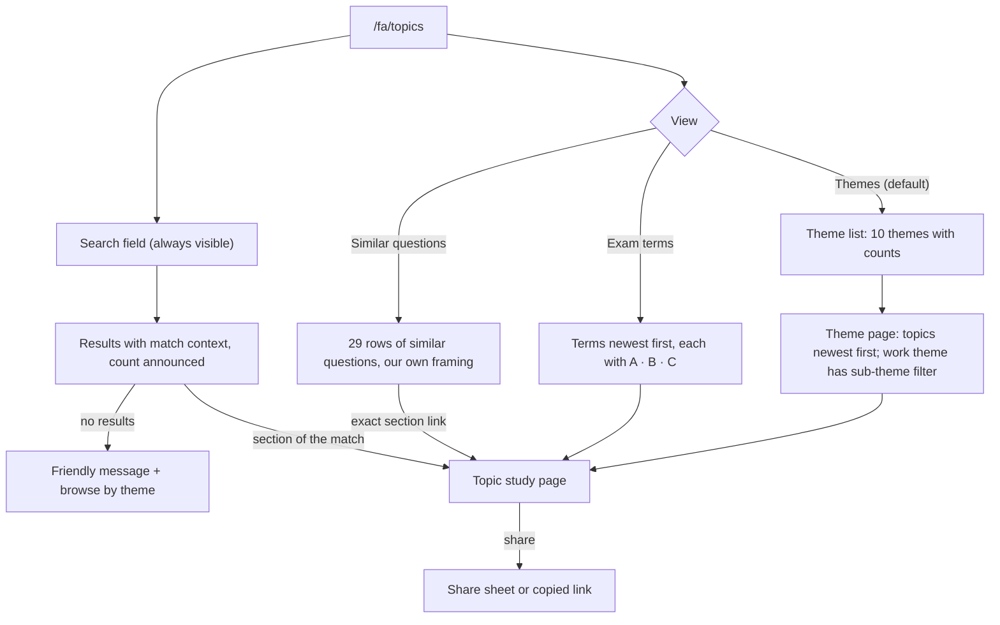

# Flow: browsing and finding a topic

| | |
|---|---|
| **Stories** | US-005 to US-010, US-064 #1, US-066 |
| **Personas** | Maryam (by theme, e.g. health), Ahmad (by theme, simple lists), Sara (by term, search) |
| **Screens** | [topic-library](../screens/topic-library.md), [similar-questions](../screens/similar-questions.md), [topic-study](../screens/topic-study.md) |

## Entry points

| Entry | Lands on |
|---|---|
| Topics tab, home "Study past topics", guide "Next: study a topic" | `/fa/topics` (by theme) |
| A shared theme or term link | `/fa/topics/themes/{themeId}` or `/fa/topics/terms/{termId}` |
| "Ready to review" on home or progress | the topic page directly ([spaced-review.md](spaced-review.md)) |
| "A similar question: …" link on a topic page | the other topic's section (`#sitA`, `#sitB` or `#general`) |
| The review after a mock: "practise this topic" | the topic page |

## Four ways in, one destination

## Steps

1. **Library opens on themes** (US-005 #1). Each theme shows its Persian name, its Danish name and the number of published topics. Counts come from the content (US-005 #1, US-064 #1). Themes with no published topics don't appear (US-005 #5).
2. **The learner picks a theme.** The URL becomes `/fa/topics/themes/{themeId}` (US-005 #4). The theme page lists topics newest term first (US-005 #3). Each item shows:
   - the Danish topic name (LTR)
   - the Persian name
   - the term label and letter, for example `Maj–Juni 2024 · B` (UXD-22)
   - the pre-2023 label where it applies (US-009), as **plain text** inside the list item; its explanation lives at list level (an info button beside the list heading, and the era divider in the terms view), on the topic page and on the reveal (rev. 2, R-05)
   - practice status where storage allows: "practised 2 times · 3 days ago", or "ready to review" (US-010)
   - The work theme (16 topics) has a sub-theme filter (`?sub=`), "All" by default.
3. **Alternatively, by term** (US-006): terms newest first, each listing its topics with letters A, B, C. A term with fewer than three published topics shows only those (US-006 #2). Rev. 2: one **era divider** between Maj–Juni 2023 and Nov–Dec 2022 ("today's format" / "older format, with its explanation") instead of a badge on every row (R-17); term headings link to their term pages, and a compact term jump list sits at the top (R-29).
4. **Alternatively, similar questions** (US-007): see [screens/similar-questions.md](../screens/similar-questions.md).
5. **Alternatively, search** (US-008): the field sits at the top of every library view. Results update after the learner stops typing; the count is announced once (US-008 #4). Each result says where it matched and links to that section.
6. **The learner opens a topic** → [study-topic.md](study-topic.md).
7. **Back** returns to the same view, filter and scroll position (US-005 #4).

## States

| State | Behaviour |
|---|---|
| First visit | No practice status anywhere. No empty "you haven't practised" messages (US-067 #4). |
| Returning, storage available | Practice status and "ready to review" on list items (US-010) |
| Storage unavailable | No status shown, nothing breaks (US-010 #3). No notice in the library: the notice belongs to progress views (US-050 #1). |
| Pilot content only (M1) | Only published themes and terms appear; counts reflect what's published (US-064 #1) |
| Slow network | Lists are text; no audio is fetched in the library (US-005 #6) |
| Search, no results | Friendly message and a link to browse by theme (US-008 #3) |
| Unknown theme or term ID | Not-found page with a link to the library |
| Unknown `?sub=` | Ignored; "All" shown |

## Edge cases

- **Persian search with Arabic letters** (ي, ك), ZWNJ or diacritics: still matches (US-008 #2).
- **Mixed-script queries** ("sundhed سلامت"): each token matches in its own script; results must match all tokens. The field's text direction follows the first strong character (`dir="auto"` on the input is acceptable here, because it's user input, not content; US-008 #5).
- **A similar-questions row whose only other occurrence is in the appendix:** the appendix link is hidden; the row still shows its published links (US-007 #4).
- **Shared links after a content update:** IDs are stable, so the link still opens the same topic (US-066 #3).

## Exits

Into a topic page; or out through any tab.
