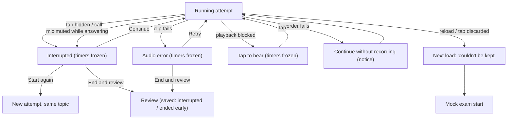

# Flow: errors and recovery

| | |
|---|---|
| **Stories** | US-050, US-061, US-062, US-063, US-038, US-027 #5–#6, US-011 #6, US-049 #4, GA-9 |
| **Screens** | [system-pages](../screens/system-pages.md); every screen's state table |
| **Components** | ErrorState, StorageNotice, Toast, AudioPlayer error state, TapToHear ([component inventory](../component-inventory.md)) |

## Principles

1. **Calm Persian, a next step, no raw errors, no blank screens** (GA-9).
2. **Text never depends on audio.** If audio fails, the text is still there (US-012 #4, US-062 #1).
3. **Fail small.** A failed clip breaks one player, not the page. A failed save is reported once, not per action (US-050 #3).
4. **Never blame the learner.** No "error", "failed", "wrong" about what the learner did (US-067 #3). Technical problems are named as the app's or the connection's.
5. **Time freezes for technical problems** in the mock exam (state machine principle 6).

## Catalogue

| # | What goes wrong | Where | What the learner sees | Next steps offered | Story |
|---|---|---|---|---|---|
| E1 | Page can't load (offline, server error) | Any route | Full-page ErrorState: "This page didn't load. Check your connection and try again." | Try again · Home | GA-9, US-061 |
| E2 | Unknown or unpublished topic, theme, term or attempt | Content routes | Not-found page | Library · Home | US-011 #6 |
| E3 | Slow page on a weak connection | Any | Text-first rendering; a loading state only after a short delay, so fast loads don't flash | – | US-061 #3 |
| E4 | Clip slow to start | Any player | Play control shows loading; a second tap doesn't start a second playback | – | US-062 #2 |
| E5 | Clip fails to load | Any player | Player shows "Audio didn't load" with Retry; text remains; other clips still work | Retry | US-062 #1 |
| E6 | Browser blocks playback (no gesture) | Mock | "Tap to hear the examiner" | Tap | US-030 #8, US-062 #4 |
| E7 | Mock audio slow to preload (> 15 s) | Mock reveal | "Loading is taking longer than usual. Nothing has started yet." | Keep waiting · Retry · Leave | US-027 #5 |
| E8 | Mock audio fails to preload | Mock reveal | "The exam audio didn't load. Nothing has started yet." | Retry · Leave | US-027 #6 |
| E9 | Clip fails mid-attempt despite preloading | Mock | Dialog; timers paused | Retry · End and review | US-038 #7 |
| E10 | Interruption (call, lock, app switch, microphone muted while answering) | Mock, answer aloud, shadowing | Dialog on return with a general reason and, in exam conditions, "the clock stopped at {m:ss} and continues from there" (R-08) | Continue · Start again (this attempt won't be kept) · End and see my answers | US-038 #1–#3 |
| E11 | Reload or discarded tab mid-attempt | Mock | "Your last mock exam stopped when the page reloaded, so it couldn't be kept." | Start a new mock exam · Mock exam page | US-038 #4 |
| E12 | Microphone denied | Recording actions | Help for this browser | Continue without recording · Try again | US-063 #2 |
| E13 | No microphone / in use | Recording actions | Plain message | Continue without recording | US-063 #4 |
| E14 | Microphone muted or ended mid-recording (e.g. a call banner) | Any recording | Treated as an interruption (E10); on Continue the microphone is re-opened; if that fails, inline notice "Your next answers won't be recorded." | Continue · Start again · End and see my answers | US-038 #6 (update), R-03 |
| E23 | Screen would auto-lock while the learner speaks | Focused modes | Prevented by the Screen Wake Lock. If unsupported: one-time tip at get ready / on first answer aloud: "Your screen may turn off while you speak. Set your phone's auto-lock to 2 minutes or more." A lock then works as E10. | – | R-01 |
| E24 | Back pressed during a mock (fallback flag `endEarly`) | `/fa/mock` | "Your mock exam ended when you went back. Your answers so far are saved." / "… Nothing was saved." | See my answers | R-02 |
| E15 | Storage unavailable (blocked, private mode, full) | Progress views; review "keep"; settings | One short StorageNotice with the reason: "Your progress can't be saved in this browser (for example in a private window). Everything else works." | Learn more (privacy page) | US-050 #1 |
| E16 | A save fails mid-session (quota) | Anywhere that saves | One toast: "We couldn't save your progress just now. You can carry on." Not repeated for later failures in the session. | – | US-050 #3 |
| E17 | Stored data is old or invalid | App start | Nothing visible: migrated or ignored, valid records kept | – | US-046 #4 |
| E18 | Storage cleared by the browser | App start | First-visit state, no errors | – | US-050 #2 |
| E19 | Delete fails or data is corrupted | Settings | Delete still clears everything the app can reach; "Your data has been deleted." | – | US-049 #4 |
| E20 | Keeping an attempt fails (quota) | Review | "This attempt couldn't be kept on this device. You can still listen now." | – | US-045 #4 |
| E21 | Share sheet unavailable | Topic | Link copied; toast "Link copied" | – | US-066 #2 |
| E22 | Unknown query values (`?topic=`, `?theme=`, `?sub=`) | Mock practice, theme | Calm inline notice; default used | – | IA §4.1 |

## Recovery paths for the mock exam

## States common to every screen

These rows appear in each screen spec's state table; the screen notes only what differs.

| State | Default behaviour |
|---|---|
| Loading (route) | Server-rendered text appears first. A skeleton appears only if loading takes longer than a short threshold (proposal 300 ms), to avoid flashing. Focus moves to the `h1` when the page is ready. |
| Slow network | No audio until play; players show loading; no layout shift when audio arrives (US-061) |
| Error | E1 |
| Storage unavailable | Study and mock features work; progress-dependent parts are hidden; the StorageNotice appears once, on progress views only (US-050 #1) |
| Microphone denied | Only screens that record are affected (E12) |
| Offline mid-session | Navigations fail as E1; audio already loaded still plays; nothing is lost from storage |
