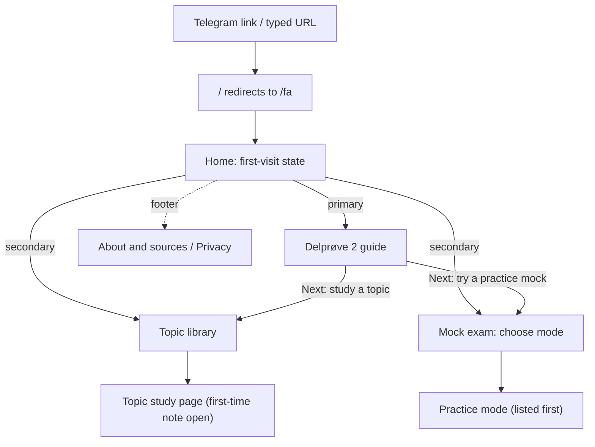

# Flow: first visit

| | |
|---|---|
| **Stories** | US-057, US-058, US-001, US-051 to US-053, US-050 #2, US-061, US-067 |
| **Personas** | All three. Ahmad needs a simple first step; Sara needs to be able to skip everything; Maryam needs to see quickly that the app will let her rehearse. |
| **Screens** | [home](../screens/home.md), [exam-guide](../screens/exam-guide.md), [topic-library](../screens/topic-library.md), [mock-start](../screens/mock-start.md) |

## Goal

Within one screen, a newcomer knows **what this is** (practice for delprøve 2 of the PD3 oral, in Persian), **that it isn't official**, and **what to do first**, without a tutorial (US-057; personas: "no forced onboarding").

## Entry points

| Entry | Lands on | Notes |
|---|---|---|
| A link shared in a Telegram group to the app's root | `/` → `/fa` home | The most likely first entry (personas, shared context). **Telegram often opens links in its in-app browser** (rev. 2, R-21): microphone, storage (separate from Chrome/Safari), wake lock and back may behave differently there. It's in the test matrix (OQ-9 spike, `qa-engineer`). If it can be detected, progress views show a gentle "open in your browser to keep your progress" note (UX-OQ-30). |
| A shared link to a topic, e.g. `/fa/topics/2024-maj-b` | The topic page directly | Must make sense on its own: header, "how this page is laid out" note, link to the guide. See [study-topic.md](study-topic.md). |
| A shared link to the guide | `/fa/guide/delproeve-2` | Ends with next steps |
| Search engine result | Any public page | Same as above |

## Steps (home entry)

1. **Home, first-visit state.** The learner sees, top to bottom:
   - the app name and a one-line purpose: "Practise delprøve 2 of the PD3 oral, with explanations in Persian"
   - a gloss: "delprøve 2 = part 2 of the oral: the unprepared conversation" (rev. 2, R-19)
   - what it **is** first, then what it isn't (R-19): "Real questions from published exams 2016–2024, checked against SIRI's wording where marked. Not made by SIRI (Styrelsen for International Rekruttering og Integration, the exam authority)." with a link to About (US-058)
   - **one primary action:** "How does delprøve 2 work?" (opens the guide; US-057 #1, US-001)
   - two secondary starting points: "Study past topics" (library) and "Try a practice mock exam" (mock start, with practice listed first)
   - the footer (about, privacy, credit)
2. **Guide** (if chosen). The learner reads the steps and the timeline. The guide ends with "Next": "Study a topic" and "Try a practice mock exam".
3. **Either path continues** into [browse-and-find-topic.md](browse-and-find-topic.md) or [mock-exam-practice.md](mock-exam-practice.md).

## States

| State | What changes |
|---|---|
| First visit, storage available | As above. The app writes nothing until the learner does something worth remembering (opens a topic, changes a setting, dismisses a note). |
| First visit, storage unavailable (private window, blocked) | Same home. No "continue" or "ready to review" sections. A single short notice appears only when the learner first reaches a progress view (US-050 #1), never on the first screen. |
| Slow network | Home is text only and server-rendered. No audio, no large images (US-057 #5, US-061 #2). |
| Returning learner | Home switches to the returning state on **any** stored progress (a topic opened or practised, or a saved mock attempt; rev. 2, R-06): "continue where you left off" becomes the primary action (US-046 #5). See [home](../screens/home.md). |
| Storage cleared since the last visit (by the learner or the browser) | Treated as a first visit, without errors (US-050 #2). |

## Edge cases

- **Sara skips everything:** every top-level section is one tap from home or the tab bar, and nothing has to be read or dismissed first.
- **Ahmad doesn't scroll:** the primary action and both secondary starting points fit in the first 375 × 667 viewport, above the tab bar, at default text size. At 200% text size they stack and scrolling is expected (GA-7).
- **The learner taps "Try a practice mock exam" first:** the mock start page explains both modes before anything happens (US-026), and links to the guide ("What will happen?").
- **Language:** only `fa` exists, so there is no language switcher (US-056 #3).
- **Unknown path** (`/fa/xyz`): Persian not-found page with links to home and the library.

## Exits

The learner leaves home for the guide, the library, the mock exam, or any tab. Nothing needs saving.

## What we deliberately don't do

- No splash screen, carousel, walkthrough, "choose your level" or "set a goal" step.
- No request for the microphone, notifications or storage permission on load (US-063 #1, US-067 #2).
- No grade promise or "pass guaranteed" style copy (GA-10).
