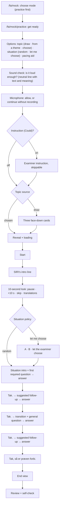

# Flow: mock exam in practice mode

| | |
|---|---|
| **Stories** | US-026 to US-036, US-038 to US-040, US-069 (Could), US-070 (Could), US-062, US-063 |
| **Behaviour spec** | [mock-exam-state-machine.md](mock-exam-state-machine.md) (states, events, timers, rules). This file is the learner-facing journey. |
| **Screens** | [mock-start](../screens/mock-start.md), [mock-get-ready](../screens/mock-get-ready.md), [mock-draw-and-look](../screens/mock-draw-and-look.md), [mock-interview](../screens/mock-interview.md), [mock-review](../screens/mock-review.md) |

## Goal

Learn the real delprøve 2 sequence **without panic**: the same prompts in the same order as the real exam and as exam conditions (US-036 #5), but with pause, hints, re-recording and no time limit (PRD §6.4). Practice is listed first everywhere (D-1).

## Entry points

| Entry | Lands on |
|---|---|
| Mock exam tab, home "Try a practice mock exam", guide "Next" | `/fa/mock` → choose **Practice** |
| "Practise this topic as a mock exam" on a topic page (US-040 #1) | `/fa/mock/practice?topic={topicId}` (draw skipped) |
| Review: "practise this topic again" | same |
| A theme page: "practise this theme" (US-040 #2) | `/fa/mock/practice?theme={themeId}` |

## Journey

## Steps

1. **Choose mode** (US-026): two cards; practice first, with its rules: "pause any time · hints · choose a topic · no time limit". What you'll need: about 5–6 minutes, a quiet place, sound on, a microphone if you want to hear yourself back. No grade; you check yourself afterwards (US-026 #4–#5).
2. **Get ready** ([screen](../screens/mock-get-ready.md); UXD-16; simplified in rev. 2, R-12):
   - **Options summary** (practice only): one line, "Draw a topic · the examiner chooses the situation", with **Change**. Change opens a sheet with: topic from a draw (default), a draw within one theme, or a chosen topic (US-040); situation random (default) or "let me choose after the look" (UXD-15); pacing aid (US-070, Could, off). Arriving with `?topic=` or `?theme=` shows that in the summary.
   - **Sound check** (US-027 #1; rev. 2, R-11): "Is the sound loud enough?" Play a short, neutral examiner line, shown with its Danish text and Persian meaning; "Yes, I can hear it" or "No sound" (help). It checks volume, not understanding.
   - **Microphone** (US-027 #2–#3, US-063): the explanation, then "Allow microphone" or "Continue without recording".
   - **Continue** (one primary button).
3. **Instruction** (US-069, Could): the examiner voice gives a short delprøve 2 instruction; Skip is always visible; it doesn't count towards any clock.
4. **Draw** (US-028): three identical, unmarked face-down cards. Tap one. With a theme of fewer than three published topics, only that many cards appear (UX-OQ-24).
5. **Reveal and load** (US-027 #4–#6, US-028 #2): the card shows its letter, the Danish and Persian topic names, the term and the pre-2023 label. Audio loads beneath; **Start** becomes available when it's ready (UXD-06). Slow (15 s) → message with retry and leave; failure → same.
6. **Intro line and look** (US-029): the examiner says SIRI's line with the topic's name; the two situation cards (Danish titles) and the note that the real exam shows two pictures. Then the 10-second countdown. Practice controls: **pause**, **+10 s**, **skip**, **show translations** of the titles (US-029 #5).
7. **Situation:** random by default; or the learner picks A, B or "let the examiner choose" (US-030 #1).
8. **Interview** ([screen](../screens/mock-interview.md)): the examiner introduces the situation and asks the first required question (US-030). The learner answers; recording starts automatically if the microphone is on (US-031). Controls:
   - **Done** (primary)
   - **Repeat**, with a visible label "Ask the examiner to repeat" above *"Undskyld, vil du godt gentage spørgsmålet?"* (US-032; R-13); for the first question also "hear the situation again"; from the second repeat, "hear it slower"
   - **Hints**: Persian translation, three key words, the matching template, in a sheet that doesn't leave the attempt (US-036 #2). The answer timer pauses while it's open (R-14).
   - **Pause** (US-036 #1): the overlay offers Continue · End and see my answers · Leave without saving (UX-OQ-02)
   - **Record again** (US-036 #4), shown only when recording (R-14)
   - **Show text** (US-030 #5): stays open for the rest of the attempt once opened; fixed examiner lines show their Persian meaning too (R-27, R-28)
   - **Pacing aid** (US-070, Could): collapsed panel, "about 2 min / about 2½ min" and "45–60 s per required answer", labelled as the booklet's approximate split; never alerts
   - answer timer showing elapsed time with the 45–60 s reference (US-036 #3)
9. **Follow-up, transition, general question, follow-up** (US-033, US-034), each after *"Tak."*. The step indicator shows "part 1 of 2" then "part 2 of 2" (US-034 #4).
10. **Closing** (US-035): recording stops, the microphone is released, the examiner says *"Tak, så er prøven forbi."*
11. **End view** → **review** ([mock-review.md](mock-review.md)).

## States and edge cases

| Situation | Behaviour | Ref |
|---|---|---|
| Microphone denied or none | Same sequence; "your turn" without recording; review shows sample answers and the self-check | US-027 #3, I13 |
| Pause | Everything freezes; resume replays an interrupted examiner clip from its start | §7.5 |
| Leave | Dialog: Continue the exam · End and see my answers (after the first answer) · Leave without saving. Paused while open. | US-039, UX-OQ-02, §7.6 |
| Phone call (incl. a call banner while answering), tab hidden | Paused; on return, a reason and Continue (replays the current question) · Start again (this attempt won't be kept) · End and see my answers | US-038, R-03, R-08, §12 |
| Screen would lock while speaking | Screen Wake Lock held; otherwise tip at get ready | R-01 |
| Browser or system back | Closes the hints sheet or dialog first, then opens the leave dialog (flag; fallback "ended early") | R-02 |
| Clip fails to play | Paused; Retry · End and review | US-038 #7 |
| Browser blocks audio | "Tap to hear the examiner" | US-030 #8 |
| Reload | "Your last mock exam couldn't be kept" view | US-038 #4 |
| Very long answer | Recording stops at 3 minutes with a calm message; the learner taps Done when ready | UXD-12 |
| `?topic=` unknown or unpublished | Notice "this topic isn't available; you can draw instead", options set to draw | IA §4.1 rule 5 |
| Topic without a follow-up in a section | That follow-up is skipped silently | US-033 #3 |

## Exits

- **Completed** → review; saved as "Practice".
- **Ended early** ("End and see my answers" from the leave dialog, pause overlay or interruption, or back under the fallback) → review; saved as "Practice · ended early" (UX-OQ-22).
- **Left without saving, restarted, reload-lost** → not saved; not counted as practice (US-039 #5).
