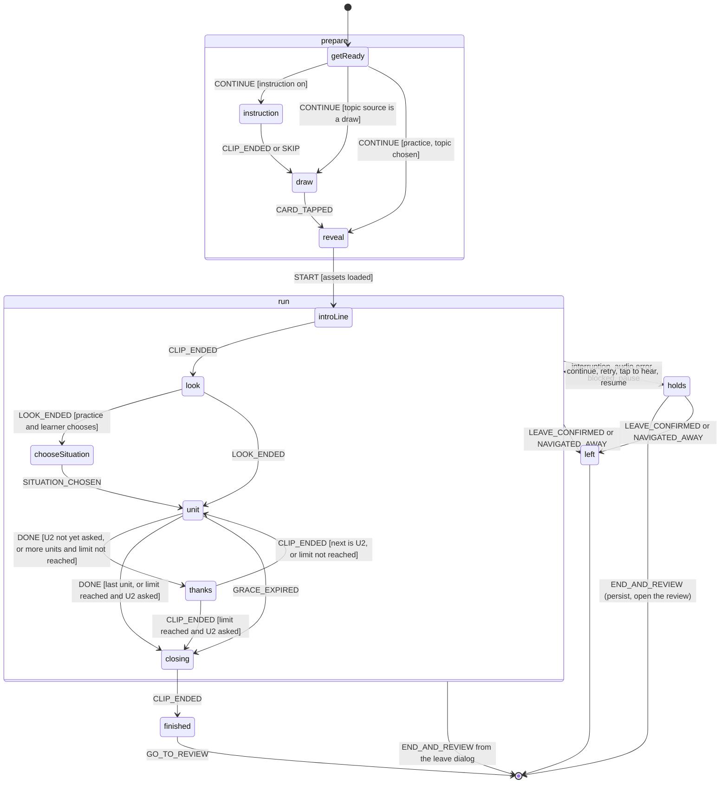
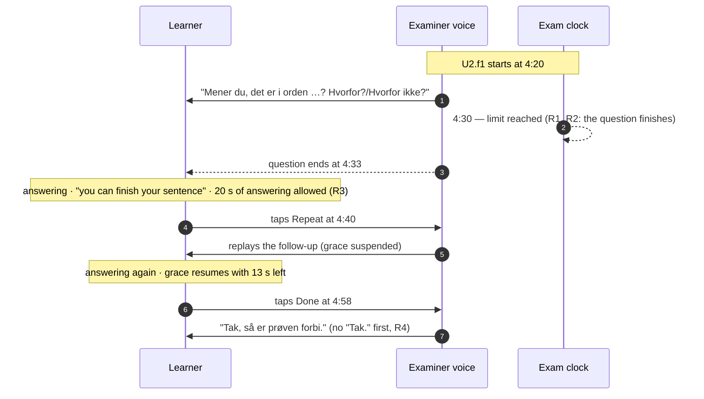

# Mock exam: behavioural state machine

| | |
|---|---|
| **Status** | Draft, **revision 2**. **Source of truth for behaviour** of the mock exam reducer. |
| **Date** | 2026-11-19 (revision 2: 2026-11-19) |
| **Author** | `ux-architect` |
| **Implementation** | Decided in `software-architect`'s ADR (written in parallel). The ADR may rename states and events, split or merge them, and choose how effects, timers and media are wired, **as long as every rule, invariant (§16) and scenario (§17) here still holds.** |
| **Stories** | US-026 to US-040, US-062 #4, US-063, US-069, US-070; GA-4, GA-11 |
| **Exam facts** | ABOUT §3.4, §4.1, §10; [PRD §6.3–§6.5](../../product/prd.md#63-the-mock-exam-the-real-exam-and-the-app-step-by-step); [exam-accuracy review](../../reviews/2026-11-18-pd3-exam-review-prd.md) Q1, Q2, Q3, Q5, suggestions 1–4 |
| **Read with** | [mock-exam-practice.md](mock-exam-practice.md), [mock-exam-exam-conditions.md](mock-exam-exam-conditions.md), [screens/mock-get-ready.md](../screens/mock-get-ready.md), [screens/mock-draw-and-look.md](../screens/mock-draw-and-look.md), [screens/mock-interview.md](../screens/mock-interview.md) |

**Revision 2 (2026-11-19)** applies the [learner walkthrough](../../reviews/2026-11-19-learner-walkthrough-ux.md) and ADR-0005 §4 / ADR-0007. Decisions marked *(delegated)* were decided by delegation on 2026-11-19, owner to confirm ([README](../README.md#revision-2-decisions-by-delegation-2026-11-19)).
- **Screen Wake Lock** in focused mode; a screen lock remains an interruption as the fallback (R-01; §9, §12.1, T34) *(delegated)*
- **Back** opens the leave dialog, closing any open sheet or dialog first; fallback "ended early" behind the ADR-0007 flag (R-02, UX-OQ-01; C19, §7.6, §12.4) *(delegated)*
- **Microphone mute or end while answering is an interruption**; "not recorded" only if the microphone doesn't come back (R-03; §7.3, §12.1) *(delegated)*
- **The second required question is always asked**, with a part-1 cut-off (R-10; C17, §10, I4, I14, T35–T37) *(delegated)*
- **"End and see my answers"** in the leave dialog and the practice pause overlay; "Leave without saving" (UX-OQ-02; §7.5, §7.6) *(delegated)*
- Practice: "show text" stays open once opened and includes the Persian meaning of fixed examiner lines; the answer timer pauses while hints are open; a slower replay from the second repeat (R-27, R-28, R-14, R-13)
- Exam conditions: no new clip or answer phase starts while the leave dialog is open (R-35)
- New status `endedEarly` in both modes; review route `/fa/mock/review/{topicId}?attempt={attemptId}` (ADR-0005 §4)

---

## 1. Scope and principles

**Scope:** from the moment the learner is on `/fa/mock/practice` or `/fa/mock/exam` (get ready) until the attempt is saved and the learner reaches the end screen, or leaves. Mode choice (`/fa/mock`) and the review (`/fa/mock/review/{topicId}?attempt={attemptId}`, ADR-0005 §4) are outside the machine; the machine hands over an attempt record and the in-memory recordings.

**Principles**
1. **One machine, two modes** (CLAUDE.md rule 9; PRD §6.4). The mode is a parameter. It changes guards, timer rules and which user events are accepted. It never changes the order of prompts (US-036 #5).
2. **Pure behaviour.** The machine holds no audio, microphone, storage or DOM. It receives **events** (§6) and emits **commands** (play clip, start recording, release microphone, announce, persist …). Time (`now`) and randomness (draw, situation) are injected so tests are deterministic (US-028 note).
3. **The machine is the single source of truth for the screen.** Every visible state of the runner maps to exactly one machine state (§5).
4. **The learner is never cut off mid-answer,** except when the grace period runs out in exam conditions (K2, DL-019, DL-049).
5. **Unexpected events are ignored, never fatal.** An event that isn't listed for the current state does nothing. This is what makes double taps safe (GA-4, US-028 #6, US-031 #7).
6. **Technical failures freeze time; the learner's choices don't.** Interruptions, audio errors and blocked playback freeze every timer. A repeat request, an open dialog or a long pause in speaking don't stop the exam clock in exam conditions (US-032 #4, US-039 #4).

---

## 2. Config values

All timings and lines come from the single exam config (DL-039). Tests use the config, not literals. **C1–C6, C10–C12 and C15 exist in the [stories' config table](../../product/user-stories.md#exam-config-proposed-defaults); C7–C9, C13, C14 and C16–C22 are new proposals from this spec.** C17 and C21 are app heuristics (SIRI gives no split); tune them in usability sessions (exam review 2026-11-20).

**Revision 2.1 (2026-11-20), decided by delegation, 2026-11-20** ([exam review](../../reviews/2026-11-20-exam-review-mock-rules.md)): C17 = 150 s; new C21 part-1 handover with notice and grace (S1); new C22 grace ceiling (suggestion 1); the slower repeat is labelled a practice aid (suggestion 3); hints sheet note "no notes in delprøve 2" (suggestion 4); the skipped-follow-up note carries no SIRI attribution (suggestion 7).

| ID | Key (suggested) | Default | Used in | Source |
|---|---|---|---|---|
| C1 | `lookSeconds` | 10 | `run.look` | §1, §3.4 |
| C2 | `examLimitSeconds` | 270 | exam clock | US-035 #2; review Q1 |
| C3 | `graceSeconds` | 20 | grace (§10) | DL-049 |
| C4 | `answerGuideSeconds` | 45–60 | practice answer timer (reference only) | booklet method; US-036 #3 |
| C5 | `maxRecordingSeconds` | 180 | recording cap per answer | US-031 #6 |
| C6 | `slowLoadNoticeSeconds` | 15 | `prepare.reveal` | US-027 #5 |
| C7 | `lookExtendSeconds` | 10 per tap | practice look "add time" | **new**; US-029 #5 |
| C8 | `examinerGapMs` | 600 | silence between consecutive examiner clips (intro → question, "Tak." → next question) | **new**; naturalness. Set to 0 if the audio files already carry the pause. |
| C9 | `oneMinuteNoticeSeconds` | 60 (remaining) | the "about one minute left" announcement, **independent of `timersVisible`** (rev. 2.2, a11y M7) | **new**; US-060 #4 |
| C10 | `pacingAid` | part 1 ≈ 120 s, part 2 ≈ 150 s; off and collapsed | practice only | US-070 (Could) |
| C11 | line IDs | `examiner.intro`, `examiner.transition`, `examiner.thanks`, `examiner.closing` | script (§4) | `content/examiner-lines.json`; the config references them by ID (schema §7) |
| C12 | `repeatRequestText` | *"Undskyld, vil du godt gentage spørgsmålet?"* | repeat control | DL-051 |
| C13 | `soundCheckClipId` | a short, neutral app-authored examiner line, shown with its Danish text and Persian meaning; draft *"Hej. Velkommen til prøven."* (UX-OQ-10; rev. 2, R-11) | get ready | **new**; US-027 #1 |
| C14 | `instructionLineId` | to be written (US-069) | `prepare.instruction` | **new**; US-069 (Could) |
| C15 | `examClockStartsAt` | start of the situation intro clip | exam clock | US-030 #4; review Q1 |
| C16 | `defaultTimersVisible` | `true` | exam clock and answer timer display | **new**; UXD-05 (OQ-19) |
| C17 | `part1CutoffSeconds` | **150** (2:30), exam conditions only (rev. 2.1, exam review S1, *decided by delegation, 2026-11-20*) | part-1 cut-off (§10) | **new, rev. 2**; R-10 |
| C21 | `part1HandoverSeconds` | **200** (3:20), exam conditions only; uses C3 grace | part-1 handover (§10 R1b) | **new, rev. 2.1**; exam review S1 *(decided by delegation, 2026-11-20)* |
| C22 | `graceCeilingSeconds` | **330** on the exam clock | absolute ceiling for grace extended by repeats (§10 R3) | **new, rev. 2.1**; exam review suggestion 1 *(decided by delegation, 2026-11-20)* |
| C18 | `micMuteInterruptMs` | 1000 | a microphone mute lasting longer than this while answering counts as an interruption | **new, rev. 2**; R-03; matches ADR-0007 §3 |
| C19 | `backBehaviour` | `leaveDialog` once the OQ-9 spike confirms the guard; otherwise `endEarly` (the ADR-0007 flag) | browser back during an attempt (§7.6, §12.4) | **new, rev. 2**; R-02 *(delegated)* |
| C20 | `slowRepeatRate` | 0.75 | practice only, from the second repeat of the same question | **new, rev. 2**; R-13 |

---

## 3. What the machine is given

**At set-up (from the route and the get-ready screen):**

| Input | Practice | Exam conditions |
|---|---|---|
| `mode` | `practice` | `exam` |
| Topic source | `draw` (default) · `drawFromTheme(themeId)` · `chosen(topicId)` (from `?topic=`, US-040 #1, or the topic picker) | `draw` only (US-037 #1, US-040 #3) |
| Situation policy | `random` (default) · `learnerChooses` (UXD-15) | `random` |
| Microphone | `granted` · `denied` · `unavailable` · `skipped` (from get ready, §9) | same |
| Preferences | `timersVisible` (C16, remembered), `alwaysShowExaminerText` (settings; UXD-13), pacing aid open or closed (US-070) | `timersVisible` only. `alwaysShowExaminerText` **doesn't apply** in exam conditions (rev. 2, R-12). |
| Injected | `now()`, `random()` | same |
| Content | from the repository: published terms and topics; for the drawn topic, its title, both situations (title, intro, `q1`, follow-ups), the general question (`q2`, follow-ups), and the examiner lines | same |

**Context the machine keeps during an attempt (suggested):** `attemptId`, `mode`, `topicId`, `situationKey`, the script (§4) and a cursor into it, `limitReached`, `part1CutoffReached` (exam), `u2Asked`, `interrupted` (exam), `answersStarted` (count of answer phases entered), `skippedFollowups` (item IDs skipped by the cut-off), timer deadlines and frozen remainders (§8), per-question facts (`answerMs`, `repeats`, `slowRepeats`, `showTextUsed`, `recorded`, `recordingCapped`, number of recording parts), `micState`, `timersVisible`, `showTextOpen` (practice persistence), and the `resumePoint` used by holds (§12).

---

## 4. The script

When the situation is decided (at the end of the look), the machine builds the script: an ordered list of **units**. A unit is what the examiner says before one answer. The learner answers once per unit.

| Unit | Role (UI label) | Clips, in order | Then |
|---|---|---|---|
| U0 | – | `examiner.intro:{topicId}` (SIRI's line, verbatim, with the topic's Danish name; US-029 #2) | the 10-second look |
| U1 | first required question | `{topic}.sit{X}.intro` (D-16) → `{topic}.sit{X}.q1` | answer |
| U1.f*n* | suggested follow-up | `{topic}.sit{X}.followup{n}` | answer |
| U2 | second required (general) question | `examiner.transition` (the app's wording, DL-050) → `{topic}.general.q2` | answer |
| U2.f*n* | suggested follow-up | `{topic}.general.followup{n}` | answer |
| closing | – | `examiner.closing` (SIRI's wording) | end |

**Rules**
- `examiner.thanks` (*"Tak."*, the app's convention, DL-021) plays **after each answer except the last**, before the next unit. After the last answer, or once the limit is reached, the closing line plays directly, because *"Tak, så er prøven forbi."* already thanks the learner (US-035 #1).
- Follow-ups are a list. Every published topic currently has exactly one per section (pilot report §1.1), but the machine handles **zero or more**. Zero follow-ups means the next unit follows straight after *"Tak."* (US-033 #3).
- A unit's clips play back to back with the C8 gap between them. Only one clip plays at a time (GA-11).
- **A unit has started** when its first clip has started playing. This matters for the limit and the cut-off (§10).
- **U2 is always asked** (rev. 2, R-10 *(delegated)*): both required questions are *obligatoriske* in the real exam (ABOUT §3.4). In exam conditions, U1 follow-ups that haven't started by the part-1 cut-off (C17) are skipped, and U2 comes next. Practice has no clock, so every unit always plays.

**Example: `2024-maj-b`, situation A** (texts from [`content/topics/2024-maj-b.json`](../../../content/topics/2024-maj-b.json))

| # | Unit | Clip | Danish text |
|---|---|---|---|
| 1 | U0 | `examiner.intro:2024-maj-b` | *Her er der to billeder, som viser nogle situationer, der handler om emnet Mangel på arbejdskraft. Du har nu 10 sekunder …* |
| – | look | – | 10 s |
| 2 | U1 | `2024-maj-b.sitA.intro` | *Situation A viser en sygeplejerske, der har ansvar for mange patienter og har travlt.* |
| 3 | U1 | `2024-maj-b.sitA.q1` | *Der mangler arbejdskraft i sundhedssektoren, … Hvorfor tror du, der gør det?* |
| | answer 1 | | |
| 4 | – | `examiner.thanks` | *Tak.* |
| 5 | U1.f1 | `2024-maj-b.sitA.followup1` | *Hvilke problemer mener du, der kan være ved, at der mangler sygeplejersker …?* |
| | answer 2 | | |
| 6 | – | `examiner.thanks` | *Tak.* |
| 7 | U2 | `examiner.transition` | *Nu vil jeg stille dig et spørgsmål af en mere overordnet karakter.* |
| 8 | U2 | `2024-maj-b.general.q2` | *Ved mangel på arbejdskraft … Hvilke fordele og ulemper mener du, der kan være ved det for samfundet?* |
| | answer 3 | | |
| 9 | – | `examiner.thanks` | *Tak.* |
| 10 | U2.f1 | `2024-maj-b.general.followup1` | *Mener du, det er i orden …? Hvorfor?/Hvorfor ikke?* |
| | answer 4 | | |
| 11 | closing | `examiner.closing` | *Tak, så er prøven forbi.* |

**Preload set** (US-027 #4, K7, DL-025): every clip the attempt can play: U0, **both** situations' intro, `q1` and follow-ups, `transition`, `q2` and its follow-ups, `thanks`, `closing`. That's 12 clips per topic today. Both situations are loaded because the situation is only decided when the look ends, and in practice the learner may pick it. *(If the ADR decides the situation at draw time from the injected random source, it may load only that situation, provided the choice is still revealed only at the end of the look.)* The sound-check clip (C13) and the instruction (C14) are loaded at get ready, not here (UXD-29, UX-OQ-11).

---

## 5. States

### 5.1 State list

| State | Screen | What the learner sees and can do |
|---|---|---|
| `prepare.getReady` | [mock-get-ready](../screens/mock-get-ready.md) | Practice options or exam rules; sound check; microphone. Continue. |
| `prepare.instruction` | mock-get-ready (final step) | The delprøve 2 instruction plays, with its text and Skip (US-069, Could). Doesn't count towards any clock. |
| `prepare.draw` | [mock-draw-and-look](../screens/mock-draw-and-look.md) | Three identical, unmarked face-down cards (US-028). Leave (no dialog: nothing is lost yet). |
| `prepare.reveal` | mock-draw-and-look | The tapped card shows letter, Danish and Persian names, term and the pre-2023 label (US-028 #2, US-009). Sub-states: `loading` → `slow` (after C6) → `loaded` or `failed`. **Start** is enabled only when `loaded` (UXD-06). |
| `run.introLine` | mock-draw-and-look | The topic and the two situation cards. The examiner says SIRI's intro line. The Persian note about pictures (US-029 #8). |
| `run.look` | mock-draw-and-look | The 10-second countdown. Practice: pause, add time, skip, show translations of the situation titles. Sub-state `lookPaused` (practice). |
| `run.chooseSituation` | mock-draw-and-look | Practice with `learnerChooses` only: "Situation A", "Situation B", "Let the examiner choose". |
| `run.unit.speaking` | [mock-interview](../screens/mock-interview.md) | The examiner is speaking (clip *k* of the unit). Primary slot shows "Listen…" (aria-disabled, UXD-08). Show text. |
| `run.unit.answering` | mock-interview | Your turn: recording indicator (if the microphone is on), answer timer, **Done**, Repeat. Practice adds hints, pause and record again. Grace notice when applicable. |
| `run.unit.repeating` | mock-interview | The examiner repeats the question (recording paused). |
| `run.thanks` | mock-interview | The examiner says *"Tak."* |
| `run.closing` | mock-interview | Recording has stopped and the microphone is released. The examiner says *"Tak, så er prøven forbi."* |
| `finished` | mock-interview (end view) | "The exam is over." One primary action: see my answers (US-035 #5). |
| `hold.paused` | mock-interview (overlay) | Practice only. Everything frozen. Continue · End and see my answers (once an answer phase has started) · Leave without saving (rev. 2). |
| `hold.blocked` | mock-interview / draw-and-look | The browser blocked playback: "Tap to hear the examiner" (US-030 #8, US-062 #4). |
| `hold.interrupted` | mock-interview (dialog) | Sub-states `away` (page hidden) and `choosing` (back in view): continue · start again · end and review (US-038 #2). |
| `hold.audioError` | mock-interview (dialog) | A preloaded clip failed to play: retry · end and review (US-038 #7). |
| `left` | – (navigates to `/fa/mock`) | Terminal. Nothing saved (US-039 #5). |

**Orthogonal flags (rev. 2):**
- **`leaveDialog`** (open / closed). Available from `run.*` and `hold.*`. In practice, opening it pauses the attempt. In exam conditions the clock keeps running (US-039 #4), the clip playing finishes, but **no new clip and no answer phase start until the dialog closes** (R-35). See §7.6.
- **`sheet`** (none / hints). Practice only. While the hints sheet is open, the answer timer pauses; recording continues (R-14).
- **`wakeLock`** (held / released / unsupported). Held in every focused-mode state (from entering `prepare.draw` until `finished` or `left`) except `hold.paused`; re-requested on `APP_VISIBLE` and on `RESUME` (R-01 *(delegated)*). The machine emits `requestWakeLock` / `releaseWakeLock`; the host reports `WAKE_LOCK_UNSUPPORTED` once, which shows the tip on get ready next time.

---

## 6. Events

| Group | Event | Payload | Sent when |
|---|---|---|---|
| **User** | `OPTIONS_SET` | topic source, situation policy, pacing aid | Practice options change on get ready |
| | `SOUND_CHECK_PLAY` · `SOUND_CHECK_HEARD` · `SOUND_CHECK_PROBLEM` | – | Sound-check row |
| | `MIC_ALLOW` · `MIC_SKIP` | – | Microphone row |
| | `CONTINUE` | – | Get ready's primary action |
| | `INSTRUCTION_SKIP` | – | Skip on the instruction |
| | `CARD_TAPPED` | card index 0–2 | A face-down card |
| | `START` | – | Start, after the reveal |
| | `RETRY_LOAD` | – | Loading slow or failed |
| | `LOOK_PAUSE` · `LOOK_RESUME` · `LOOK_EXTEND` · `LOOK_SKIP` | – | Practice look controls |
| | `SITUATION_CHOSEN` | `A` · `B` · `random` | Practice situation choice |
| | `TAP_TO_HEAR` | – | Blocked-playback button |
| | `DONE` | – | Done |
| | `REPEAT` | `rate`: 1, or C20 (practice, second repeat onwards) | Repeat control (current question); "hear it slower" sends rate C20 (R-13) |
| | `HINTS_OPENED` · `HINTS_CLOSED` | – | Practice hints sheet (pauses the answer timer, R-14) |
| | `BACK_PRESSED` | – | Browser or system back while the C19 guard is active (§7.6) |
| | `REPEAT_INTRO` | – | "Hear the situation again" (U1 only; US-032 #3) |
| | `RERECORD` | – | Practice "record again" (US-036 #4) |
| | `PAUSE` · `RESUME` | – | Practice pause (US-036 #1) |
| | `SHOW_TEXT` · `HIDE_TEXT` | – | Show text toggle (US-030 #5) |
| | `TIMERS_TOGGLED` | – | Show or hide timers (UXD-05) |
| | `LEAVE_REQUESTED` · `LEAVE_CONFIRMED` · `LEAVE_CANCELLED` | – | Leave control and its dialog; Escape sends `LEAVE_CANCELLED` |
| | `CONTINUE_AFTER_INTERRUPTION` · `RESTART` · `END_AND_REVIEW` | – | Interruption dialog. `END_AND_REVIEW` is also sent by "End and see my answers" in the leave dialog and the practice pause overlay (rev. 2). |
| | `RETRY_AUDIO` | – | Audio-error dialog |
| | `GO_TO_REVIEW` | – | End view |
| **Media** | `MIC_GRANTED` · `MIC_DENIED` · `MIC_UNAVAILABLE` | reason (`none`, `in-use`, `insecure`, `other`) | Result of a microphone request |
| | `ASSETS_LOADED` · `ASSETS_FAILED` | – | Preload result |
| | `CLIP_STARTED` · `CLIP_ENDED` · `CLIP_FAILED` | clip ID | Playback lifecycle |
| | `PLAYBACK_BLOCKED` | clip ID | The browser refused to start playback without a gesture |
| | `RECORDING_STARTED` · `RECORDING_FAILED` | – | Recorder lifecycle |
| | `MIC_MUTED` | – | The microphone track has been muted by the system for longer than C18 while the page is visible (typically an incoming-call banner) |
| | `MIC_ENDED` | – | The microphone track ended (headset unplugged, permission revoked, device taken by another app) |
| | `MIC_REACQUIRED` · `MIC_REACQUIRE_FAILED` | – | Result of re-opening the microphone after an interruption or before the next answer |
| | `WAKE_LOCK_UNSUPPORTED` · `WAKE_LOCK_LOST` | – | The Screen Wake Lock can't be held, or the system released it |
| **Platform** | `APP_HIDDEN` · `APP_VISIBLE` | – | Page visibility (tab hidden, screen locked despite the wake lock, app switched) |
| | `AUDIO_INTERRUPTED` | – | The system stopped playback or the audio session (phone call, Siri, alarm) while the page may still be visible |
| | `NAVIGATED_AWAY` | – | Any route change not caused by `LEAVE_CONFIRMED`, `END_AND_REVIEW` or `GO_TO_REVIEW`: a typed URL, an external link, or browser back when the C19 guard isn't active |
| **Time** | `TICK` | `now` | Delivered by the host while any deadline is pending. The machine derives the time events below from its deadlines. |
| | *derived:* `LOOK_ENDED` · `PART1_CUTOFF` · `PART1_HANDOVER` · `GRACE_CEILING` · `LIMIT_REACHED` · `ONE_MINUTE_LEFT` · `GRACE_EXPIRED` · `RECORDING_CAP_REACHED` · `LOAD_SLOW` · `GAP_ELAPSED` | – | When `now` passes a deadline |

`window.blur` without the page being hidden (for example clicking another desktop window) is **not** an interruption.

---

## 7. Transitions

Notation: **guard** in brackets; **commands** after "→". Anything not listed is ignored (principle 5).

### 7.1 Prepare

| State | Event | Guard | Commands and next state |
|---|---|---|---|
| `getReady` | `SOUND_CHECK_PLAY` | – | play C13 (stops any previous sound-check playback) |
| | `SOUND_CHECK_HEARD` | – | `soundOk = true` |
| | `SOUND_CHECK_PROBLEM` | – | show sound help (silent switch, volume, Bluetooth); stays |
| | `MIC_ALLOW` | mic not yet decided, and not known to be denied | request microphone (the browser prompt appears only now; US-063 #1) |
| | `MIC_GRANTED` / `MIC_DENIED` / `MIC_UNAVAILABLE` | – | set `micState`; denied shows per-browser help and "continue without recording" (US-063 #2, #4) |
| | `MIC_SKIP` | – | `micState = skipped` |
| | `CONTINUE` | `micState` decided (granted, denied, unavailable or skipped) | exam: mark nothing yet. → `instruction` if US-069 is on; else → `draw`; practice with a chosen topic → `reveal` and start preload |
| `instruction` | on enter | – | play C14 (the `CONTINUE` tap is the gesture) |
| | `CLIP_ENDED` / `INSTRUCTION_SKIP` | – | stop audio → `draw` (or `reveal` for a chosen topic) |
| `draw` | on enter | – | focused mode starts: `requestWakeLock` (R-01). Choose the cards with `random()`: exam and practice "draw" pick one eligible term (all three of its topics published) and shuffle A, B, C; if no term is eligible, pick three distinct published topics (US-028 #5). Practice "draw from theme": up to three distinct published topics of that theme (UX-OQ-24). |
| | `CARD_TAPPED(i)` | no card drawn yet | `topic = cards[i]` → `reveal.loading`; start preload (§4); start the C6 deadline; announce the reveal |
| `reveal.loading` | `ASSETS_LOADED` | – | → `reveal.loaded` |
| | `LOAD_SLOW` | – | → `reveal.slow` (message with retry and leave; US-027 #5). Loading continues. |
| | `ASSETS_FAILED` | – | → `reveal.failed` (same choices; US-027 #6) |
| `reveal.slow` | `ASSETS_LOADED` | – | → `reveal.loaded` |
| `reveal.slow` / `reveal.failed` | `RETRY_LOAD` | – | restart preload and the C6 deadline → `reveal.loading` |
| `reveal.loaded` | `START` | – | create `attemptId`; write the in-progress marker (§14); arm the back guard if C19 = `leaveDialog` (the sentinel history entry is pushed inside this tap, ADR-0007 §3); play U0 → `run.introLine`. This tap is the gesture that lets later examiner audio play without further taps (US-027 #7). |
| any `prepare.*` | Leave | – | no dialog (no attempt exists yet); stop audio; → `/fa/mock`. Nothing saved. |

### 7.2 Intro line, look and situation

| State | Event | Guard | Commands and next state |
|---|---|---|---|
| `introLine` | `CLIP_ENDED(U0)` | – | set look deadline `now + C1` → `look`; announce "10 seconds to look" |
| `look` | `LOOK_ENDED` | exam, or practice with `random` | `situationKey = random(A, B)`; build the script → `unit.speaking` (U1); announce "the examiner chose situation X" |
| | `LOOK_ENDED` | practice with `learnerChooses` | → `chooseSituation` |
| | `LOOK_PAUSE` | practice | freeze the remaining look time → `look.paused` |
| `look.paused` | `LOOK_RESUME` | practice | new deadline `now + remaining` → `look` |
| `look` / `look.paused` | `LOOK_EXTEND` | practice | add C7 to the remaining time (no cap) |
| | `LOOK_SKIP` | practice | treat as `LOOK_ENDED` |
| `chooseSituation` | `SITUATION_CHOSEN(A or B)` | practice | `situationKey = choice`; build the script → `unit.speaking` (U1) |
| | `SITUATION_CHOSEN(random)` | practice | `situationKey = random(A, B)`; as above |

In exam conditions `LOOK_PAUSE`, `LOOK_EXTEND` and `LOOK_SKIP` are ignored, and the controls aren't shown (US-029 #4).

### 7.3 Units

| State | Event | Guard | Commands and next state |
|---|---|---|---|
| `unit.speaking` (clip *k*) | on enter | – | play clip *k*. Show text: **exam conditions** resets to hidden at each new unit; **practice** keeps `showTextOpen` once the learner has opened it, or if `alwaysShowExaminerText` is on (UXD-13, R-28). In practice the shown text of fixed examiner lines (intro line, transition, *"Tak."*, closing) includes their Persian meaning (R-27). |
| | `CLIP_STARTED` | clip is U1's situation intro, exam | **start the exam clock** (C15; US-030 #4, US-037 #2). Practice: start the elapsed display. |
| | `CLIP_ENDED(k)` | more clips in the unit | wait C8 → play clip *k + 1* |
| | `CLIP_ENDED(last)` | exam and leave dialog open | wait; the answer phase starts when the dialog closes (R-35). The clock keeps running. |
| | `CLIP_ENDED(last)` | otherwise | → `unit.answering`; `answersStarted += 1`. If `micState = granted`: start recording (re-opening the microphone first if it was closed; failure → "not recorded" for the rest of the attempt, with a notice). Start the answer timer and the C5 deadline. If exam and `limitReached`: start the grace allowance (§10). Announce "your turn" (§15). |
| | `PLAYBACK_BLOCKED` | – | → `hold.blocked` |
| | `CLIP_FAILED` | – | → `hold.audioError` |
| `unit.answering` | `DONE` | – | stop recording (keep the take); save `answerMs`; choose the **next unit** (§10 R1–R2b): if U2 hasn't been asked → `thanks`, then the next U1 follow-up, or U2 if the follow-ups are exhausted or `part1CutoffReached` (skipped follow-ups go to `skippedFollowups`); else if exam and `limitReached` → `closing`; else if another unit follows → `thanks`; else → `closing` |
| | `REPEAT(rate)` | rate C20 only in practice, and only from the second repeat of this question | pause recording and the answer timer; `repeats += 1` (and `slowRepeats += 1` at C20); → `unit.repeating`, playing the unit's **question** clip at `rate` (for U2, `q2` without the transition) |
| | `HINTS_OPENED` / `HINTS_CLOSED` | practice | pause / resume the answer timer; recording is unaffected (R-14) |
| | `REPEAT_INTRO` | U1 | as `REPEAT`, but play the situation intro, then `q1` |
| | `RERECORD` | practice | discard this answer's take; restart recording, the answer timer and the C5 deadline; announce "recording again" |
| | `RECORDING_CAP_REACHED` | recording | stop recording (keep the take); `recordingCapped = true`; stay in `answering`, without recording; announce (§15). The answer only ends at `DONE` (UXD-12). |
| | `MIC_MUTED` / `MIC_ENDED` | – | **an interruption** (rev. 2, R-03 *(delegated)*): handled as `AUDIO_INTERRUPTED` in §7.5 (stop and keep the recording, freeze timers, dialog). It does **not** mark the microphone unavailable. |
| | `RECORDING_FAILED` | – | the recorder itself failed to start: stay in `answering` without recording; `micState = unavailable` for the rest of the attempt; notice (US-038 #6) |
| | `PART1_CUTOFF` | exam | `part1CutoffReached = true`. Nothing visible changes; the answer in progress continues. |
| | `PART1_HANDOVER` | exam; a part-1 answer is in progress | start a C3 grace allowance; show and announce the handover notice (R1b, rev. 2.1). A part-1 clip playing at C21 finishes first; the grace starts with its answer phase. `GRACE_EXPIRED` then ends the answer → *"Tak."* → U2. |
| | `GRACE_CEILING` | exam; in grace | at C22 (330 s): the answer ends at the next `DONE`; a replay in progress ends the answer when it finishes (rev. 2.1) |
| | `LIMIT_REACHED` | exam | `limitReached = true`; start the grace allowance; show the grace notice; announce (§10) |
| | `GRACE_EXPIRED` | exam | stop recording (keep the partial answer; US-035 #3) → `closing` |
| | `PAUSE` | practice | → `hold.paused` |
| `unit.repeating` | `CLIP_ENDED` | last clip of the repeat | resume recording (same answer) and the answer timer → `unit.answering` |
| | `PLAYBACK_BLOCKED` / `CLIP_FAILED` | – | as in `speaking` |
| | `PAUSE` | practice | → `hold.paused` (the repeat replays from its start on resume) |
| `thanks` | on enter | – | play `examiner.thanks` |
| | `CLIP_ENDED` | the next unit chosen at `DONE` is U2 | wait C8 → `unit.speaking` (U2), even if `limitReached` (R1 exception) |
| | `CLIP_ENDED` | not `limitReached`; a part-1 follow-up is next and `part1CutoffReached` became true during *"Tak."* | skip the remaining U1 follow-ups → U2 |
| | `CLIP_ENDED` | not `limitReached` | wait C8 → `unit.speaking` (next unit) |
| | `CLIP_ENDED` | `limitReached` and U2 already asked | → `closing` |
| | leave dialog open (exam) | – | after *"Tak."* ends, wait until the dialog closes (R-35) |
| | `CLIP_FAILED` | – | skip it silently and continue as `CLIP_ENDED`. *"Tak."* carries no content, so it isn't worth a hold. |

`DONE`, `REPEAT`, `REPEAT_INTRO`, `RERECORD` and the hints events are accepted **only in `unit.answering`**. In every other state they're ignored, which makes a second quick tap harmless (US-031 #7).

### 7.4 Closing and end

| State | Event | Guard | Commands and next state |
|---|---|---|---|
| `closing` | on enter | – | stop recording if still on; **release the microphone** (US-035 #3–#4); stop the exam clock and record `totalMs`; **persist the attempt** (status §14) and clear the in-progress marker; play `examiner.closing` |
| | `CLIP_ENDED` / `CLIP_FAILED` / `PLAYBACK_BLOCKED` | – | → `finished`. The closing text is shown on the end view either way; the learner isn't asked to retry it. |
| | `APP_HIDDEN` | – | stop audio → `finished` (already persisted) |
| `finished` | on enter | – | `releaseWakeLock`; disarm the back guard; announce "the exam is over" |
| | `GO_TO_REVIEW` | – | hand over the attempt and recordings → `/fa/mock/review/{topicId}?attempt={attemptId}` (ADR-0005 §4) |

### 7.5 Holds

| State | Event | Guard | Commands and next state |
|---|---|---|---|
| any active `run.*` | `PAUSE` | practice | pause audio (the clip will replay from its start); pause recording; freeze all timers; `releaseWakeLock` (the phone may sleep while paused); `resumePoint = here` → `hold.paused` |
| `hold.paused` | `RESUME` | practice | `requestWakeLock`; return to `resumePoint`: examiner clip → replay it from its start; answering → resume recording and the answer timer; look → resume the countdown |
| | `END_AND_REVIEW` | practice; `answersStarted ≥ 1` | as `END_AND_REVIEW` below (rev. 2, UX-OQ-02) |
| any active `run.*` | `PLAYBACK_BLOCKED` | – | freeze all timers (the exam clock hasn't started yet if this is U1's intro) → `hold.blocked`; show "Tap to hear the examiner" |
| `hold.blocked` | `TAP_TO_HEAR` | – | play the blocked clip; unfreeze timers on `CLIP_STARTED` → back to the state that was playing. **Not** counted as an interruption. |
| any active `run.*` (except `closing`) | `APP_HIDDEN` / `AUDIO_INTERRUPTED` / `MIC_MUTED` or `MIC_ENDED` while answering | – | stop audio; stop recording (keep the part recorded so far); freeze all timers; `resumePoint = here`; record the interruption time (`frozenAtMs`) for the dialog; exam: `interrupted = true` (US-038 #1, #3; R-03) → `hold.interrupted.away`, or `.choosing` if the page is still visible |
| any active `run.*` except answering | `MIC_MUTED` / `MIC_ENDED` | – | not an interruption: nothing stops. The microphone is re-opened silently before the next answer (§7.3). |
| `hold.paused` / `hold.blocked` / `hold.audioError` | `APP_HIDDEN` | – | nothing changes (timers are already frozen). Exam with `hold.blocked` or `hold.audioError`: `interrupted = true`. |
| `hold.interrupted.away` | `APP_VISIBLE` | – | `requestWakeLock` (it is released when the page is hidden) → `hold.interrupted.choosing` (dialog takes focus) |
| `hold.interrupted.choosing` | `CONTINUE_AFTER_INTERRUPTION` | – | if the interrupted state recorded audio: re-open the microphone; `MIC_REACQUIRE_FAILED` → `micState = unavailable` for the remaining answers, with the notice "Your next answers won't be recorded" (R-03). Then resume per §12.2; timers continue from their frozen values. |
| | `RESTART` | – | discard this attempt and its recordings (not saved; UXD-11); new `attemptId`, same topic and mode; situation decided again by the policy → `run.introLine` (this tap is the gesture) |
| | `END_AND_REVIEW` | – | stop everything; release the microphone and the wake lock; persist with status §14 → straight to the review (no end view) |
| any active `run.*` | `CLIP_FAILED` (except "Tak." and the closing) | – | freeze all timers; exam: `interrupted = true` (US-038 #7) → `hold.audioError` |
| `hold.audioError` | `RETRY_AUDIO` | – | replay the failed clip from its start; unfreeze on `CLIP_STARTED`. A second failure stays here, with the message "still not playing". |
| | `END_AND_REVIEW` | – | as above |

### 7.6 Leaving

| State | Event | Guard | Commands and next state |
|---|---|---|---|
| `run.*`, `hold.*` | `LEAVE_REQUESTED` | – | open the leave dialog: **Continue the exam** (default) · **End and see my answers** (only once `answersStarted ≥ 1`) · **Leave without saving** (rev. 2, UX-OQ-02 *(delegated)*). **Practice:** if not already paused, pause as `PAUSE` and remember `pausedByDialog = true`. **Exam:** the clock keeps running and the clip playing finishes, but no new clip or answer phase starts while the dialog is open (R-35); recording in progress continues. |
| leave dialog open | `LEAVE_CANCELLED` (button, Escape, or back) | – | close the dialog. Practice with `pausedByDialog`: resume as `RESUME`. Practice paused by the learner before: stay paused. Exam: anything that waited (R-35) starts now. |
| | `END_AND_REVIEW` | `answersStarted ≥ 1` | stop audio and recording (keep everything recorded); release the microphone and the wake lock; persist with status `endedEarly` (§14) → the review |
| | `LEAVE_CONFIRMED` ("Leave without saving") | – | stop audio and recording; discard all recordings; release the microphone and the wake lock; clear the in-progress marker → `left` (route to `/fa/mock`). **Nothing saved**, and the topic isn't counted as practised (US-039 #3, #5). |
| leave dialog open | `APP_HIDDEN` / `AUDIO_INTERRUPTED` | – | close the dialog, then handle as in §7.5 |
| any state from `START` onwards, C19 = `leaveDialog` | `BACK_PRESSED` | – | **closes the topmost layer first** (rev. 2, R-02 *(delegated)*): hints sheet open → close it; leave dialog open → `LEAVE_CANCELLED`; pause overlay, interruption or audio-error dialog open → open the leave dialog on top of it (a second back closes it again). Otherwise → `LEAVE_REQUESTED`. The sentinel history entry is re-pushed every time (ADR-0007 §3). |
| any state from `START` onwards, C19 = `endEarly` (fallback if the spike finds the guard unreliable) | back (arrives as `NAVIGATED_AWAY`) | – | if `answersStarted ≥ 1`: persist with status `endedEarly` (recordings stay available in the mock section's session store where the platform keeps them), release everything, and `/fa/mock` shows "Your mock exam ended when you went back. Your answers so far are saved." with **See my answers**. Otherwise: release everything, nothing saved, and `/fa/mock` shows "Your mock exam ended when you went back. Nothing was saved." |
| any state from `reveal.loaded` onwards | `NAVIGATED_AWAY` (not back) | – | as `LEAVE_CONFIRMED`, without a dialog |

---

## 8. Timers

All timers are deadlines or accumulated durations held by the machine and evaluated on `TICK`. **Frozen** means the remaining time is stored and nothing counts down.

| Timer | Starts | Counts in | Frozen in | Ends | Practice | Exam conditions |
|---|---|---|---|---|---|---|
| **Look** (C1) | end of U0 | `look` | `look.paused`, `hold.*` | `LOOK_ENDED` | pause, +C7, skip | fixed |
| **Exam clock** (C2) | `CLIP_STARTED` of U1's situation intro (C15) | every `run.*` state, including `repeating`, `thanks`, the C8 gaps and while the leave dialog is open | `hold.blocked`, `hold.interrupted`, `hold.audioError` | entering `closing` | – (not used) | yes |
| **Practice elapsed** | same moment | every `run.*` state | `hold.*`, leave dialog (practice pauses) | entering `closing` | display only, no limit (US-036 #3) | – |
| **Answer timer** | entering `unit.answering` | `unit.answering` only | `repeating`, `hold.*`; practice: while the hints sheet is open (R-14) | `DONE`, `GRACE_EXPIRED` | shown with the C4 reference | shown, without the C4 reference |
| **Part-1 cut-off** (C17) | exam clock at C17 | – | – | one `PART1_CUTOFF` | – | yes; invisible to the learner (§10) |
| **Part-1 handover** (C21) | exam clock at C21, if U2 not yet asked | – | – | one `PART1_HANDOVER` | – | yes; notice + C3 grace (§10 R1b) |
| **Grace ceiling** (C22) | exam clock at C22 | – | – | one `GRACE_CEILING` | – | yes (§10 R3) |
| **Grace allowance** (C3) | see §10 | `unit.answering` only | `repeating`, `hold.*` | `DONE`, `GRACE_EXPIRED` | – | yes |
| **Recording cap** (C5) | each recording start or restart | while recording | `repeating`, `hold.*` | `RECORDING_CAP_REACHED` | yes | yes |
| **Slow-load notice** (C6) | `CARD_TAPPED` or `RETRY_LOAD` | `reveal.loading` | – | `LOAD_SLOW` | yes | yes |
| **Examiner gap** (C8) | `CLIP_ENDED` with another clip due | gaps | `hold.*` | `GAP_ELAPSED` | yes | yes |
| **One-minute notice** (C9) | exam clock at C2 − C9 | – | – | one announcement, **whatever the timer setting** (rev. 2.2, a11y M7); if it falls during an answer it is queued until after Done (§15) | – | yes |
| **Pacing aid** (C10) | part 1: U1's intro starts; part 2: U2's transition starts | as practice elapsed | as practice elapsed | – | display only, collapsed by default, never alerts (US-070) | not available |

**Display** (UXD-05): exam conditions show the exam clock as elapsed time "m:ss of about 4:30" and the answer timer, both hidden together by one "hide timers" toggle that's remembered (C16). Neither ever counts down, changes colour by itself, or prompts the learner to move on (OQ-3, DL-052). The look countdown is the only countdown, because SIRI's own line says "10 sekunder".

---

## 9. Examiner audio, recording and the microphone in each state

| State | Examiner audio | Recording | Microphone stream | Primary slot (UXD-08) |
|---|---|---|---|---|
| `getReady` | the sound check, on tap only | never | requested only on `MIC_ALLOW`; may stay open afterwards (decided by the OQ-9 spike) | Continue (label adapts, see the screen spec) |
| `instruction` | instruction (C14) | never | as above | Skip |
| `draw`, `reveal` | none | never | as above | Start (enabled when loaded) |
| `introLine` | U0 | never | open if granted (the spike decides whether to open it now or per answer) | "Listen…" |
| `look` | none | never | as above | "Looking…" (countdown) |
| `chooseSituation` | none | never | as above | the three choices |
| `unit.speaking` | the unit's clips | **never** (US-031 #8) | as above | "Listen…" (aria-disabled) |
| `unit.answering` | none | **on** if `micState = granted` and the cap isn't reached | in use; the browser's indicator is on | **Done** |
| `unit.repeating` | the question again | paused | in use | "Listen…" |
| `thanks` | *"Tak."* | never | as above | "Listen…" |
| `closing` | the closing line | stopped **before** the line plays | **released** on entry (US-035 #4) | "Listen…" |
| `finished` | none | never | released; the indicator must be off | See my answers |
| `hold.paused` | paused | paused | may stay open | Resume |
| `hold.blocked` | waiting for a tap | not started | as before | Tap to hear |
| `hold.interrupted` | stopped | stopped; the part recorded is kept | released if the platform requires it to resume cleanly, and re-opened on Continue; the learner must not be asked for permission again within one attempt if avoidable (OQ-9). If it can't be re-opened, the remaining answers are "not recorded" (R-03). | Continue (dialog) |
| `hold.audioError` | failed | not running | as before | Retry (dialog) |
| `left` | stopped | stopped and discarded | **released** | – |

**Screen Wake Lock (rev. 2, R-01 *(delegated)*).** Held in every focused-mode state from `prepare.draw` to `finished`, except `hold.paused`, so the screen doesn't lock while the learner speaks without touching it. The browser releases it when the page is hidden; it's re-requested on `APP_VISIBLE` and `RESUME`. It's released at `finished`, `left` and `END_AND_REVIEW`. If the API isn't available (or the request fails), get ready shows a one-time tip next time: "Your screen may turn off while you speak. Set your phone's auto-lock to 2 minutes or more." A screen lock then remains an interruption (§12.1). The same rule applies to answer aloud and shadowing.

**Recording parts.** A repeat or a practice pause pauses the recording, and the answer plays back as one recording. An interruption stops it; if the learner continues, the answer has two parts, which the review plays one after the other and labels "recorded in 2 parts" (UXD-10). A practice "record again" replaces everything recorded for that answer.

---

## 10. The time limit and the grace period (exam conditions)

Rules (US-035 #2; DL-049; review suggestion 4; UXD-09):

- **R0. Both required questions are always asked** (rev. 2, R-10 *(delegated)*). In the real exam both are *obligatoriske* (ABOUT §3.4); the examiner trims follow-ups, not required questions.
- **R1a. Part-1 cut-off (C17, 2:30).** Once the exam clock reaches C17, no U1 follow-up **starts**. An answer in progress continues (subject to R1b), then *"Tak."* and U2. A U1 follow-up whose first clip had already started finishes, and its answer continues (subject to R1b). Skipped follow-ups are recorded as a neutral fact for the review ("The app moved on to the general question to leave time for it."), with **no SIRI attribution**, because the cut-off is the app's rule (rev. 2.1, suggestion 7). The cut-off is invisible during the attempt.
- **R1b. Part-1 handover (C21, 3:20; rev. 2.1, S1).** If a part-1 answer (q1 or a U1 follow-up) is still running when the exam clock reaches C21, the learner sees a calm **handover notice**: "You can finish your sentence. Then the examiner will ask the next question." (announced once), and the answer gets a **C3 grace allowance** (answering time only, as R3). It ends at `DONE` or `GRACE_EXPIRED`; then *"Tak."*, the transition and `q2`. A part-1 examiner clip playing at C21 finishes, and its answer starts with the handover grace. This protects time for `q2` (exam conditions only).
- **R1. No new unit starts once the limit is reached, except U2 if it hasn't been asked yet.** When `LIMIT_REACHED` fires, `limitReached` becomes true for the rest of the attempt. With R1b, part 1 normally ends by about 3:40; reaching 4:30 before U2 is asked needs long holds-free repeats or clips, and is handled the same way: *"Tak."*, U2, and U2's answer gets a grace allowance; then the closing.
- **R2. A unit that has started finishes.** If the examiner is speaking a unit's clips at the limit, the remaining clips of **that unit** still play, including the question after the transition in U2 or after the situation intro in U1. *Reason:* an examiner who has announced a general question doesn't then end without asking it, and US-035 #2 says "an examiner question is playing: it finishes, and I get the grace period to answer it".
- **R3. The grace allowance is C3 seconds of answering time.** It starts when the learner's answer phase starts after the limit (or at the limit, if they're already answering). It counts only in `unit.answering`, so a repeat requested during grace doesn't use it up. **Ceiling (rev. 2.1, C22):** the exam clock never runs past 330 s in grace. At 330 s (`GRACE_CEILING`), the closing plays at the learner's next `DONE` or, if a repeat is playing, as soon as that replay ends, whichever comes first; grace remaining is ignored. (U2 still has to be asked if it hasn't been: R0 takes precedence.) *Reason:* the grace period is there to let the learner finish speaking, not to time the examiner.
- **R4. The answer in progress ends at the first of `DONE` or `GRACE_EXPIRED`.** Then the closing line plays directly, with no *"Tak."* before it, unless U2 still has to be asked (R1).
- **R5. Between units, the closing plays at once.** If the limit is reached while *"Tak."* or a C8 gap is playing, the next unit doesn't start; the closing follows as soon as *"Tak."* ends (under a second).
- **R6. The limit can't be reached while time is frozen** (holds) or before the clock starts (U0, look).
- **R7. The learner sees a calm grace notice that leads with permission** (rev. 2, R-09): "You can finish your sentence. Then the examiner will end the exam." (draft «می‌توانید جمله‌تان را تمام کنید. بعد ممتحن آزمون را تمام می‌کند.»). There is **no** grace countdown on screen, no colour change and no "time is up" wording. It's announced once. **The grace and handover notices are always shown and announced, whatever the timer setting** (rev. 2.2, a11y M7; closes UX-OQ-03): hiding the timers hides numbers, never the end of an answer.
- **R8. The recording cap (C5) is independent** of the limit and grace.

| Case | Where the learner is at 270 s | What happens |
|---|---|---|
| L1 | Answering | Grace notice; the answer ends at Done or after 20 s of answering; closing |
| L2 | The examiner is asking a follow-up | It finishes; the answer phase starts with the grace notice; Done or 20 s; closing |
| L3 | The transition is playing | It finishes, `q2` plays (R2), then the answer with grace; closing |
| L4 | *"Tak."* is playing, or the gap after it | *"Tak."* finishes; closing at once (R5) |
| L5 | A repeat is playing | It finishes; the answer resumes with grace (R3) |
| L6 | The learner asks for a repeat during grace | Grace is suspended during the replay and resumes after (R3) |
| L7 | Done after the limit | Closing at once, no *"Tak."* (R4) |
| L8 | The learner finished all units before 270 s | Closing after the last Done; the review shows the total time with the US-035 #7 note |
| L9 | Answering q1 at 2:30 (cut-off) | The answer continues; at Done, *"Tak."*, then the transition and U2. The part-1 follow-up is skipped and noted neutrally in the review (R1a). |
| L10 | The part-1 follow-up started at 2:25 | It finishes and is answered; U2 follows (R1a) |
| L11 | Still answering a part-1 question at 3:20 (rev. 2.1) | Handover notice; C3 grace; the answer ends at Done or after 20 s of answering; *"Tak."*, transition, `q2` (R1b). `q2` normally starts by about 3:45, leaving time to answer before 4:30. |
| L12 | Repeats during grace push the clock to 5:30 (rev. 2.1) | No further extension: the closing plays at the next Done, or when the playing replay ends (C22) |

**Practice mode has no limit,** so none of this applies. The closing plays after the last answer (PRD §6.3 row 6).

---

## 11. Repeat requests (US-032; review Q5; DL-022)

- **Available** in `unit.answering` for every unit, required or follow-up, in both modes. Not available while the examiner is speaking: the learner waits for the question to end, as at the real table.
- **The control has a visible action label** ("Ask the examiner to repeat", draft «درخواست تکرار سؤال») above the Danish phrase, and a first-time hint "Say it aloud, then tap" (rev. 2, R-13).
- **What it does:** pauses the recording and the answer timer, then replays **the same audio** (never a rephrasing). **Practice only, from the second repeat of the same question:** a second option "Hear it slower" replays at C20 (0.75×). It is labelled **a practice aid, not something the real examiner does** (rev. 2.1, suggestion 3, decided by delegation, 2026-11-20). `speech-engineer` may produce it as SSML-rate synthesis rather than time-stretching. Exam conditions always replay at normal speed. U1 offers a second option, "hear the situation again", which replays the situation intro and then the question (US-032 #3). U2's repeat replays `q2` only, not the transition.
- **The control shows** *"Undskyld, vil du godt gentage spørgsmålet?"* (C12) with its Persian meaning, inviting the learner to say it aloud before tapping (US-032 #1).
- **Clock:** in exam conditions the exam clock keeps running (US-032 #4). Grace isn't used up during a repeat (R3).
- **No limit** on the number of repeats. The review shows the count per question as a neutral fact (US-032 #5, US-041 #5).
- **Show text** is a separate control and doesn't count as a repeat.

---

## 12. Interruptions, reload and navigation

### 12.1 What counts as what

| Situation | Event | Result | Label (exam conditions) |
|---|---|---|---|
| Tab hidden, app switched, incoming call that takes over the screen, **or the screen locked despite the wake lock** (or because it isn't supported) | `APP_HIDDEN` | `hold.interrupted` | interrupted |
| Phone call, Siri or alarm that stops audio while the page stays visible | `AUDIO_INTERRUPTED` | `hold.interrupted.choosing` | interrupted |
| **While answering:** the microphone is muted for over 1 s (typically an incoming-call banner) or its track ends (rev. 2, R-03) | `MIC_MUTED` / `MIC_ENDED` | `hold.interrupted.choosing`; on Continue the microphone is re-opened; if that fails, the remaining answers are "not recorded" | interrupted |
| Not answering: the microphone is muted or ends | `MIC_MUTED` / `MIC_ENDED` | nothing visible; re-opened silently before the next answer | not interrupted |
| The recorder fails to start | `RECORDING_FAILED` | continue without recording, with a notice (US-038 #6) | not interrupted |
| A preloaded clip fails to play | `CLIP_FAILED` | `hold.audioError` (except *"Tak."* and the closing, §7.3–§7.4) | interrupted |
| The browser blocks autoplay | `PLAYBACK_BLOCKED` | `hold.blocked` (one tap) | not interrupted |
| The learner presses Leave and confirms | `LEAVE_CONFIRMED` | `left`; nothing saved | – |
| Browser or system back (Android back, iOS edge swipe) | `BACK_PRESSED` (C19 = `leaveDialog`) or `NAVIGATED_AWAY` (C19 = `endEarly`) | §7.6 and §12.4 | – |
| A typed URL or an external link | `NAVIGATED_AWAY` | as leave, without a dialog | – |
| Reload, or the browser discards the tab | (the machine is gone) | on the next load: the "couldn't be kept" view (§12.3) | – |
| Focus moves to another window without hiding the page | – | nothing | – |

**The platform decides which signal arrives.** On iOS a call usually hides the page; on some Android devices the page stays visible but loses audio focus. The machine treats both the same way. Which browser signals map to `APP_HIDDEN`, `AUDIO_INTERRUPTED`, `MIC_MUTED` and `MIC_ENDED` is for the OQ-9 spike and the ADR. The spike must include an **incoming-call banner while answering** and **Telegram's in-app browser** (R-03, R-21).

### 12.2 "Continue" after an interruption (UXD-10)

The dialog says, calmly, that the attempt stopped **and why** in general terms ("the screen turned off, a call came in, or another app opened"), that **"the clock stopped at {m:ss} and continues from there"** (exam conditions), and offers **Continue** (primary), **Start again (this attempt won't be kept)** and **End and see my answers** (US-038 #2; rev. 2, R-08). In practice mode the copy says "paused" rather than "stopped", and nothing is labelled.

| Interrupted in | Continue does |
|---|---|
| `introLine` | replays U0 from its start, then the look |
| `look` | restarts the look at the full C1 (the learner lost their place; in exam conditions the attempt is already labelled interrupted) |
| `chooseSituation` | shows the choice again |
| `unit.speaking` clip *k* | replays from clip *k* to the end of the unit (for example if the transition was cut off, transition then `q2`) |
| `unit.answering` or `unit.repeating` | replays the unit's **question** clip ("continue, which replays the current question", US-038 #2), then answering resumes; the answer gets a second recording part |
| `thanks` | goes straight on to the next unit (or the closing if `limitReached`) |
| `hold.paused` (practice) | returns to the paused state |

All timers continue from their frozen values. In exam conditions a grace allowance in progress keeps its remaining time.

### 12.3 Reload or discarded tab (US-038 #4)

- **While an attempt runs** (from `START` until `closing`), a small **in-progress marker** exists in session-scoped storage: `attemptId`, mode, topic ID, start time (§14).
- **On loading `/fa/mock/practice` or `/fa/mock/exam`** with a marker present and no live machine, the page shows the **"couldn't be kept" view**: "Your last mock exam stopped when the page reloaded, so it couldn't be kept. Nothing was saved." with "Start a new mock exam" (primary) and "Back to the mock exam page". The marker is then cleared.
- On any other route, a leftover marker is cleared silently.
- The microphone isn't active, no audio plays, and there is no half-restored exam.
- If session storage is unavailable, the page simply loads at get ready. Nothing breaks (US-050).

### 12.4 Back navigation

**Decided by delegation, 2026-11-19 (R-02, UX-OQ-01), behind the ADR-0007 flag (C19) until the OQ-9 spike confirms the guard on real iPhones and Android phones:**
- **C19 = `leaveDialog` (target).** Back never ends an attempt by itself. It closes the topmost sheet or dialog first (Android convention), and otherwise opens the leave dialog (§7.6). Leaving always needs an explicit "Leave without saving" or "End and see my answers".
- **C19 = `endEarly` (fallback, if the guard proves unreliable).** Back ends the attempt, but anything answered is **saved as "ended early"**, and `/fa/mock` shows a notice with "See my answers" (§7.6). With no answer yet, the notice says nothing was saved.
- The old behaviour (back discards silently, US-038 #5) is retired in both settings (story update in the README).
- **The review page** applies the same guard while it holds unkept recordings (R-34).
- **Answer aloud** (a panel, not a route) keeps its own rule: back closes the panel, with the discard guard if a take exists.

---

## 13. Differences between the modes

Everything below is a guard or a timer rule on the same states. The prompts and their order are identical (US-036 #5).

| Behaviour | Practice | Exam conditions | Story |
|---|---|---|---|
| Topic | draw, draw from a theme, or choose | draw only (one real term) | US-028, US-040 |
| Instruction before the draw (Could) | optional, skippable | optional, skippable | US-069 |
| Look | pause, add time, skip; Persian translations of the situation titles on request | fixed 10 s; Danish only | US-029 #4–#5 |
| Situation | random, or "let me choose" | random | US-030 #1, UXD-15 |
| Exam clock and limit | none; elapsed time only | 270 s from the situation intro, then grace | US-035, US-037 |
| Pause | at any time | none | US-036 #1, US-037 #2 |
| Hints (translation, key words, template) | in `unit.answering` | none | US-036 #2, US-037 #3 |
| Answer timer reference (45–60 s) | shown | not shown | US-036 #3 |
| Pacing aid | optional, collapsed | not available | US-070 |
| Record again | yes | no | US-036 #4, US-037 #4 |
| Repeat | yes | yes; the clock runs | US-032 |
| Show text | yes | yes; use is noted neutrally | US-030 #5 |
| Leave dialog open | attempt paused | attempt carries on | US-039 #4 |
| Interruption | paused; continue when ready | stops; "interrupted" label if continued or ended | US-038 #3 |
| Audio error | paused; retry or end | stops; "interrupted" label | US-038 #7 |
| Part-1 cut-off (C17) | none: every unit plays | from 2:30 no new part-1 follow-up; at 3:20 a handover notice + grace for a part-1 answer; U2 always asked; grace ceiling 5:30 | R-10; exam review S1 |
| Show text | stays open once opened; Persian meaning for fixed examiner lines; "always show" setting applies | resets per unit; Danish only; setting doesn't apply | R-12, R-27, R-28 |
| Slower repeat | from the second repeat | never | R-13 |
| Hints sheet open | answer timer paused | – | R-14 |
| End early by choice | leave dialog and pause overlay | leave dialog | UX-OQ-02 |
| History label | "Practice", plus "ended early" when status is `endedEarly` | "Exam conditions"; "Interrupted" after any interruption; "Exam conditions · ended early" when ended by choice or by back (fallback); never "failed" | US-037 #5, PRD §6.4 (PM update) |

---

## 14. What is persisted

Persistence goes through the progress-store interface (CLAUDE.md rule 6). The machine only emits `persist` commands. If storage is unavailable, every command is a no-op and the attempt still runs and reviews normally (US-050 #1); a failed save is reported **once** (US-050 #3).

| When | What | Where (behavioural) | Never |
|---|---|---|---|
| `START` | in-progress marker: `attemptId`, mode, topic ID, start time | session-scoped storage | anything else mid-attempt |
| `TIMERS_TOGGLED` | `timersVisible` | device preferences | – |
| Get ready (once) | "microphone explanation seen" (US-044 #1) | device preferences | the permission itself (the browser owns it) |
| Entering `closing` (status `completed`), `END_AND_REVIEW`, or back with C19 = `endEarly` | **attempt record:** `attemptId`, exam part (`2`, for delprøve 1 later), mode, topic ID, situation key, start date, total time (frozen time excluded), status (`completed`; `interrupted` in exam conditions after any interruption; `endedEarly` in either mode when ended by choice or by back), the ordered list of item IDs asked, skipped follow-up IDs (R1a), and for each item: answer time, repeats, slow repeats, show-text used, recorded yes/no, recording capped, number of parts | progress store | recordings (memory only, unless kept from the review, US-045); hint use; any personal data |
| Same moment | topic marked practised with the date; spaced-review step updated (US-046 #1, US-047 #1 and #4) | progress store | – |
| Later, in the review | self-check ticks (US-042 #5); the optional "focus next time" item (R-18); "keep on this device" with the recordings (US-045) | progress store | – |

**Not persisted:** `left`, `RESTART`ed and reload-lost attempts. They don't appear in history and don't count as practice (US-039 #5).

---

## 15. Announcements

Through one polite live region, sparingly (US-060 #4; GA-5). **Announcements wait until no examiner clip is playing,** so a screen reader never talks over the examiner. Dialogs announce themselves by taking focus and need no live-region message.

**Rev. 2.2 (accessibility audit 2026-11-21, decided by delegation, 2026-11-21):**
- **Answers stay quiet (M8).** While `unit.answering`, announcements are **queued and delivered after `DONE`** (or `GRACE_EXPIRED`), so screen-reader speech doesn't interrupt the learner or leak into the recording. Exceptions, announced live: the **handover** and **grace** notices. "Your turn" is announced as the answer phase starts, before the learner speaks. Queued messages that are no longer true when delivered are dropped (e.g. "one minute left" after the limit).
- **Timer setting (M7).** `timersVisible = false` hides numbers only. The one-minute, handover and grace announcements are emitted regardless.
- **Danish in announcements (M1).** Messages are emitted as message keys with params; any Danish param (a topic name, a phrase) is **content, rendered as ``** inside the live region, never interpolated into a plain string, `aria-label` or `title`.

| Moment | Message (key) | Intended meaning | Condition |
|---|---|---|---|
| Card revealed | `mock.live.revealed` | "You drew topic {letter}: {topic name in Danish}." | – |
| Look starts | `mock.live.lookStarted` | "10 seconds to look at the topic." | – |
| Look ends | `mock.live.lookEnded` | "The time to look is over." | – |
| Situation decided | `mock.live.situationChosen` | "The examiner chose situation {key}." | – |
| Answer phase starts | `mock.live.yourTurnRecording` / `mock.live.yourTurn` | "Your turn. Recording." / "Your turn." | first answer: full message; later answers: "Your turn." only, to stay sparing |
| One minute left | `mock.live.oneMinuteLeft` | "About one minute left." | exam, whatever the timer setting (rev. 2.2); queued if during an answer; dropped if the limit is reached before it's delivered |
| Part-1 handover (C21) | `mock.live.handover` | "You can finish your sentence. Then the examiner will ask the next question." (rev. 2.1) | exam |
| Limit reached | `mock.live.finishSentence` | "You can finish your sentence. Then the examiner will end the exam." (R-09) | exam |
| Recording cap | `mock.live.recordingCapped` | "Recording for this answer stopped at 3 minutes. Tap Done when you're ready." | – |
| Microphone can't be re-opened after an interruption, or the recorder fails | `mock.live.notRecording` | "Your next answers won't be recorded. The exam continues." | – |
| Practice pause, resume | `mock.live.paused` / `mock.live.resumed` | "Paused." / "Continuing." | practice |
| Recording again | `mock.live.rerecording` | "Recording again." | practice |
| Exam over | `mock.live.examOver` | "The exam is over." | – |

**Not announced:** every second of any timer; the press of Done (the examiner's *"Tak."* is the feedback); repeats (the audio is the feedback).

---

## 16. Invariants (property tests)

- **I1** Recording is on only in `unit.answering`. It is never on while any examiner clip plays (US-031 #8).
- **I2** At most one clip plays at any moment (GA-11).
- **I3** In exam conditions the exam clock only stops in `hold.blocked`, `hold.interrupted` and `hold.audioError`, and when `closing` starts.
- **I4** No unit's first clip starts after `limitReached`, except U2 when it hasn't been asked (R1). No U1 follow-up's first clip starts after `part1CutoffReached` (R1a).
- **I14** In exam conditions, every attempt that reaches `closing` has asked U2 (R0).
- **I15** While the leave dialog is open in exam conditions, no clip starts and no answer phase starts (R-35).
- **I16** With C19 = `leaveDialog`, no sequence of `BACK_PRESSED` events alone ends an attempt.
- **I21** (rev. 2.2) With `timersVisible = false`, `LIMIT_REACHED`, `PART1_HANDOVER` and the one-minute deadline still emit `announce` (the handover and grace notices live; the one-minute notice possibly queued).
- **I22** (rev. 2.2) During `unit.answering`, the only `announce` commands emitted for immediate delivery are "your turn" (on entry), the handover notice and the grace notice; all others are queued until the answer ends.
- **I18** (rev. 2.1) In exam conditions, no part-1 answer continues past C21 + C3 seconds of answering time; after it ends, the next unit is U2.
- **I19** (rev. 2.1) The handover grace starts at most once per attempt, and only while U2 hasn't been asked.
- **I20** (rev. 2.1) Once the exam clock passes C22, grace is never suspended again; the attempt reaches `closing` (after U2, if still needed) at the next `DONE` or replay end.
- **I17** A microphone mute or end during `unit.answering` never sets `micState = unavailable` directly; only a failed re-open or `RECORDING_FAILED` does (R-03).
- **I5** `unit.answering` is left only by `DONE`, `GRACE_EXPIRED`, `REPEAT`/`REPEAT_INTRO` (to `repeating`), a hold, or leaving. In practice, never by time alone.
- **I6** Each answer accepts `DONE` once. Any sequence of rapid duplicate user events produces the same state as a single event.
- **I7** The microphone is released in `closing`, `finished`, `left` and on `NAVIGATED_AWAY`.
- **I8** Every attempt that reaches `closing` or `END_AND_REVIEW` (or back with C19 = `endEarly` after an answer began) is persisted exactly once. `left`, `RESTART` and reload-lost attempts are never persisted.
- **I9** For the same topic and situation, both modes produce the same sequence of clips.
- **I10** In exam conditions the machine never accepts `PAUSE`, `RERECORD`, `LOOK_PAUSE`, `LOOK_EXTEND`, `LOOK_SKIP` or hint events.
- **I11** The exam clock never starts before U1's situation intro starts playing.
- **I12** Nothing the machine emits contains a grade, score or judgement (GA-10). Labels are mode and status only.
- **I13** With `micState ≠ granted`, the attempt runs the same sequence and reaches `finished` (US-027 #3).

---

## 17. Test scenarios

Seeded `random()` and a fake clock. "→" is the expected state or command.

| # | Mode | Given | When | Then |
|---|---|---|---|---|
| T1 | exam | seed picks term `2024-maj`, cards [C, A, B] | `CARD_TAPPED(1)` twice within 50 ms | one reveal of `2024-maj-a`; preload starts once |
| T2 | exam | reveal loading | 15 s pass with no `ASSETS_LOADED` | `reveal.slow`; no timer running; Start disabled |
| T3 | exam | `reveal.loaded` | `START` | marker written; U0 plays; exam clock not started |
| T4 | exam | U0 ended | 10 s of `TICK` | `LOOK_ENDED`; situation from seed; U1 intro plays; on its `CLIP_STARTED` the exam clock is 0 |
| T5 | exam | look running | `LOOK_PAUSE`, `LOOK_EXTEND`, `LOOK_SKIP` | ignored; look still ends at 10 s |
| T6 | exam | U1 `q1` ended, mic granted | – | `unit.answering`; recording started; "your turn, recording" announced after the clip, not during it |
| T7 | both | `unit.answering` | `DONE`, `DONE` | one stop; one *"Tak."*; next unit starts once |
| T8 | both | `unit.speaking` | `DONE` | ignored |
| T9 | exam | answering U1, clock 1:10 | `REPEAT` | recording paused; `q1` replays (not the intro); `repeats = 1`; clock keeps running |
| T10 | exam | answering U1 | `REPEAT_INTRO` | intro then `q1` replay; `repeats = 1` |
| T11 | exam | answering U2.f1 at 4:29 | clock passes 4:30 | grace notice; announcement; recording continues |
| T12 | exam | in grace for 8 s | `REPEAT`, replay lasts 9 s, then answering | grace remaining is still 12 s after the replay (R3) |
| T13 | exam | in grace, U2 already asked | 20 s of answering | recording stops; partial take kept; closing plays with no *"Tak."*; microphone released before the closing |
| T14 | exam | transition playing at 4:30 | – | transition ends, `q2` plays (R2), then answering with grace |
| T15 | exam | *"Tak."* playing at 4:30 | – | closing follows *"Tak."*; the next unit never starts (I4) |
| T16 | exam | finished before 4:30 | last `DONE` at 3:40 | closing; total 3:40 recorded; status `completed` |
| T17 | practice | answering, 2:59 recorded | 1 s passes | recording stops (cap); state stays `answering`; Done still needed |
| T18 | practice | answering | `PAUSE` then `RESUME` after 5 min | no timer advanced during the pause; recording resumes in the same answer |
| T19 | practice | answering | `RERECORD` | previous take discarded; answer timer back to 0 |
| T20 | exam | answering U1.f1, 30 s recorded | `APP_HIDDEN`, `APP_VISIBLE`, `CONTINUE_AFTER_INTERRUPTION` | timers frozen while away; follow-up clip replays; answer has 2 parts; status will be `interrupted` |
| T21 | exam | interrupted | `END_AND_REVIEW` | persisted once with status `interrupted`; microphone released; review opens |
| T22 | practice | interrupted | `RESTART` | old attempt not persisted; new `attemptId`; U0 plays |
| T23 | both | marker present on load | open `/fa/mock/exam` | "couldn't be kept" view; marker cleared; no audio; microphone not requested |
| T24 | exam | running, leave dialog open, q1 clip ends meanwhile | 30 s pass, then `LEAVE_CANCELLED` | clock advanced 30 s; no answer phase until the dialog closed; recording starts only then (R-35, I15) |
| T25 | practice | running | `LEAVE_REQUESTED`, then Escape | paused while open; resumes on cancel |
| T26 | both | running | `LEAVE_CONFIRMED` | nothing persisted; topic not marked practised; microphone released |
| T27 | both | `micState = denied` | full run | same clip sequence as with a microphone (I9, I13); no recording commands |
| T28 | exam | answering, 40 s recorded | `MIC_MUTED` (call banner), then `CONTINUE_AFTER_INTERRUPTION`, `MIC_REACQUIRED` | timers frozen; dialog; question replays; answer has 2 parts; `micState` still granted; status `interrupted` (R-03, I17) |
| T29 | exam | U1 intro `PLAYBACK_BLOCKED` | `TAP_TO_HEAR` | exam clock starts at the clip's actual start; not labelled interrupted |
| T30 | exam | `q2` `CLIP_FAILED` at 2:10 | `RETRY_AUDIO` | timers frozen during the dialog; `q2` replays; status `interrupted` |
| T31 | both | topic whose general section has no follow-up | last answer is U2 | closing after U2's Done; no error (US-033 #3) |
| T32 | practice | `learnerChooses` | `LOOK_ENDED`, `SITUATION_CHOSEN(B)` | script uses situation B |
| T33 | both | storage unavailable | full run | attempt runs and reviews; one "couldn't save" notice; no repeated notices |
| T34 | both | wake lock unsupported; answering | screen auto-locks (`APP_HIDDEN`) | interruption as T20; next get ready shows the auto-lock tip once (R-01) |
| T35 | exam | answering q1 at 2:29 | clock passes 2:30, `DONE` at 2:55 | *"Tak."* then transition + `q2`; `sitX.followup1` in `skippedFollowups`; review note has no SIRI attribution (R1a, I4) |
| T36 | exam | U1 follow-up clip started at 2:25 | clock passes 2:30 | follow-up finishes and is answered; then U2 |
| T37 | exam | answering q1 since 0:15 (rev. 2.1) | clock passes 3:20 | handover notice announced once; after 20 s of answering (`GRACE_EXPIRED`) the answer ends; *"Tak."*, transition, `q2`; `q2` answer has no grace until 4:30 (R1b, I18) |
| T42 | exam | U1 follow-up clip playing at 3:20 | clip ends | answer starts with the handover grace; Done at 3:30 → *"Tak."* → U2 (R1b) |
| T43 | exam | in handover grace | `REPEAT` | grace suspended during the replay, resumes after (R3); still at most C3 s of answering (I18) |
| T44 | exam | answering U2 at 4:29 | clock passes 4:30 | normal limit grace (R3); the handover never fires in part 2 (I19) |
| T45 | exam | in grace, repeats push the clock to 5:30 (rev. 2.1) | `GRACE_CEILING`, replay ends | no further suspension; the closing plays when the replay ends (C22, I20) |
| T46 | practice | answering q1 for 4 min | – | no cut-off, handover or ceiling: practice has no clock limits |
| T47 | exam | `timersVisible = false`, answering U2 at 4:29 (rev. 2.2) | clock passes 4:30 | grace notice shown and `announce(mock.live.finishSentence)` emitted immediately (I21) |
| T48 | exam | `timersVisible = false`, answering q1 at 3:19 | clock passes 3:20 | handover notice shown and announced immediately (I21) |
| T49 | exam | `timersVisible = false`, answering at 3:29 | clock passes 3:30 (one minute left), `DONE` at 3:45 | `oneMinuteLeft` queued during the answer, delivered after Done (I21, I22) |
| T50 | exam | answering, recording cap reached | `RECORDING_CAP_REACHED`, then `DONE` | cap message queued and delivered after Done (I22) |
| T51 | exam | one-minute notice queued; limit reached before Done | `LIMIT_REACHED` | grace notice announced live; the queued one-minute notice is dropped |
| T38 | both | answering, hints sheet open (practice) | `BACK_PRESSED` (C19 = `leaveDialog`) | sheet closes; attempt continues; second back opens the leave dialog; third back closes it (I16) |
| T39 | both | answer 2 done | `LEAVE_REQUESTED`, `END_AND_REVIEW` | persisted once with status `endedEarly`; review opens with both answers |
| T40 | both | C19 = `endEarly`; one answer done | back | persisted `endedEarly`; `/fa/mock` shows the notice with "See my answers" |
| T41 | practice | second `REPEAT` on the same question | "hear it slower" | replay at C20; `slowRepeats = 1`; exam conditions never offers it |
