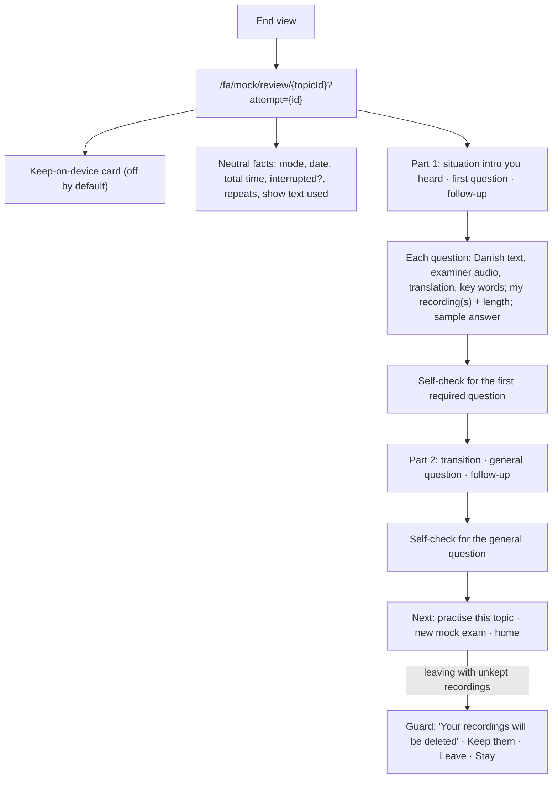

# Flow: reviewing after a mock exam

| | |
|---|---|
| **Stories** | US-041 to US-045, US-035 #7, US-046, US-048 #2, US-050, US-067 |
| **Decisions** | D-6 (recordings session-only; opt-in to keep the latest attempt per topic), D-19 (no answer translations) |
| **Screens** | [mock-review](../screens/mock-review.md) |

## Goal

The learner hears what they said next to the sample answer for each question, checks themselves against the assessed skills, and leaves with **one specific thing to improve** (H5), without any grade (GA-10, K4).

## Entry points

| Entry | Recordings available? |
|---|---|
| End view of a completed attempt ("See my answers") | Yes, in memory for this session |
| "End and see my answers" from the leave dialog, the practice pause overlay, an interruption or an audio error (rev. 2) | Yes, what was recorded |
| Back under the fallback flag (`endEarly`), via "See my answers" on `/fa/mock` | Where the session kept them |
| Mock history on the progress page (US-048 #2) | Only if the attempt was kept on this device (US-045) |
| A reload of the review URL in the same session | No (memory is gone). The stored facts and sample answers still show, with a calm note. |

## Steps

1. **Header and facts** (US-041 #5): topic (Danish and Persian names, term and letter), situation, mode, date; then neutral facts: total time (with "time during the interruption isn't counted" when interrupted, R-37); "interrupted" or "ended early" if it applies; repeats asked, followed by "Asking for a repeat is allowed in the real exam" (R-15); whether "show text" was used; and, if the part-1 cut-off applied, "The app moved on to the general question to leave time for it." (R-10; rev. 2.1: no SIRI attribution, since the cut-off is the app's rule). If the attempt ended before the limit in exam conditions: "In a real exam the examiner fills about 4½ minutes with more follow-up questions" (US-035 #7).
2. **Keep on this device** (US-045; D-6; UXD-21), near the top, off by default: "Your recordings are deleted when you leave this page. Keep this attempt on this device?" Turning it on stores the attempt and its recordings, replacing any earlier kept attempt for the same topic (US-045 #1). If storage is full or unavailable: "This attempt couldn't be kept on this device. You can still listen now." (US-045 #4).
3. **Questions in exam order** (US-041 #1): first the situation intro the learner heard (text and audio, source label). Then each question with:
   - role label, Danish text, examiner audio; Persian translation and key words on request (US-041 #3)
   - **my answer**: player(s) with recording length "m:ss" (US-043) and the booklet's 45–60 s reference for required answers, never marked red, green, "too short" or "failed" (US-043 #2); "recorded in 2 parts" if interrupted; "not recorded" if there was no microphone
   - **sample answer** (for follow-ups, the short answer): text and audio, collapsed by default on phones, side by side at 1280 px; no translation (D-19)
   - links: this section on the topic page; the matching template (US-041 #3, US-020)
   - The transition line appears between parts as a small, labelled line ("the app's wording").
   - Only one clip plays at a time (US-041 #2).
4. **Self-check** (US-042; UXD-21), after each part, for the required question of that part: seven items for the general question, six for the first (the "both sides" item applies only to advantages-and-disadvantages). Each has a short Persian explanation and a Danish example phrase. Ticks save with the attempt when storage is available (US-042 #5). There's no total, score or grade, and skipping it triggers no reminder (US-042 #3–#4).
5. **Focus next time** (rev. 2, R-18; optional): "Pick one thing to focus on next time" — the learner may pick one self-check item (e.g. "give an example"). It's saved with the attempt and shown in history instead of the ticks. Skipping it triggers nothing.
6. **Next steps:** "Practise this topic" (topic page), "Start a new mock exam", "Home".
7. **Leaving with recordings that aren't kept** through any in-app link (US-044 #2): a dialog, "Your recordings from this attempt will be deleted. Keep them on this device, or leave?" with **Keep and leave**, **Leave without keeping**, **Stay**. **Browser back** shows the same dialog when the ADR-0007 back guard is enabled (rev. 2, R-34); otherwise, and when closing the tab, recordings are discarded without asking (the learner was told on the first recording and at the top of this page).

## States

| State | Behaviour | Ref |
|---|---|---|
| Fresh, with recordings | As above | US-041 |
| No recordings (microphone denied or skipped) | Same page, "not recorded" under each question. Rev. 2 (R-15): its own first-time note ("Listen to the sample answer and think about what you said. Then tick what you did."), and sample answers **expanded** (the "answer first" reason no longer applies). Self-check works. | US-041 #4 |
| Opened on another device or after storage was cleared | The topic's questions and sample answers, with "This attempt isn't on this device" (ADR-0005 §4) | – |
| From history, kept | Recordings play; "kept on this device" with a Delete button | US-045 #2 |
| From history, not kept | Facts, questions, sample answers, ticks; "Recordings from this attempt weren't kept" (once, at the top) | D-6 |
| Reload in the same session | As "from history, not kept" | – |
| Storage unavailable | Fresh review works fully. Keep toggle disabled with the reason. Ticks aren't saved; one notice says so. No history entry exists, so a later visit can't find this attempt. | US-050 #1 |
| Unknown or deleted `attempt` query | As above: the topic's samples, "This attempt isn't on this device", with "Start a mock exam" and "My progress". Unknown `topicId` → not-found. | GA-9 |
| Content changed since the attempt (a corrected question) | The review shows today's approved text for the stored item IDs. IDs never change, so nothing breaks. | CLAUDE.md rule 3 |
| Audio failed | Per-player retry; text stays | US-062 |

## Exits

Topic page, new mock, home, progress. The microphone is already released (it was released at the closing line).
