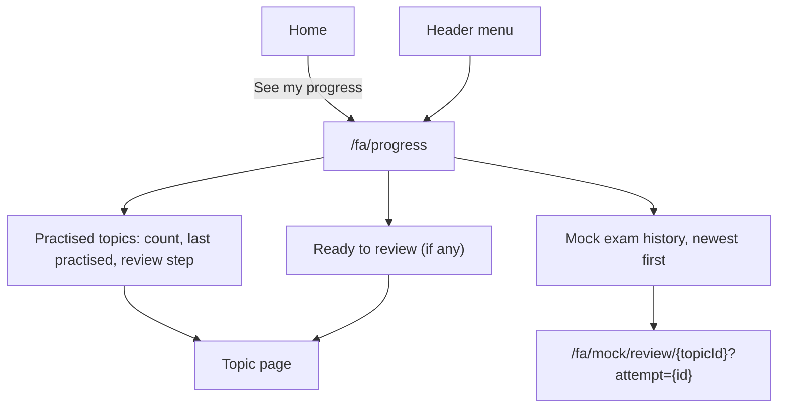
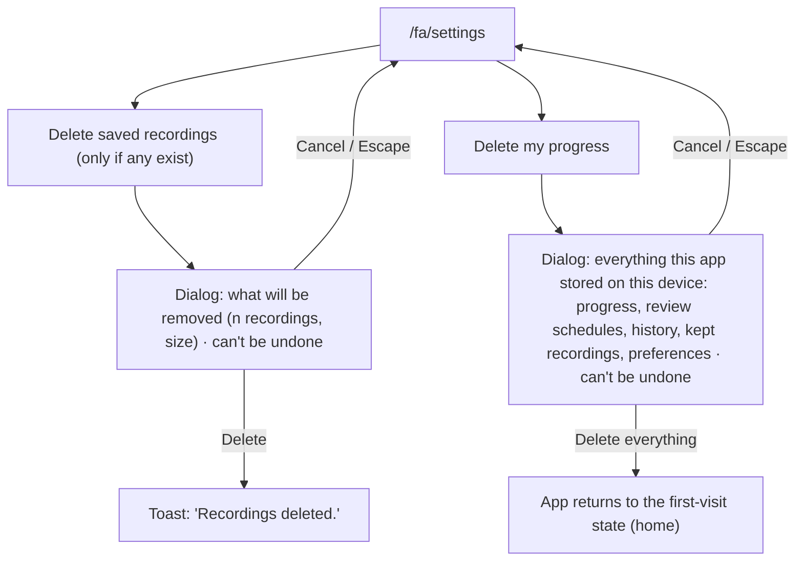

# Flow: progress and data on this device

| | |
|---|---|
| **Stories** | US-046, US-048, US-049, US-045, US-050, US-059, US-010, US-067 |
| **Rules** | CLAUDE.md rule 6 (progress behind an interface, versioned, guarded) and rule 10 |
| **Screens** | [progress](../screens/progress.md), [settings](../screens/settings.md), [about-and-privacy](../screens/about-and-privacy.md), [home](../screens/home.md) |

## What is stored (only on this device, only when storage is available)

| Data | Written when | Shown where | Story |
|---|---|---|---|
| Topic practised: count, dates | Answer-aloud Done; shadowing a whole answer (rev. 2); saved mock attempt | Home "continue", topic header, library items, progress | US-046 |
| Last opened topic | Opening a topic page | Home "continue where you left off" | US-046 #5 |
| Review schedule per topic | First practice; later practices | Home, progress, library, topic | US-047 |
| Mock attempts (facts, ticks, optional "focus next time") | End of a saved attempt; ticking the self-check; picking a focus (R-18) | Progress history (mode, total time, focus); review | US-048, US-042 #5 |
| Kept recordings (latest per topic, opt-in) | "Keep on this device" in a review | Review from history; settings (size) | US-045 |
| Preferences | Changing them | Wherever they apply | US-015 #3, US-055, UXD-05, UXD-13, UXD-14 |
| One-time flags | First-time notes dismissed; recording explanation seen | – | UXD-26, US-044 #1 |

**Never stored:** recordings that weren't kept, hint use, search queries, anything personal (US-046 #3).

## Flows

### Seeing progress

### Deleting data (US-049)

1. **Delete my progress** is always available, including when stored data is corrupted (US-049 #4). The dialog lists exactly what goes, names that it can't be undone, and the destructive button says what it does ("Delete everything"), never just "OK" (US-049 #2).
2. After deleting everything, the app returns to home in its first-visit state (US-049 #3).
3. Deleting a single kept attempt happens from its review (US-045 #2).

### Losing data without choosing to (US-050 #2, #4; R9)
- The privacy and about pages explain that progress lives only in this browser on this device, can be lost when browser data is cleared, and doesn't move to another phone.
- If it happens, the app simply starts in the first-visit state.

## States

| State | Progress page | Settings |
|---|---|---|
| Nothing stored yet | Calm empty state: "Your practice will appear here after you answer a question aloud or finish a mock exam." + links | Delete progress shown but explains there's nothing stored yet (button disabled with reason) |
| Data present | Sections as above | Both delete actions (recordings only if any) |
| Storage unavailable | StorageNotice instead of the sections | Notice; delete actions hidden ("nothing is stored in this browser") |
| Corrupted data | Valid records shown; invalid ones ignored | Delete works |
