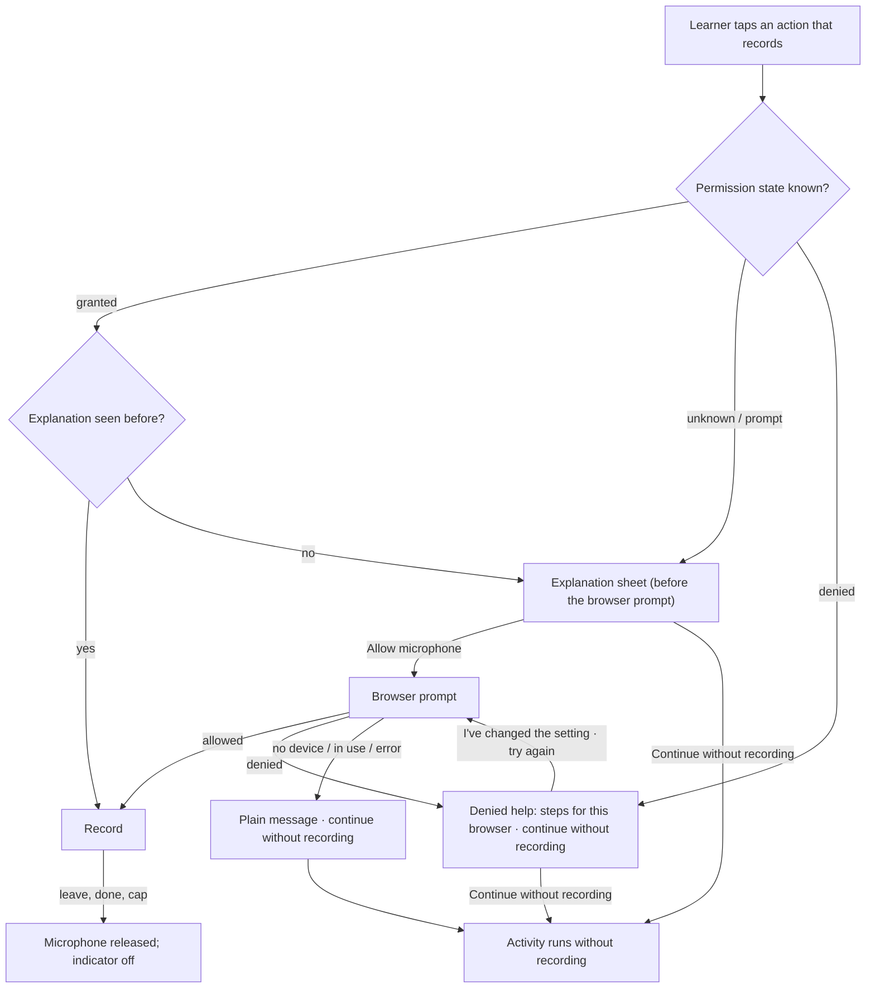

# Flow: recording consent and microphone permission

| | |
|---|---|
| **Stories** | US-044, US-063, US-027 #2–#3, US-019 #1 and #6, US-024 #5, US-059 #3, US-062 #5, GA-13 |
| **Rules** | CLAUDE.md rule 10 (recordings stay on the device); DL-024 (microphone optional everywhere); K6 |
| **Open technical question** | OQ-9 (iOS volume and routing while the microphone is open; MediaRecorder support) |
| **Components** | MicPermissionExplainer, MicDeniedHelp, RecordingIndicator ([component inventory](../component-inventory.md)) |

## Goal

The learner understands **why** the app wants the microphone and **what happens to recordings** before the browser ever asks, can always say no, and is never blocked by permissions or hardware.

## Entry points (every action that records)

| Action | Where |
|---|---|
| "Answer aloud" | Topic page ([study-topic.md](study-topic.md)) |
| "Record" | Shadowing |
| Microphone row in get ready | Mock exam |

**The app never asks for the microphone when a page loads** (US-063 #1).

## Flow

## Steps

1. **Explanation sheet** (US-044 #1, US-063 #1, US-027 #2), shown the first time any recording action is used (remembered on the device; once per session without storage). In Persian:
   - why: "so you can hear yourself afterwards and compare with the sample answer"
   - **recordings stay on this device and are never uploaded**
   - by default they're deleted when you leave the page; after a mock exam you can choose to keep your latest attempt per topic on this device (US-045)
   - the microphone is optional; every exercise works without it
   - link: privacy page (US-059 #3)
   - actions: **Allow microphone** (primary) · **Continue without recording**
2. **The browser prompt** appears only after "Allow microphone" (US-063 #1).
3. **Allowed:** recording starts at the right moment of the activity, with an icon and the text "recording" (never colour or a dot alone), announced once (US-031 #1).
4. **Denied** (US-063 #2–#3): a sheet with short Persian steps for the learner's browser, detected from the platform:
   - iOS Safari: the "aA" menu → Website Settings → Microphone → Allow (wording checked against current iOS by QA)
   - Android Chrome: the lock icon → Permissions → Microphone
   - desktop browsers: the icon in the address bar
   - "Continue without recording" (primary) · "I've changed it, try again"
   - Once denied, the app **doesn't ask again on every action**; recording actions show a small "microphone off" note with a link to this help instead.
5. **Unavailable** (no microphone, in use by another app, insecure context): a plain message and "continue without recording" (US-063 #4).
6. **Release:** when recording stops for good or the learner leaves, the microphone is released and the browser's indicator turns off (US-063 #6, US-044 #4). In the mock, at the closing line (US-035 #4).

## States

| State | What the learner sees |
|---|---|
| Never asked | Recording actions show their normal label |
| Granted | Same; recording works |
| Denied | Recording actions work in "without recording" mode, with a small note and the help link |
| Unavailable | As denied, with the unavailable message |
| Muted or ended mid-recording | Treated as an interruption; on Continue the microphone is re-opened; if it can't be: "Your next answers won't be recorded." (R-03; US-038 #6 update) |
| Storage unavailable | The explanation sheet shows once per session |

## Edge cases

- **iOS examiner volume while the microphone is open** (R3, US-062 #5): whatever the OQ-9 spike decides (open the microphone per answer, or keep it open), the sound check in get ready is played **in the same audio state the exam will use**, so a learner who hears it will hear the examiner.
- **A shared phone:** nothing is stored by default; "delete everything" is in settings (US-049).
- **Network:** no request ever contains audio (GA-13). Copy never says "upload", "send" or "save to the cloud", and the Persian avoids the loanword «آپلود»; draft: «صدای شما از این گوشی بیرون نمی‌رود.» ("your voice never leaves this phone") (rev. 2, walkthrough A4).
- **Calls while recording (rev. 2, R-03, decided by delegation):** a system mute of the microphone (over 1 s) or the track ending while the learner is answering is an **interruption** (pause, keep the take, dialog), not "microphone unavailable". The microphone is re-opened on Continue; only if that fails do later answers go unrecorded, with a notice.
- **Telegram's in-app browser** may not support recording, or may keep its own permissions (R-21): covered by the OQ-9 spike and the test matrix.
