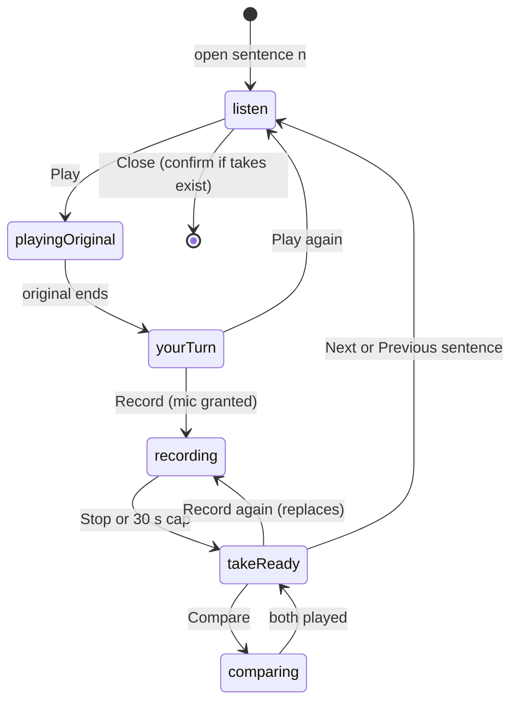

# Flow: shadowing

| | |
|---|---|
| **Stories** | US-024 (Should, D-7), US-025 (Could), US-044, US-063, US-015 #3 (speed) |
| **Screens** | [shadowing](../screens/shadowing.md) |
| **Dependency** | Sentence boundaries and per-sentence audio timings from the TTS word timings (UX-OQ-15; `speech-engineer`, `content-engineer`) |

## Goal

Hear one sentence, say it, compare the two, so pronunciation and rhythm move towards natural Danish (US-024; §3.3 on prosody).

## Entry points

| Entry | `contentId` |
|---|---|
| "Shadow sentence by sentence" under a sample answer | `{topic}.{section}.{q}.answer` |
| Same, under a suggested follow-up's short answer | `{topic}.{section}.followup1.answer` |
| Same, on a personal example | `{topic}.{section}.example1` |
| "Shadow" on a template step or toolbox item (US-025, Could) | `tpl.why.step1`, `toolbox.rescue.4`, … (one sentence, so N = 1) |

All open `/fa/shadow/{contentId}` in focused mode.

## Steps

1. **Open:** the page shows "sentence 1 of N", the whole text with the current sentence marked (not by colour alone), and the current sentence large (US-024 #1). Nothing plays until the learner taps (GA-11).
2. **Listen:** Play plays only this sentence, at the learner's chosen speed (US-024 #2, US-015 #3).
3. **Your turn:** Record (icon + text). The first time, the recording explanation appears first ([recording-consent-and-microphone.md](recording-consent-and-microphone.md)).
4. **Stop:** the take is ready, with its length. A per-sentence cap of 30 s protects memory (proposal; much shorter than C5 because a sentence is short).
5. **Compare:** plays the original, then the learner's take, one after the other (US-024 #3). Each can also be played on its own.
6. **Next / Previous:** arrows that mirror in RTL (US-024 #4). Takes are kept per sentence while the page is open, so moving back finds the earlier take.
7. **Finish:** on the last sentence, "Next" becomes "Done", returning to the origin page.

## States

| State | Behaviour |
|---|---|
| Microphone denied or none | Listen and repeat aloud without recording; Record is replaced by "say it aloud, then continue" (US-024 #5) |
| Audio slow or failed | The sentence's play control shows loading or retry; text stays (US-062) |
| Timing data missing for an item | Shadowing link isn't shown for that item (no broken page) |
| Storage unavailable | No effect |
| Interrupted (tab hidden) | Playback and recording stop; the take recorded so far is kept; no dialog needed (no timer) |

## Exits and data

- **Close** with any take in memory → "Your recordings will be deleted. Leave anyway?" (US-044 #2). Browser back closes without asking (the learner was told).
- Takes are never stored or uploaded; the microphone is released on leaving (US-024 #6, US-044 #4–#5, US-063 #6).
- **Rev. 2 (UX-OQ-05, decided by delegation):** shadowing **a whole answer** (reaching "Done" on its last sentence, with or without a microphone) counts as practising that topic for progress and spaced review: it is speaking aloud. Shadowing a single template or toolbox phrase doesn't count (no topic). An explicit "I studied this today" button stays an interview question.
- **Screen Wake Lock** held while shadowing (R-01); interruptions (hidden page, microphone muted while recording) stop and keep the take.
