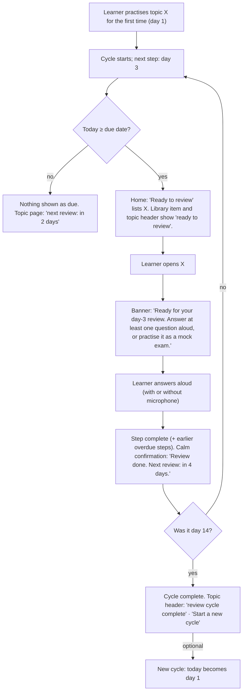

# Flow: spaced review

| | |
|---|---|
| **Stories** | US-047 (Should), US-046, US-010, US-067, US-050 |
| **Decision** | D-22 (by delegation, 2026-11-19, owner to confirm): per topic, at the booklet's intervals; day 1 is the first study day. Closes OQ-2. |
| **Config** | Review steps: day 3, 7 and 14 (offsets +2, +6, +13 local calendar days) |
| **Screens** | [home](../screens/home.md), [progress](../screens/progress.md), [topic-study](../screens/topic-study.md), [topic-library](../screens/topic-library.md) |

## Goal

Bring the learner back to each topic on the booklet's schedule (day 1 → 3 → 7 → 14, booklet line 52) **without any pressure**: a calm in-app list, no notifications, no streaks, no "missed" (US-047 #5–#7; DL-032).

## The schedule (per topic)

| Day | What | Date |
|---|---|---|
| Day 1 | The first day the topic is **recorded as practised** (US-047 #1; US-046 #1): an answer-aloud Done, shadowing a whole answer to its last sentence (rev. 2, UX-OQ-05), or a mock attempt that is saved (completed, ended early or interrupted) | D |
| Day 3 | Review step 1 | D + 2 |
| Day 7 | Review step 2 | D + 6 |
| Day 14 | Review step 3; then the cycle is complete | D + 13 |

**What completes a review step:** practising the topic (the same events as day 1) on or after the step's due date. That step, and any earlier overdue steps, are completed together (US-047 #4). Practising before a step is due doesn't complete it. Several practices on the same day count once.

**Why "practised" and not "opened":** opening a topic page by accident shouldn't start a schedule. A listen-only learner can start a cycle by answering aloud (works without a microphone) or by shadowing a whole answer (rev. 2). An explicit "I studied this today" stays an interview question (UX-OQ-05).

## Steps

1. **Day 1** happens automatically the first time a topic is practised. A one-time explanation appears in the confirmation: "We'll suggest reviewing this topic on day 3, 7 and 14. The booklet suggests this schedule per chapter; the app applies it per topic." (US-047 #2).
2. **When a step is due**, the topic appears on home under **"ready to review"** (draft «آمادهٔ مرور»; US-047 #3), oldest due first, up to three items with "see all" linking to `/fa/progress#review`. The library item and the topic header show the same label (US-010 #2).
3. **Opening the topic** shows a calm banner explaining what completes the review (UXD-17).
4. **Practising** completes the step; a polite toast confirms it with the next due date (US-047 #4).
5. **After day 14**: "review cycle complete" and an optional "Start a new cycle" (US-047 #6). Nothing nags.

## Tone and display rules

- **Overdue is never special.** A step due last week and one due today look identical: "ready to review" (US-047 #5). No counts of missed days, no warning colours, no red dots.
- **No totals of what isn't done** (US-067 #4): no "12 topics waiting", no percentage of the library. The home list shows names, not a backlog number. The progress page may say "3 topics are ready to review", which is a count of an invitation, not of failures; `persian-localization-reviewer` checks the wording.
- **No notifications, emails, badges or streaks** (US-047 #7, US-067).
- **Relative due dates** ("today", "in 4 days"); absolute dates only on the progress page, Gregorian with Persian month names and digits, e.g. «۲ دسامبر ۲۰۲۶» (UXD-23; UX-OQ-08 closed).

## States

| State | Behaviour |
|---|---|
| No practised topics yet | No "ready to review" section on home; progress page explains what will appear here |
| Topics practised, none due | Home shows no review section; the progress page lists upcoming steps per topic |
| Storage unavailable | No schedule at all; progress page shows the storage notice (US-050 #1) |
| Storage cleared | Schedules are gone; first-visit state without errors (US-050 #2) |
| Device date changes (travel, manual change) | Due dates are computed from stored local calendar dates; a date moving backwards never "un-completes" a step |

## Edge cases

- **Practising in a mock that was left** (not saved): doesn't count (US-039 #5).
- **Shadowing:** a whole answer counts; a single phrase doesn't (see [shadowing.md](shadowing.md)).
- **Topic unpublished later** (content review): its schedule is kept in storage but hidden until it's published again.
- **Delete my progress** (US-049): all schedules go with it.
