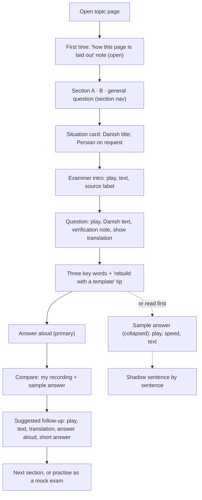
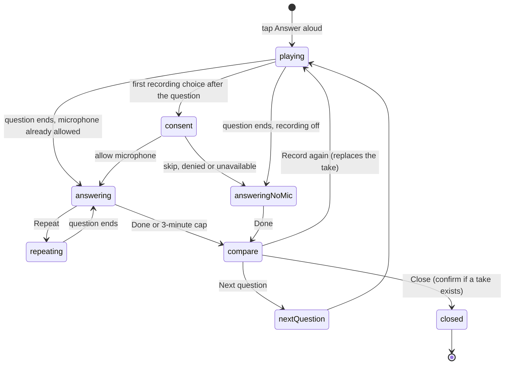

# Flow: studying a topic, including "answer this question aloud"

| | |
|---|---|
| **Stories** | US-011 to US-020, US-068, US-019 (D-7), US-044, US-046, US-047, US-062, US-063, US-065, US-066, US-040 |
| **Decisions** | D-16 (situation intros), D-17 (verification), D-18 (situation titles), D-19 (no answer translations), D-20 (personal examples), D-21 (no margin notes) |
| **Screens** | [topic-study](../screens/topic-study.md), [answer-aloud](../screens/answer-aloud.md), [shadowing](../screens/shadowing.md) |

## Goal

The learner works through a topic the way the booklet's method suggests: hear the question, rebuild an answer from the three key words and a template, **say it aloud**, then compare with the sample answer (PRD §6.2; booklet lines 46–52).

## Entry points

Library lists, search results, similar-question links, "ready to review" (home, progress), the review after a mock ("practise this topic"), a shared link.

## The study path through one section

The path is **suggested, not enforced** (US-004 #3). Every block is usable on its own, in any order.

## Steps

1. **Header** (US-011 #1): Danish topic name, Persian name, term and letter, theme, and the pre-2023 label with its explanation (US-009). Practice status or a "ready to review" banner if relevant (US-010, US-047).
2. **First-time note** (US-011 #3), open on the first topic page the learner ever sees, collapsed afterwards: in the exam the examiner picks **one** of the two situations, introduces it, asks the first question, and later asks the general question. Study both situations.
3. **Section navigation:** A · B · general question (US-011 #4).
4. **Situation card** (D-18): the booklet's title in Danish, with a source label "the booklet's description of the picture" (rev. 2, R-16); Persian behind "show translation" (US-011 #2; UXD-18).
5. **Examiner intro** (US-012 #5; D-16): play (examiner voice), Danish text, and a source label: **"SIRI's suggested wording (examiner booklet May–June 2024)"** or "the app's wording". SIRI's intros and follow-ups are suggestions the examiner may reword (2024 booklet p. 5); suggested follow-ups get the same "SIRI's suggested wording" label when their check matches (rev. 2.1, exam review S3, decided by delegation, 2026-11-20).
6. **First required question** (US-012): role label, play, Danish text, verification note (US-068; rev. 2, R-16: "checked on {date} · SIRI examiner booklet {term}, p. {page} · open (external)" in a disclosure, or "as given in the booklet, not yet checked word for word"), "show translation" (US-013), and any "a similar question: …" links from `content/topic-links.json` (US-007 #5).
7. **Key words** (US-014): three Danish–Persian pairs, stacked (UXD-24), with a tip linking to the template.
8. **Answer aloud** (US-019) — the section's primary action, with a subtitle "you speak, then compare" so it isn't read as "play the answer aloud" (rev. 2, UX-OQ-04). See below.
9. **Sample answer** (US-015), **collapsed by default** so the learner tries first (UXD-04, R7; UX-OQ-04): label (OQ-14 wording), template link (US-020), audio with speed, Danish text with the booklet's bold connectives, word highlight while playing (US-016), "shadow sentence by sentence" (US-024). **No translation control** (D-19).
10. **Personal example**, where one exists (US-018; D-20): labelled in Persian as an example from a nurse's perspective; audio; a prompt to make your own, linking to the toolbox's personal sentences.
11. **Suggested follow-up** (US-017): label "suggested follow-up", a one-line note that real examiners ask follow-ups as they judge necessary, play, Danish text, verification note, "show translation", **answer aloud**, and the short answer (collapsed, audio, no translation; D-19).
12. **Repeat for section B and the general question.** The general section adds a note: the examiner first announces a more general question; listen for *overordnet* or *generelt* (US-001 #1, US-034), linking to the examiner phrases.
13. **End of page:** related topics (our wording; D-21), "practise this topic as a mock exam" (US-040), share (US-066), report a problem (US-065), source credit with booklet pages (US-058).

## Sub-flow: answer this question aloud (US-019, D-7)

| Step | What happens | Story |
|---|---|---|
| Tap "answer aloud" | The focused panel opens and starts the question. The microphone explanation is visible before the learner is asked to allow the microphone. The recorder loads while the question plays, and **Allow** becomes available when it is ready. [Recording consent](recording-consent-and-microphone.md) | US-019 #1, US-044 #1, US-063 #1 |
| Question plays | Examiner voice. **The question text is shown by default** (rev. 2, UX-OQ-29: the learner has just read it on the page), with "hide text" for learners who want listening practice; the choice is remembered during the topic visit (UXD-14). | US-019 #1 |
| Answering | Recording starts once the question ends and microphone access is available. The app shows and announces "recording" and holds a Screen Wake Lock while recording (R-01). Elapsed timer with "the booklet suggests about 45–60 seconds" as a neutral reference. Model answer, translation and key words are hidden. **Hint** reveals the three key words (required questions only; follow-ups have none). **Repeat** replays the question, pausing the recording. | US-019 #1–#3, US-032 (same control as the mock) |
| Done | Recording stops ("recording stopped" is announced; there's no examiner reply here). | US-019 #4 |
| 3-minute cap (C5) | Recording stops, a message explains the cap, and comparison opens. | US-031 #6 (same rule) |
| Compare | "Your answer" player with its length, then the sample answer (text and audio, expanded). One clip at a time. **Focus moves to "Play your answer"** when this step opens. **Next question** has a separate button so a second press on Done can't skip the comparison (rev. 2, R-04). After the learner has allowed the microphone, **Record again** and **Next question** open it on the tap and start recording after the examiner finishes. **Next question** follows topic order (sit A q1 → sit A follow-up → sit B q1 → … → general follow-up). **Close** leaves the exercise. | US-019 #4–#5 |
| Counted as practised | At the first Done or recording cap for the question, with or without a take. Starts or advances the spaced-review cycle (D-22). | US-019 #7, US-046 #1, US-047 #1 |
| Interrupted | Hiding the tab during an answer or while the microphone is starting freezes the timer and keeps any take. While answering, a sustained microphone mute (C18) or a track ending also pauses the exercise. The learner chooses **Continue** to resume or **Done** to finish. Practice is saved on Done or at the recording cap. | US-038 (same rule), R-03 |
| Leaving | **Close** with a take in memory asks "Your recording will be deleted. Leave anyway?" (Leave / Stay). The browser's back closes the panel and discards without asking, because the learner was told up front (US-044 #1). Recordings are never uploaded or stored. | US-019 #8, US-044 #2–#5 |
| No microphone | The exercise runs the same way without recording: "Your turn — answer aloud", Done, then the sample answer only. | US-019 #6, K6 |

## States of the page

| State | Behaviour |
|---|---|
| First visit | First-time note open; no status |
| Returning | Practice status in the header; review banner if due (US-047) |
| Loading (route) | Text-first. Audio loads only on play (US-061 #2). |
| Audio slow or failed | Per-player loading or retry; text stays (US-062 #1–#2) |
| Microphone denied | Answer aloud still works without recording (US-019 #6) |
| Storage unavailable | Everything works; no status; no review banner |
| Topic not found or unpublished | Not-found page with a link to the library (US-011 #6) |
| Practice-mock from here | "Practise this topic as a mock exam" → `/fa/mock/practice?topic={id}` (US-040 #1) |

## Edge cases

- **Two clips:** playing any clip stops the other (US-012 #3). Opening the answer panel stops page audio.
- **A section without a follow-up or personal example:** the block doesn't appear (US-017 #4, US-018 #3).
- **2023-nov-a situation B** isn't a *"Hvorfor tror du"* question (pilot report §1.4): the template link still follows the role (template 1), as US-020 specifies. Flag to `pd3-exam-expert` if that reads oddly.
- **A question whose SIRI check *differs*:** the display follows OQ-17 (UX-OQ-20). The component reserves a "SIRI's wording differs" disclosure under the question.
- **Deep link to `#general`:** the page opens scrolled to the general section, with focus on its heading.

## Exits

Back to the list; another topic via similar or related links; the mock exam (practice, this topic); shadowing; any tab.
