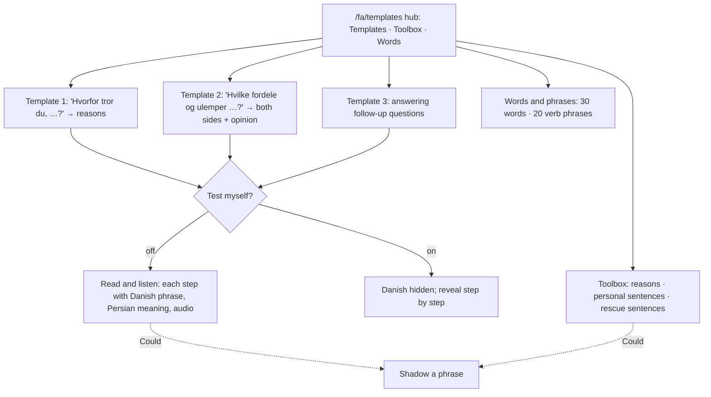

# Flow: templates and phrases

| | |
|---|---|
| **Stories** | US-021, US-022, US-023, US-020, US-002, US-025 (Could), US-065 |
| **Content** | Booklet `skeletons` (lines 241–296), `universal` (302–347), `vocab` (5815–5882); schema §11.1–§11.3 |
| **Screens** | [templates](../screens/templates.md), [toolbox-and-vocabulary](../screens/toolbox-and-vocabulary.md), [shadowing](../screens/shadowing.md) |

## Goal

Give the learner a ready structure for any question (templates), something to say when the mind goes blank (toolbox), and the high-value words and phrases (vocabulary), all with audio. This is step 1 of the booklet's method: "first learn the three templates" (line 46).

## Entry points

| Entry | Lands on |
|---|---|
| Templates tab | `/fa/templates` (hub) |
| Key-word tip on a topic page ("rebuild your answer with a template") | the matching template |
| Template link under a sample answer (US-020) | the matching template |
| Hint sheet in a practice mock | a condensed template card in the sheet (no navigation away) |
| Review after a mock | the matching template |
| Guide: rescue sentence, examiner phrases | `/fa/toolbox#rescue` |
| Study method step 1 | `/fa/templates` |

## Steps

1. **Hub** shows the three templates as cards, in the booklet's order (US-021 #1). Each card says which exam question it fits: template 1 → the first required question, template 2 → the second required question, template 3 → follow-ups (US-021 #4). A segmented control switches to Toolbox and Words.
2. **Template page:** the steps in order. Each step has its Persian label (for example "start", "reason 1"), the Danish phrase exactly as in the booklet (with its grammar notation such as *+ verbum + subjekt*), the Persian meaning, and a play button (US-021 #2–#3). Template 1 shows the booklet's example. Template 3 shows cue → answer rows. Audio plays the reviewed `spoken` variant where the booklet text contains notation (schema §11.1; OQ-S1).
3. **Test myself** (US-021 #5): a toggle hides every Danish phrase. Each step shows its Persian label and meaning with a "reveal" button. Revealing one doesn't reveal the next. A "reveal all" and "hide all" pair resets. The toggle state isn't stored.
4. **Toolbox** (US-022): three groups. The rescue group explains when to use them (asking for a repeat; keeping going) and shows the booklet's *"Undskyld, vil du gentage spørgsmålet?"* with a note that the mock exam's repeat button uses *"Undskyld, vil du godt gentage spørgsmålet?"*, which is equally correct (US-022 #3).
5. **Words and phrases** (US-023): two groups as in the booklet. One phrase plays at a time; opening the list loads no audio (US-023 #2).

## States

| State | Behaviour |
|---|---|
| First visit | Hub shows a one-line note: "The booklet builds every sample answer on these three templates. Learn them first." (dismissible, UXD-26) |
| Loading | Text first; audio on tap only |
| Audio failed | Per-item retry; text stays (US-062) |
| Storage unavailable | No effect (nothing stored here) |
| Microphone denied | Only affects shadowing (Could) |

## Edge cases

- **Danish phrases with alternatives** ("Ja, det mener jeg, fordi … / Nej, det mener jeg ikke, fordi …"): shown verbatim; the audio reads the reviewed `spoken` variant.
- **The V2 word-order table and template 2's grammar tip** (lines 271, 290–296) have no story. Recommendation: show them on the relevant template pages as a collapsed "grammar in brief" block, attributed to the booklet (UX-OQ-17).
- **Nurse-specific personal sentence** ("Jeg er selv sygeplejerske, og …"): shown as in the booklet. Consider the same label as personal examples (UX-OQ-25).

## Exits

Back to where the learner came from (back link names the origin when it was a topic page), or any tab.
