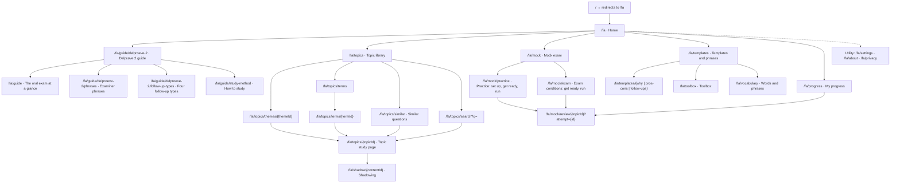
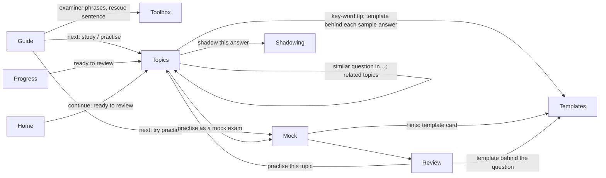
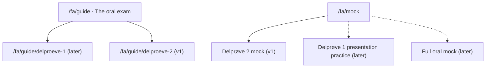

# Information architecture (v1)

| | |
|---|---|
| **Status** | Draft for owner review and a `learner-persona` walkthrough |
| **Date** | 2026-11-19 |
| **Author** | `ux-architect` |
| **Inputs** | [PRD rev. 3.1](../product/prd.md) (incl. D-18 to D-22, decided by delegation on 2026-11-19, owner to confirm), [user stories rev. 3.1](../product/user-stories.md), [personas](../product/personas.md), [decision log](../product/decision-log.md), [schema proposal](../content/schema-proposal.md). See [README](README.md#decisions-d-18-to-d-22-applied-here). |
| **Read with** | [README](README.md) (conventions, UX decisions `UXD-xx`, open questions `UX-OQ-xx`), [component inventory](component-inventory.md), [flows/](flows/), [screens/](screens/) |

This document defines **where things live, how learners move between them, and what the URLs are.** It doesn't define visual style (that's `ui-designer`) or routing code (that's `software-architect`).

---

## 1. Principles behind this structure

1. **Mirror the exam, then the method.** The study page is laid out like the exam asks it (situation A, situation B, the general question; US-011). The core loop follows the booklet's method: templates → key words → answer aloud → mock → review → come back ([PRD §6.2](../product/prd.md#62-the-core-loop)).
2. **Few top-level sections, each with one job.** Six learner-facing sections (US-057 #3). Everything else is a page inside one of them or a utility page.
3. **Content and interface are separate.** Learning content (Danish, with Persian translations) comes from the content repository; interface strings come from `messages/fa.json`. The IA never depends on how content is stored (CLAUDE.md rule 1).
4. **Stable addresses.** Every topic, theme and term has a URL built from its permanent content ID, so links shared in Telegram groups keep working after content updates (US-066 #3; CLAUDE.md rule 3).
5. **Timed and recording activities run in a focused mode** with no tab bar and one visible exit (UXD-02).
6. **Room for delprøve 1** without moving any v1 URL (§8).

---

## 2. Sitemap



### 2.1 Sections and what each is for

| Section | Job | Main stories | Entry points |
|---|---|---|---|
| **Home** `/fa` | Say what the app is, and offer the next step: first-time starting points, or "continue" and "ready to review" for returning learners | US-057, US-046 #5, US-047 #3, US-067 | App launch, logo, tab |
| **Guide** `/fa/guide/…` | Explain delprøve 2 in Persian: steps, timeline, examiner behaviour, assessment, grade facts, examiner phrases, follow-up types, study method | US-001 to US-004 | Tab, home (first-visit primary), mock start ("what will happen?"), topic page notes |
| **Topics** `/fa/topics/…` | Find a past topic (by theme, term, similar questions or search) and study it | US-005 to US-020, US-068 | Tab, home, ready-to-review list, similar-question links, review |
| **Templates and phrases** `/fa/templates`, `/fa/toolbox`, `/fa/vocabulary` | The booklet's three answer templates, the toolbox (reasons, personal sentences, rescue sentences) and the golden words and phrases | US-021 to US-023, US-025 | Tab, key-word tip on topic pages, hints in practice mocks, review |
| **Mock exam** `/fa/mock/…` | Run the delprøve 2 sequence in practice or exam conditions, then review | US-026 to US-045, US-069, US-070 | Tab, home, "practise as a mock exam" on a topic page (US-040), progress history |
| **My progress** `/fa/progress` | What I've practised, what's ready to review, my mock history | US-046 to US-048, US-010 | Header menu, home ("see my progress"), settings |
| **Utility** | Settings (incl. deleting data), about and sources, privacy | US-049, US-054, US-055, US-058, US-059 | Header menu, footer, first microphone explanation (privacy) |

### 2.2 What booklet content appears where

| Booklet part (anchor or lines) | In the app | Where | Notes |
|---|---|---|---|
| 51 main topics (`t-…` anchors) | Yes, once `approved` (US-064) | Topic study pages; mock draws | Situation cards show the booklet's own situation title for all 51 topics; SIRI's 2024 picture captions aren't used (D-18, US-029 #1) |
| Personal examples (7, all nurse-specific) | Yes, to everyone | Topic study page, under the sample answer | Labelled in Persian as an example from a nurse's perspective, with a prompt to make your own (D-20, US-018; UXD-19) |
| Margin notes ⭐ 📌 🔁 🔗 🩺 (45) | **Text never shown** | – | 🔁 and 🔗 become structured "similar question" and "related topics" links in our own neutral wording (D-21, US-007 #5, US-064 #6; UXD-20) |
| Three templates (`skeletons`, lines 241–296) | Yes | `/fa/templates/…` | The V2 word-order table and template 2's grammar tip have no story yet (UX-OQ-17) |
| Toolbox (`universal`, lines 302–347) | Yes | `/fa/toolbox` | Three groups: 10 reasons, 6 personal sentences, 9 rescue sentences |
| Golden words and phrases (`vocab`, lines 5815–5882) | Yes | `/fa/vocabulary` | 30 words, 20 verb phrases. The source list (lines 5884–5894) goes to the about page after review. |
| Similar-questions table (`recurring`, lines 4887–4926) | Data only | `/fa/topics/similar`; per-question links on topic pages | The booklet's framing text (line 4885) is never shown (D-15). Links to appendix topics are hidden (US-007 #4). |
| Study method (lines 44–52) | Steps 1–4, attributed | `/fa/guide/study-method` | Step 5 (line 54) is never shown (D-15). The booklet's time-split table (lines 225–235) may appear here, attributed (US-004 #5). |
| Chapter 0, "the oral exam from the official view" (lines 112–237) | No | – | The guide is written from ABOUT_PD3_MUNDTLIG.md (DL-043). The four follow-up types and the BEK quote may be reused with attribution (schema §11.5). |
| Appendix 2013–2015 and the 2004–2012 title list | No | – | D-3 |
| Persian translations of model answers and follow-up answers | **Don't exist** | – | D-19 (US-017 #1): only questions (and titles, key words, phrases) have Persian. No "show translation" control appears on answers. |

---

## 3. Navigation model

### 3.1 Phone (below 768 px): bottom tab bar + header menu (UXD-01)

```
┌───────────────────────────────────────────┐
│ [≡ Menu]                      App name     │  ← header: name at the start (right),
├───────────────────────────────────────────┤     menu at the end (left)
│                                           │
│                 page content              │
│                                           │
├───────────────────────────────────────────┤
│ Guide  Templates  [ Mock ]  Topics   Home │  ← bottom tab bar; reads right to left:
└───────────────────────────────────────────┘     Home is first (rightmost)
```

- **Five tabs, in reading order (right to left):** Home · Topics · Mock exam · Templates and phrases · Guide.
  - The mock exam sits in the middle, the most comfortable thumb position, because it's the app's core speaking activity.
  - Each tab has an icon and a visible text label. Icons alone are not enough for Ahmad (GA-8).
  - Labels must fit on one line at 360 px at default text size (rev. 2, R-30): short labels such as «خانه», «موضوع‌ها», «آزمون», «عبارت‌ها», «راهنما» (drafts). Whether learners understand the templates tab's label is a test item (UX-OQ-27).
  - Mock history is one tap from the mock tab ("My past mock exams" on `/fa/mock`) and from Home's returning state (UX-OQ-27).
  - The active tab is marked with `aria-current="page"` and a non-colour indicator.
- **Header menu (≡)** opens a drawer listing **every** section, so the main navigation reaches all six (US-057 #3): Home, Guide, Topics, Templates and phrases, Mock exam, **My progress**, then Settings, About and sources, Privacy.
- **Why progress is not a tab:** Home already carries the progress a returning learner acts on ("continue", "ready to review"; US-046 #5, US-047 #3) and links to the full progress page. The guide is more important as a tab: format knowledge is goal G1, and anxious learners revisit "what will happen" in the days before the exam. Validate in the walkthrough (UX-OQ-27).
- **Back:** deep pages show a back link at the top start (right), naming the parent ("‹ Work and the labour market"). The arrow mirrors in RTL. The browser's back button always works and returns to the same view, including the selected theme, term or search (US-005 #4).

### 3.2 Tablet (768–1023 px) and desktop (1024 px and up): top navigation

```
┌──────────────────────────────────────────────────────────────────────────┐
│ [≡]  My progress  Guide  Templates&phrases  Mock exam  Topics  Home  Name│
└──────────────────────────────────────────────────────────────────────────┘
```

- All six sections appear as text links in the header, in the same order as the tabs, with **My progress last** in reading order (leftmost, next to the menu) (rev. 2, R-31). The menu keeps Settings, About and Privacy.
- No bottom bar at these widths.
- At 1280 px, reading content is capped at a comfortable measure. Wide layouts add a side column (start side, right): section navigation on topic pages, a filter column in the library, and side-by-side "my answer | sample answer" in reviews.

### 3.3 Focused mode (UXD-02)

The **mock exam runner** (from the draw onwards), the **answer-aloud panel** and **shadowing** run in focused mode:
- No tab bar and no section links. The header shows only a **Leave** or **Close** control at the start (right), the activity name, and, in the mock, the timers toggle.
- The primary action ("Done", "Record", "Next") sits in the bottom thumb zone, in the same place throughout the activity (UXD-08).
- Leaving through the app's own controls always confirms when something would be lost (US-039, US-044 #2).
- **Back (rev. 2, R-02, decided by delegation):** in the mock, back closes the topmost sheet or dialog first, then opens the leave dialog; it never ends an attempt by itself. Until the OQ-9 spike confirms the guard, it sits behind the ADR-0007 flag, with "save as ended early" as the fallback ([state machine §12.4](flows/mock-exam-state-machine.md#124-back-navigation)). In answer aloud and shadowing, back closes the activity, with the discard guard if a recording exists.
- **Screen Wake Lock (rev. 2, R-01, decided by delegation):** held throughout every focused mode so the screen doesn't lock while the learner speaks; a one-time auto-lock tip where unsupported.

### 3.4 Route changes and focus

- On every route change, focus moves to the page's `h1`, and the new page title is what assistive technology announces (US-060 #3). Exception: switching a view inside a page (library tabs, template "test myself") keeps focus on the control that was used.
- A skip link ("skip to content") is the first focusable element on every page.
- Anchored sections (`#sitA`, `#sitB`, `#general`) move focus to the section heading when used from the section navigation.

### 3.5 Footer (non-focused pages)

About and sources · Privacy · "Not an official SIRI product" (US-058) · booklet credit, in the form agreed with the author (D-12). The footer sits above the tab bar's safe area on phones.

---

## 4. URL scheme (UXD-03)

### 4.1 Rules

1. **Locale prefix on every page:** `/{locale}/…`. `fa` is the default. `/` redirects to `/fa`. Adding `en` later serves `/en/…` with no other change (US-056).
2. **Path segments are English, lowercase, hyphenated and locale-independent** (`topics`, `themes`, `mock`). They never change between languages, so a shared `/fa/…` link maps one-to-one to `/en/…`.
3. **Content IDs are used verbatim:** topics `2024-maj-b`, themes `arbejde`, terms `2024-maj`, content items `2024-maj-b.sitA.q1.answer` (`.claude/rules/content-data.md`). IDs never change once published.
4. **Sections of a topic are fragments,** not routes: `/fa/topics/2024-maj-b#sitA`, `#sitB`, `#general`. One page per topic keeps sharing simple.
5. **Filters and view options are query parameters:** `?sub=` (sub-theme), `?q=` (search), `?topic=` / `?theme=` (practice mock set-up). Unknown values are ignored with a calm notice, never an error.
6. **Ephemeral activity state is never in the URL.** The mock exam's draw, look, questions and answers all happen on `/fa/mock/practice` or `/fa/mock/exam`. A reload can't resume an attempt (US-038 #4), so a per-state URL would only promise something we can't keep.
7. **Reserved words** under `/fa/topics/`: `themes`, `terms`, `similar`, `search`. Topic IDs match `^\d{4}-(maj|nov)-[a-c]$` and can never collide with them.
8. **Not-found:** any unknown or unpublished ID shows the Persian "not found" page with a link to the library (US-011 #6), with HTTP status 404.

### 4.2 Route table

| Route | Page | Stories | Notes |
|---|---|---|---|
| `/fa` | Home | US-057, US-046 #5, US-047 #3 | First-visit and returning states |
| `/fa/guide` | The oral exam at a glance | US-001 #7 | Delprøve 1 marked "coming later". Linked from the delprøve 2 guide. Becomes the guide tab's target when delprøve 1 ships (UXD-25). |
| `/fa/guide/delproeve-2` | Delprøve 2 guide | US-001 | **Guide tab target in v1.** Fragments: `#steps`, `#timeline`, `#examiner`, `#assessment`, `#grade`, `#sources`. |
| `/fa/guide/delproeve-2/phrases` | Examiner phrases | US-002 | |
| `/fa/guide/delproeve-2/follow-up-types` | Four follow-up types | US-003 | |
| `/fa/guide/study-method` | How to study | US-004 | Not under `delproeve-2`: the method is about using the booklet and the app |
| `/fa/topics` | Library, by theme (default view) | US-005, US-009, US-010 | |
| `/fa/topics/themes/{themeId}` | A theme's topics | US-005 #2–#4 | `?sub={subthemeId}` for the work theme's five sub-themes |
| `/fa/topics/terms` | Library, by exam term | US-006 | |
| `/fa/topics/terms/{termId}` | One term's A, B, C | US-006 #3 | |
| `/fa/topics/similar` | Similar questions | US-007 | |
| `/fa/topics/search?q=` | Search results | US-008 | Empty `q` shows the search field only |
| `/fa/topics/{topicId}` | Topic study page | US-011 to US-020, US-068 | `#sitA`, `#sitB`, `#general` |
| `/fa/shadow/{contentId}` | Shadowing | US-024, US-025 | `contentId` is a model-answer, follow-up-answer, template-step or toolbox-item ID. Back returns to the item's page. |
| `/fa/templates` | Templates hub | US-021 | |
| `/fa/templates/why` · `/pros-cons` · `/follow-ups` | One template | US-021, US-020 | Slugs map to `tpl.why`, `tpl.prosCons`, `tpl.followup` |
| `/fa/toolbox` | Toolbox | US-022 | Fragments `#reasons`, `#personal`, `#rescue` |
| `/fa/vocabulary` | Words and phrases | US-023 | Fragments `#words`, `#phrases` |
| `/fa/mock` | Mock exam: choose a mode | US-026 | Practice is listed first (D-1) |
| `/fa/mock/practice` | Practice: options, get ready, then the runner | US-027 to US-036, US-040, US-069, US-070 | `?topic={topicId}` skips the draw (US-040 #1); `?theme={themeId}` limits the draw (US-040 #2) |
| `/fa/mock/exam` | Exam conditions: rules, get ready, then the runner | US-027 to US-035, US-037 to US-039 | No parameters accepted: the topic always comes from the draw (US-040 #3) |
| `/fa/mock/review/{topicId}?attempt={attemptId}` | Review of one attempt | US-041 to US-045, US-048 #2 | **Rev. 2 (ADR-0005 §4):** the page is static per topic (questions, model answers, audio); the `attempt` query is read in the browser to overlay the attempt record and, straight after an attempt, the in-memory recordings. Opened on another device: the topic's model answers and "this attempt isn't on this device". |
| `/fa/progress` | My progress | US-046 to US-048 | Fragments `#review`, `#history`, `#practised` |
| `/fa/settings` | Settings | US-049, US-045 #3, US-054, US-055 | |
| `/fa/about` | About and sources | US-058 | |
| `/fa/privacy` | Privacy | US-059 | |

### 4.3 Dates and term labels (rev. 2, decided by delegation)

- **Dates** are Gregorian, with Persian month names and Persian digits, e.g. «۲ دسامبر ۲۰۲۶» (UX-OQ-08 closed). Recent activity and due dates stay relative ("today", "in 4 days"; UXD-23).
- **Term labels** stay Danish with Latin digits, e.g. `Maj–Juni 2024 · B`, rendered as an isolated Danish run (UX-OQ-09 closed; UXD-22).
- **One digit style per label** (R-17, R-33): a label is either Persian interface text with Persian digits, or a Danish term label with Latin digits. Labels that refer to an exam term embed the TermLabel rather than writing a year, e.g. the pre-2023 label reads "older format (before Maj–Juni 2023)".

### 4.4 Page titles

Pattern: `{page title} · {app name}` (the app name comes from `ui-designer`'s identity work, DL-017). Topic pages use the Danish topic name, then the Persian name: `Mangel på arbejdskraft — کمبود نیروی کار · {app name}`. Titles come from messages, except content names, which come from content (GA-1).

---

## 5. How a first-time learner is oriented (US-057)

**No forced onboarding.** Sara would leave, and Ahmad wouldn't read it (personas). Orientation is built from five light layers instead:

1. **Home answers three questions in one screen:** what this is ("practice for delprøve 2 of the PD3 oral, in Persian", with a Persian gloss of "delprøve 2"), where the questions come from (published exams), then that it isn't made by SIRI, spelled out (rev. 2, R-19), and where to start. Three starting points, with **"How does the exam work?"** as the primary action on a first visit (US-057 #1). See [screens/home.md](screens/home.md).
2. **The guide ends with next steps,** in the core-loop order: "Study a topic" and "Try a practice mock exam" (practice first, D-1).
3. **Each activity explains itself before it starts:**
   - mock exam: the two modes and their rules (US-026)
   - get ready: why the microphone is used, before the browser asks (US-027 #2, US-063 #1)
   - exam conditions: "can't be paused" stated up front, with practice as the alternative (US-026 #3)
4. **One dismissible first-time note per screen, at most** (UXD-26), for example the topic page's "how this page is laid out" note (US-011 #3). Dismissal is remembered on the device. Without storage, it shows collapsed after the first view in a session.
5. **Wayfinding everywhere:** an `h1` on every page, a back link naming the parent, the active tab, section navigation on topic pages ("A · B · general question"), and in the mock a step indicator ("part 1 of 2") so the learner always knows how far along they are (US-034 #4).

The first-visit journey is specified in [flows/first-visit.md](flows/first-visit.md).

---

## 6. Wayfinding within long pages

| Page | Mechanism | Stories |
|---|---|---|
| Topic study page | Sticky section navigation (A · B · general question) with the current section marked (`aria-current="true"`) and a heading for each section. At 1280 px it becomes a side list on the start side. | US-011 #4 |
| Delprøve 2 guide | A short contents list at the top linking to the fragments | US-001 |
| Toolbox, vocabulary | Group headings with fragment links | US-022, US-023 |
| Review | Questions in exam order, each headed by its role ("first required question") | US-041 |
| Mock runner | Step indicator: part 1 of 2 (the situation question and its follow-up), part 2 of 2 (the general question and its follow-up) | US-034 #4 |

---

## 7. Cross-links (how sections feed each other)



- **Topic → template:** every sample answer links to its template by question role: first required → template 1, second required → template 2, follow-up → template 3 (US-020; OQ-8 closed).
- **Topic → topic:** "a similar question: Maj–Juni 2023 · C" under the question (from the similar-questions data), and "related topics" at the end of the page (from the 🔗/🔁 references). The note text is never shown (D-21, US-007 #5). **Source (rev. 2, UX-OQ-14 closed):** the public file `content/topic-links.json`, created by `content-engineer` (ADR-0002) and read through the repository. The app never reads `content/internal/`.
- **Guide → toolbox:** the rescue sentence *"Det har jeg ikke tænkt så meget over før, men jeg tror, at …"* (US-001 #4) and the repeat request (US-002) link to the toolbox's rescue group.

---

## 8. Where delprøve 1 slots in later

[PRD §6.9](../product/prd.md#69-room-for-later) asks that "delprøve 2" be one part of "the oral exam". v1 prepares for that without exposing anything that doesn't exist yet:

| Area | v1 | When delprøve 1 ships |
|---|---|---|
| **Guide** | `/fa/guide` exists as "the oral exam at a glance" (15 minutes, two parts, delprøve 1 "coming later", with only the facts allowed by US-001 #7). The guide tab goes straight to `/fa/guide/delproeve-2`. | Add `/fa/guide/delproeve-1`. The guide tab's target changes to `/fa/guide`, which links to both parts. No v1 URL changes. |
| **Practice tools** | – | New section `/fa/delproeve-1/…`: enter your own topic, a 2-minute presentation timer that never cuts off, follow-up practice by question type (US-003 content). It reuses the recorder, the timer and the review components. |
| **Mock exam** | `/fa/mock` is delprøve 2. Its page title and heading say "Delprøve 2 mock exam". | `/fa/mock` gains a part choice. A full oral mock (delprøve 1, then 2) could be `/fa/mock/full`. The state machine already keeps its timings and lines in config ([state machine §2](flows/mock-exam-state-machine.md#2-config-values)). |
| **Topic library** | Its heading says "Delprøve 2 topics" from day one | Unchanged. Delprøve 1 topics are personal and set by the teacher (§3.3), so they never join this library. |
| **Templates and toolbox** | Template 3 and the toolbox already serve follow-up questions in general | Template 3 and the rescue sentences link from delprøve 1 follow-up practice |
| **Navigation** | Five tabs | The guide tab becomes "Guide" for both parts. A sixth tab is not needed: delprøve 1 practice lives under the mock exam tab, labelled "Practise" if needed (validate then). |
| **Progress data** | Attempts carry the exam part (`2`) | Delprøve 1 attempts use `1`. History filters by part. |



---

## 9. Search scope (US-008)

- **Searches:** topic names (da, fa), situation titles (da, fa), questions and suggested follow-ups (da, fa), key words (da, fa).
- **Doesn't search (v1):** model answers, follow-up answers, templates, toolbox, vocabulary, guide. Searching answers would mostly match common words and bury the useful results. Revisit if learners ask.
- **Results** are topics, each showing which field matched (for example "in situation B's question"), and linking to the matching section fragment.
- Matching rules (case, Arabic/Persian letters, ZWNJ, diacritics) are as in US-008 #1–#2.

---

## 10. What the IA deliberately leaves out

- No user accounts, profiles or sign-in (DL-007).
- No streaks, goals, badges or leaderboards anywhere (US-067).
- No page that lists "what you haven't done" (US-067 #4). The library shows what exists; progress shows what you've done.
- No language switcher while only `fa` exists (US-056 #3).
- No appendix, margin-note text or booklet chapter 0 (§2.2).
